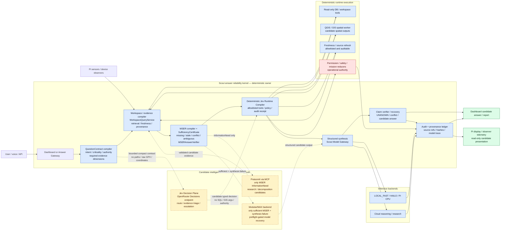

# Scout AI current architecture

This diagram describes the verified candidate-only integration boundary. It is
not an authority graph: deterministic Scout policy owns execution, provenance,
permission, safety, mission state, and hardware effects.

## Boundary legend

| Surface | Candidate-only | Runtime safety truth | Authority |
| --- | --- | --- | --- |
| Jev | `true` | `false` | typed routing suggestion only |
| PraisonAI / MCP response | `true` | `false` | untrusted evidence until contract validation and MSER reprojection |
| MAX output | `true` | `false` | model backend; no direct tool or state authority |
| QGIS / terrain / risk artifacts | `true` | `false` | spatial hypothesis or evidence candidate |
| MSER certificate, deterministic reducers, provenance ledger | candidate envelope retained | never promoted by model output | Scout deterministic runtime |
| permission, safety, mission, notification, hardware control | not model-generated | owned by existing deterministic policy | external effects require explicit runtime authority |

## Routing invariants

1. Static and aggregate questions use the deterministic fast lane; Jev is not
   called.
2. Spatial, cross-artifact, ambiguous, and recovery cases may make one batched
   Jev request. Its output is compiled through the deterministic contract and
   cannot become SQL, GIS arguments, permission changes, safety truth, or a
   hardware command.
3. MSER is the hard evidence gate. Jev cannot turn missing, stale, contradictory,
   or ambiguous evidence into `SUFFICIENT`.
4. PraisonAI is available only when MSER emits an `InformationNeed`; its MCP
   response is candidate evidence and must be reprojected through MSER.
5. MAX is available only when MSER is sufficient, deterministic synthesis or
   structured output has failed, the selected model is allowed, and MAX preflight
   is ready. Otherwise the route fails closed to human review or an evidence gap.
6. Every generated artifact retains `candidate_only=true` and
   `runtime_safety_truth=false`; provenance, hashes, freshness, and authority
   are deterministic fields.
