# Scout Runtime Multi-Gate Safety Reducer

Status: slices 7-35 implement the deterministic local safety template from
runtime gate evidence through Phase 1 mutation and alert application packet
dry-run. This is not the full production safety system yet: hardware transport,
resident production paths for every gate, real outbound send, authenticated
emergency approval workflow, and verified delivery evidence are still open
work. A static Emergency Mobile Approval UI v0 exists for local review and
artifact validation only. Slice 36 now has a candidate/shadow implementation of
the OD-001 through OD-018 Daily Emergency Review contract shared with Contextual
Permissioning. Slice 37 adds local Emergency Call Out admission and dry-run
executor receipts. Slice 38 adds a deterministic local Night Runtime Authority
preflight that consumes only approved Daily Emergency Review receipts and
revalidates freshness, gate matrix, event sequence, and hashes at use time.
Slice 39 adds a deterministic production gate residency audit for all six
primary gates. Slice 40 adds an authenticated production approval preflight that
records operator identity proof without releasing transport. Slice 41 adds an
approved transport executor selection preflight that blocks until production
approval completion and delivery verification exist. Slice 42 adds deterministic
transport-release, delivery-evidence verification, and workflow-completion
closure contracts for approved executor receipts. Slice 43 adds a local
live-evidence contract audit for weather and environment-threat gate inputs.
Slice 44 adds a local live-observation bridge that turns sealed weather and
environment-threat provider/field refs into reducer-owned gate events. These
are not production runtime mutation, external transport, live-provider request
execution, or Pi/hardware validation. Slice 45 adds a deterministic Phase 1
runtime promotion readiness gate that checks reducer/adapter/request/audit
lineage before any future writer invocation. Slice 46 adds a local writer
invocation guard aㄏnd receipt around the deterministic Phase 1 writer. Slice 47
adds a local production transport invocation guard and receipt between approved
executor selection and verified delivery evidence. Slice 48 adds a local live
provider connector readiness and request contract for weather/environment
evidence, binding connector health, credential references, route scope, and
reviewed provider-effect boundaries without calling the provider. Slice 49 adds
a production transport effect receipt intake contract that converts an external
executor's sanitized receipt into delivery evidence only after invocation
lineage and delivered-status proof match. Slice 50 adds a Phase 1 writer
production deployment readiness audit for runtime host, deployment, effect
boundary, rollback, and operator-review refs before any production writer
rollout. Slice 51 adds a production transport executor effect-boundary
readiness check that binds the authorized invocation to reviewed executor,
credential-ref, delivery-verifier, and fallback-plan refs before any separate
executor can perform outbound transport. Slice 52 adds a local live-provider
response receipt intake that binds an authorized provider request to sanitized
provider evidence before preparing weather or environment-threat observations.
Slice 53 adds a local live-provider connector health receipt intake that
prepares request manifests from reviewed health evidence before provider
request authorization. Slice 54 adds a local field/device validation receipt
intake that can enrich live provider response observations with reviewed field
or device validation refs before residency audits. Slice 55 adds a local
resident freshness attestation receipt intake that can enrich live provider
responses with reviewed freshness refs before the observation bridge. Slice 56
adds a local live-provider executor effect-boundary readiness check before any
future provider API execution. Slice 57 adds a local live-provider executor
invocation guard and receipt that binds operator identity and exact
confirmation to the reviewed executor boundary before any separate provider
executor can make a live request. Slice 58 adds a local live-provider effect
receipt intake that converts a sanitized external executor receipt into a
provider response receipt only when invocation and provider execution lineage
match. Slice 59 adds a local live connector-health executor invocation guard
and receipt binding before connector health receipts can be promoted into
request-ready provider connector manifests. Slice 60 adds a local live
freshness-attestor invocation guard and receipt binding before freshness
attestation receipts can enrich provider response observations. Slice 61 adds a
local live field/device validator invocation guard and receipt binding before
field/device validation receipts can enrich provider response observations.
Slice 62 adds an injected live-provider executor harness that can call a
reviewed provider client after Slice 57 authorization and emit a sanitized
Slice 58 provider effect receipt; local tests use fake provider clients and do
not perform a real provider API call. Slice 63 adds an injected live connector
health executor harness that can call a reviewed health client after Slice 59
authorization and emit a sanitized connector health receipt for Slice 53 intake;
local tests use fake health clients and do not qualify a real connector. Slice
64 adds an injected live freshness-attestor executor harness that calls a
reviewed freshness client after Slice 60 authorization and emits a sanitized
freshness attestation receipt for Slice 55 intake. Slice 65 adds an injected
live field/device validator executor harness that calls a reviewed
field/device validation client after Slice 61 authorization and emits a
sanitized validation receipt for Slice 54 intake. Local tests for both new
harnesses use fake clients and do not qualify real field devices, provider
APIs, production network paths, Pi hardware, or runtime ingestion. Slice 66
adds an injected production transport executor harness that can call a reviewed
transport client after Slice 51 readiness and Slice 47 invocation authorization
and emit a sanitized transport effect receipt for Slice 49 intake. Local tests
use a fake transport client and do not send SMS, publish MQTT, transmit LoRa,
use satellite bridges, invoke radios, or qualify hardware delivery. Slice 67
adds a production cutover qualification audit that requires reviewed
qualification receipts for real provider API, connector health, credential
access, resident freshness, field/device validation, writer deployment,
transport client, outbound delivery, and Pi/hardware before the system can be
marked ready for production cutover. Slice 68 adds JSON load/write helpers and
a local CLI for that cutover audit so a blocked or ready production-readiness
decision can be persisted as a reusable artifact without performing external
effects. Slice 69 adds an area-specific qualification claim matrix and evidence
bundle admission gate so each production area must supply the exact required
claims before a qualification receipt can be accepted for cutover audit. Slice
70 wires that bundle admission path into the local CLI so reviewed bundle files
can produce admission decisions, emitted receipts, and a cutover audit artifact
in one deterministic no-effect pass. Slice 71 adds freshness and stale-binding
checks to qualification claims so production evidence must be observed and
reviewed within its declared age window before it can be admitted. Slice 72
adds a local source-integrity verifier that binds qualification claim refs and
hashes to sanitized local evidence package files before those files can support
production-readiness evidence. Slice 73 wires that source-integrity report into
bundle admission and the CLI so a qualification receipt cannot become cutover
eligible unless its claim sources were verified. Slice 74 adds a manifest-driven
production qualification dossier validator that runs source-integrity,
admission, receipt, and cutover audit generation across all required areas and
summarizes missing or failed production qualification evidence in one report.
Slice 75 adds a qualification threat-coverage audit and wires it into the
dossier so hallucination, agent runaway, prompt injection, malicious MCP
results, stale candidates, authority escalation, accidental action, local/cloud
inconsistency, and the required safety qualification modes must be reviewed
before the dossier can claim production cutover readiness. Slice 76 adds
source-integrity verification for the threat coverage evidence itself, so the
threat and qualification-mode refs must bind to sanitized local artifact files
before the coverage audit can pass. Slice 77 adds an internal production
qualification gap plan that turns a dossier report's open area, threat, mode,
and source-integrity blockers into machine-readable action rows with required
artifacts and unblock conditions. Slice 78 adds an internal evidence request
pack that expands those gap rows into reviewer/operator-facing artifact
requests for area bundles, source packages, threat cases, qualification mode
cases, threat source packages, and dossier reruns. Slice 79 adds an internal
evidence request fulfillment intake that checks submitted reviewer/operator
artifact refs against the request pack and reports fulfilled, missing,
mismatched, rejected, or source-unverified rows before any dossier rerun. Slice
80 adds source-integrity verification for those submitted fulfillment artifacts,
so a fulfillment report cannot become verified unless each submitted ref binds
to a sanitized local artifact file with the expected hash. Slice 81 adds a
remediation readiness gate that checks the gap plan, request pack, fulfillment
report, and source-integrity lineage before declaring the open gaps ready for a
dossier rerun; it never claims production cutover readiness. Slice 82 adds an
external qualification action packet that converts ready or blocked remediation
rows into operator-authorized next actions for provider/API, transport,
delivery, deployment, and Pi/hardware qualification without executing any of
those actions. Slice 83 adds an external operator authorization intake that
checks those action packets against operator identity, reviewed effect-boundary,
idempotency, and expiry refs, while still producing only a local report with
`execution_allowed=false`. Slice 84 adds an external executor invocation guard
that checks a requested handoff against the recorded authorization, executor
refs, invocation refs, idempotency, and second operator confirmation while still
performing no executor call. Slice 85 adds an external result receipt intake
that validates sanitized result receipts returned by a separate executor against
the invocation handoff, then marks them ready for future evidence fulfillment
without treating them as cutover proof. Slice 86 adds an external result
evidence bridge that converts matching, sanitized external result artifacts back
into an evidence fulfillment manifest, where the existing fulfillment
source-integrity gate still has to verify local sanitized files before any
dossier rerun or cutover claim. Slice 87 adds an external result remediation
closure report that runs the bridged manifest through source-integrity,
fulfillment, and remediation readiness in one deterministic local pass. Slice
88 adds a closure-bound local dossier rerun intake that runs the existing
dossier validator only after Slice 87 is ready, records nested dossier
readiness for review, and still refuses production cutover or execution. Slice
89 adds a local production cutover authorization intake that binds a ready
rerun report to operator identity, authorization, reviewed effect-boundary,
rollback, change-request, expiry, idempotency, and an explicit review
confirmation phrase while still refusing execution or production cutover. Slice
90 adds a local production cutover release handoff guard that turns a recorded
cutover authorization into a future release-executor handoff envelope while
still refusing executor invocation, deployment, or runtime mutation. Slice 91
adds a sanitized cutover release effect receipt intake that records external
executor result evidence without treating it as cutover authority. Slice 92
adds a local cutover release closure review that binds the effect receipt to a
reviewer, rollback plan, change-request, source-integrity, freshness, expiry,
and explicit closure phrase while still refusing production cutover.

This spec defines the shared contract between Scout runtime safety gates and the
Safety Arbiter / State Reducer. It keeps every individual gate as an evidence
producer. Only the reducer-owned Phase 1 adapter may prepare a controlled
transition request, and only the deterministic Phase 1 writer may mutate the
local `SafetyStateMachine`. The alert application layer may prepare SMS, LoRa,
and MQTT drafts from that state, but it still must not send outbound messages
without a future approved production transport and operator approval path.

## Gate Set

Primary runtime safety gates:

| Gate | Role |
| --- | --- |
| `pace_gate` | Moving too slowly for the active route segment or reference timing. |
| `delay_gate` | Planned checkpoint, camp, or retreat timeline is exceeded. |
| `physiologic_gate` | Baseline-relative physiological strain and recovery pressure. |
| `weather_gate` | Weather evidence worsens enough to alter the plan. |
| `darkness_gate` | Daylight buffer becomes insufficient for the next safe objective. |
| `environment_threat_gate` | On-route threat such as landslide, washout, route loss, rockfall, bees, snakes, or other immediate field hazard. |

`companion_match_gate` is a supporting pressure input. It can influence pace,
delay, and physiologic interpretation, but it is not a primary safety gate and
must not directly own Phase 1 safety truth.

## Slice Plan

| Slice | Status | Contract |
| --- | --- | --- |
| 7. Generic SafetyGateEvent | `[x]` | `scout_runtime_safety_gate_event` and batch input contract in `scout_runtime_safety_gate_models.py`. |
| 8. Gate adapters | `[x]` | Deterministic adapters for pace, delay, darkness, weather, and environment threat fixtures in `scout_runtime_safety_gate_adapters.py`. |
| 9. Multi-gate reducer dry-run | `[x]` | `scout_runtime_safety_reducer_dry_run` merges gate events into a reducer candidate without Phase 1 mutation. |
| 10. Escalation policy + hysteresis | `[x]` | Escalate quickly, de-escalate slowly, and record suppressed reasons in `scout_runtime_safety_reducer.py`. |
| 11. Admin/debug reducer rendering | `[x]` | `/admin/debug` shows reducer contribution, selected candidate, blocked gates, map refs, and evidence refs. |
| 12. Controlled Phase 1 adapter | `[x]` | Feature-flagged reducer-owned adapter result; prepares a transition request only when enabled and reviewed. |
| 13. Local route-progress feed wiring | `[x]` | `scout_runtime_route_gate_feeds.py` converts local replay route progress, reference segment timing, planned timeline, and daylight buffer into pace/delay/darkness gate events. |
| 14. Durable reducer state store | `[x]` | `scout_runtime_safety_state_store.py` persists reducer candidate snapshots and a rebuildable local index without Phase 1 mutation. |
| 15. Local shadow runtime replay | `[x]` | `scout_runtime_shadow_replay.py` runs the route feed, gate batch, reducer, Phase 1 adapter candidate, and state store end-to-end on macOS without Scout hardware. |
| 16. Admin + debug state-store replay | `[x]` | `scout_runtime_state_store_projection.py` projects the durable state-store index/latest snapshot into `/admin/debug` timeline evidence and `/admin` evidence tree/panel rendering. |
| 17. Physiologic-first safety template | `[x]` | Documents how `physiologic_gate` becomes the first full safety template: gate event, reducer, adapter, future `Phase1TransitionRequest`, deterministic mutation service, and separate outbound policy. |
| 18. Phase1TransitionRequest schema | `[x]` | `scout_runtime_phase1_mutation.py` defines reducer-owned `scout_phase1_transition_request` with source refs, hashes, data quality, privacy, and boundary metadata. |
| 19. Reducer-to-Phase 1 mapping | `[x]` | Maps reducer `L_n` candidates to existing `SafetyLevel` values and gate ids to `SafetyEventType` values without changing the reducer contract. |
| 20. Phase1SafetyMutationService | `[x]` | Applies approved transition requests through `SafetyStateMachine.apply_event()` as the only local writer; no `/safety/*` call and no outbound alert. |
| 21. Mutation audit store | `[x]` | Persists `scout_phase1_safety_mutation_result` and `scout_phase1_safety_mutation_audit_index` as local audit artifacts. |
| 22. Shadow replay mutation opt-in | `[x]` | `run_runtime_shadow_replay(... phase1_mutation_enabled=True)` exercises route feed -> reducer -> adapter -> request -> writer -> audit on macOS. |
| 23. Mutation projection contract | `[x]` | `build_phase1_mutation_projection()` and `phase1_mutation_projection_event()` expose read-only admin/debug timeline evidence. |
| 24. Safety template coverage | `[x]` | Specs and regression tests cover the physiologic-first mutation path, outbound separation, and privacy boundaries. |
| 25. Alert application packet schema | `[x]` | `scout_alert_application_layer.py` defines `scout_alert_application_packet` and nested `scout_emergency_packet` from a Phase 1 mutation result. |
| 26. Phase 1 mutation -> alert packet handoff | `[x]` | `build_alert_packet_from_phase1_mutation()` consumes local Phase 1 truth and emits a transport-neutral alert draft without sending. |
| 27. SMS text renderer | `[x]` | `render_sms_text()` produces a short manual-copy draft with source refs, privacy, data quality, and `sent=false`. |
| 28. LoRa compact renderer | `[x]` | `render_lora_compact()` produces bounded JSON bytes plus hex/base64 evidence; no radio uplink is invoked. |
| 29. MQTT JSON renderer | `[x]` | `render_mqtt_json()` produces an application-layer topic/payload/qos/retain draft; no MQTT publish is performed. |
| 30. Outbound policy decision | `[x]` | `decide_outbound_policy()` blocks live send, requires explicit operator approval for manual copy, and keeps external send disabled. |
| 31. macOS dry-run evidence writer | `[x]` | `run_alert_application_dry_run()` writes local packet, SMS, LoRa, MQTT, policy, evidence, and result artifacts. |
| 32. Admin/debug timeline projection event | `[x]` | `alert_application_projection_events()` emits read-only timeline evidence with map refs and `sent=false`. |
| 33. Emergency Mobile Approval UI v0 | `[x]` | `docs/emergency/scout-emergency-mobile-approval-v0.html` provides side-by-side mobile and desktop approval surfaces, icon-first production path status, local approval/callout artifact preview, and offline-map layer toggles; no production send. |
| 34. Emergency Mobile Closed-Loop Sandbox v0 | `[x]` | A synthetic phone/wearable scenario exercises the SensorLogger handler and real shadow reducer, then binds an immutable candidate packet to mobile approval, a sandbox-only transport attempt/receipt, and the Dashboard `Living` projection. Phase 1 truth, network transport, hardware, and production delivery remain untouched. |
| 35. Alpha Mobile/Wearable GPX Simulation Sandbox v0.1 | `[x]` | Replays a canonical historical GPX on a deterministic virtual clock through a real `127.0.0.1` MQTT 3.1.1 broker, phone/wearable SensorLogger messages, scheduled and interactive faults, all six shadow gates, candidate approval, and a correlated simulator receipt. The Admin mobile console exposes the local-only flow without `/safety/*`, Phase 1 mutation, hardware control, external network, or delivery claims. |
| 36. Safety / Emergency Daily Night-Alternative Human Review | `[x] candidate/shadow` | Extends the Safety / Emergency desktop and mobile surfaces with one shared, fail-closed daily review session. Each mission day groups exact `night_alternative` packets and append-only decisions, closes at the destination-driven day boundary, and returns only current-day receipts to Contextual Permissioning; this slice performs no runtime authorization, Phase 1 mutation, safety API call, transport, or outbound action. |
| 37. Emergency Call Out executor admission v0 | `[x] local/no-send` | `scout_alert_application_layer.py` now gates Emergency Call Out through `execute_emergency_call_out()` and `run_emergency_call_out_dry_run()`, recording local admission, attempt, and unverified receipt artifacts while blocking production transport and verified-delivery claims. |
| 38. Deterministic night runtime authority preflight | `[x] local/preflight` | `scout_contextual_permission_workbench.py` now provides `build_night_runtime_authority_request()` and `evaluate_night_runtime_authority()` to consume an `approve_for_runtime_consideration` receipt, revalidate current packet freshness, event sequence, gate matrix, aggregate hash, and envelope hash, and emit only a candidate authority decision without runtime mutation. |
| 39. Production gate residency audit v0 | `[x] local/audit` | `scout_runtime_safety_reducer.py` now provides `build_production_gate_residency_audit()` plus JSON load/write helpers. The audit classifies all six primary gates as `resident_ready`, `shadow_only`, or `not_resident` by checking resident evidence, freshness, route context, field validation, and clean safety boundaries before a reducer candidate can be treated as production-resident evidence. |
| 40. Production emergency approval preflight v0 | `[x] local/auth-preflight` | `scout_alert_application_layer.py` now provides `ProductionEmergencyApprovalRequest`, `ProductionEmergencyApprovalDecision`, and `evaluate_production_emergency_approval()` to bind an authenticated operator proof, exact approval phrase, alert packet, rendered message, outbound policy, and call-out admission while leaving production approval grant, transport release, workflow completion, and verified delivery false. |
| 41. Approved transport executor selection preflight v0 | `[x] local/transport-preflight` | `scout_alert_application_layer.py` now provides `ApprovedTransportExecutor`, `ApprovedTransportExecutorSelectionRequest`, `ApprovedTransportExecutorSelectionDecision`, and `evaluate_approved_transport_executor_selection()` to select an approved executor only after packet lineage, production approval completion, and delivery-verification support all pass; the v0 selector performs no network, hardware, outbound send, or delivery verification. |
| 42. Production transport release and delivery closure v0 | `[x] local/verification-contract` | `scout_alert_application_layer.py` now provides `ProductionTransportReleaseRequest`, `ProductionTransportReleaseDecision`, `ProductionDeliveryEvidenceReport`, `ProductionDeliveryVerificationDecision`, `ProductionEmergencyWorkflowCompletionDecision`, `evaluate_production_transport_release()`, `verify_production_delivery_evidence()`, and `evaluate_production_emergency_workflow_completion()` to close the approval -> executor -> verified-delivery evidence chain without invoking transport, hardware, `/safety/*`, or runtime mutation. |
| 43. Weather/environment live-evidence contract audit v0 | `[x] local/audit` | `scout_runtime_safety_reducer.py` now provides `build_production_live_evidence_contract_audit()` plus JSON load/write helpers. The audit covers `weather_gate` and `environment_threat_gate`, requiring live source refs, source-gate hashes, freshness/current-observation proof, route scope, provider or field attestation, and clean effect boundaries before those inputs can be treated as production-ready live evidence. |
| 44. Weather/environment live-observation bridge v0 | `[x] local/no-provider-call` | `scout_runtime_safety_gate_adapters.py` now provides `ProductionLiveWeatherObservation`, `ProductionLiveEnvironmentThreatObservation`, `build_production_weather_gate_event()`, `build_production_environment_threat_gate_event()`, and `build_runtime_safety_gate_events_from_live_observations()` to convert sealed provider/field/device refs into weather/threat gate events that pass the Slice 43 audit without opening network connections, ingesting runtime data, calling `/safety/*`, or mutating Phase 1. |
| 45. Phase 1 runtime promotion readiness gate v0 | `[x] local/readiness-gate` | `scout_runtime_phase1_mutation.py` now provides `Phase1RuntimePromotionReadinessGate`, `evaluate_phase1_runtime_promotion_readiness()`, and JSON load/write helpers to verify reducer, adapter, transition request, production gate residency, live-evidence audit, runtime authority ref, and operator review ref before any future deterministic writer invocation. It performs no Phase 1 mutation, `/safety/*` call, outbound send, network connection, or hardware action. |
| 46. Phase 1 writer invocation guard v0 | `[x] local/writer-guard` | `scout_runtime_phase1_mutation.py` now provides `Phase1RuntimeWriterInvocationRequest`, `Phase1RuntimeWriterInvocationReceipt`, `invoke_phase1_runtime_promotion_writer()`, and JSON receipt load/write helpers. The guard requires a ready Slice 45 gate, matching transition request hash, authenticated operator identity, exact local-writer confirmation phrase, and explicit mode before it can call the local deterministic `Phase1SafetyMutationService`; production runtime writes, `/safety/*`, outbound sends, network connections, and hardware remain false. |
| 47. Production transport invocation guard v0 | `[x] local/no-send-guard` | `scout_alert_application_layer.py` now provides `ProductionTransportInvocationRequest`, `ProductionTransportInvocationReceipt`, `evaluate_production_transport_invocation_guard()`, and optional delivery-verifier binding to the invocation receipt. The guard requires a released transport, ready executor selection, matching packet/message/executor hashes, authenticated operator identity, exact transport-invocation phrase, and reviewed effect-boundary ref before producing an invocation receipt; it still performs no network connection, external send, hardware action, `/safety/*` call, or verified delivery. |
| 48. Live provider connector request contract v0 | `[x] local/no-provider-call` | `scout_runtime_safety_gate_adapters.py` now provides `ProductionLiveProviderConnectorManifest`, `ProductionLiveProviderRequestContract`, `ProductionLiveProviderRequestReadinessReceipt`, and `evaluate_production_live_provider_request_contract()` to bind weather/environment connector health, credential refs, route scope, idempotency, and reviewed provider-effect boundary refs before a future provider request. The contract can produce a provider request boundary ref, but performs no live health check, provider API call, runtime ingest, `/safety/*` call, Phase 1 mutation, or credential/raw-location exposure. |
| 49. Production transport effect receipt intake v0 | `[x] local/effect-receipt-intake` | `scout_alert_application_layer.py` now provides `ProductionTransportEffectReceipt`, `ProductionTransportEffectReceiptIntakeDecision`, `ProductionTransportEffectReceiptIntakeBoundary`, and `build_delivery_evidence_from_transport_effect_receipt()` to verify an external executor's sanitized effect receipt against the authorized transport invocation before preparing a delivery evidence report. The intake performs no network, hardware, external send, `/safety/*` call, Phase 1 mutation, or verified-delivery claim. |
| 50. Phase 1 writer production deployment readiness v0 | `[x] local/deployment-readiness` | `scout_runtime_phase1_mutation.py` now provides `Phase1RuntimeWriterDeploymentManifest`, `Phase1RuntimeWriterDeploymentReadinessAudit`, `Phase1RuntimeWriterDeploymentBoundary`, `evaluate_phase1_writer_production_deployment_readiness()`, and JSON load/write helpers to require a successful local guarded writer invocation, runtime environment/deployment refs, runtime authority, reviewed writer effect boundary, rollback plan, and operator review before any future production rollout. The audit performs no production write, `/safety/*` call, network action, outbound send, or hardware control. |
| 51. Production transport executor effect-boundary readiness v0 | `[x] local/no-send-readiness` | `scout_alert_application_layer.py` now provides `ProductionTransportExecutorEffectBoundaryManifest`, `ProductionTransportExecutorEffectBoundaryReadinessDecision`, `ProductionTransportExecutorEffectBoundaryReadinessBoundary`, and `evaluate_production_transport_executor_effect_boundary_readiness()` to require an authorized invocation, exact executor lineage, reviewed executor effect-boundary refs, credential ref, delivery verifier, and fallback plan before a separate executor can be considered ready. The readiness check performs no network, hardware, external send, `/safety/*` call, Phase 1 mutation, or delivery verification. |
| 52. Live provider response receipt intake v0 | `[x] local/no-provider-ingest` | `scout_runtime_safety_gate_adapters.py` now provides `ProductionLiveProviderResponseReceipt`, `ProductionLiveProviderResponseIntakeDecision`, `ProductionLiveProviderResponseIntakeBoundary`, and `build_live_observation_from_provider_response_receipt()` to bind an authorized provider request to sanitized provider response evidence before preparing weather or environment-threat live observations. The intake performs no connector health check, provider API call, runtime ingest, `/safety/*` call, Phase 1 mutation, or credential/raw-location exposure. |
| 53. Live provider connector health receipt intake v0 | `[x] local/health-intake` | `scout_runtime_safety_gate_adapters.py` now provides `ProductionLiveConnectorHealthReceipt`, `ProductionLiveConnectorHealthIntakeDecision`, `ProductionLiveConnectorHealthIntakeBoundary`, and `build_live_provider_connector_manifest_from_health_receipt()` to convert sanitized live connector health evidence into a request-ready connector manifest. The intake performs no connector health check, provider API call, runtime ingest, `/safety/*` call, Phase 1 mutation, or credential/raw-location exposure. |
| 54. Live field/device validation receipt intake v0 | `[x] local/field-device-intake` | `scout_runtime_safety_gate_adapters.py` now provides `ProductionLiveFieldDeviceValidationReceipt`, `ProductionLiveFieldDeviceValidationDecision`, `ProductionLiveFieldDeviceValidationBoundary`, and `build_live_field_device_validation_intake()` to bind reviewed field/device validation evidence to provider response receipts and enrich prepared weather/threat observations. The intake performs no field validation action, provider API call, runtime ingest, `/safety/*` call, Phase 1 mutation, or credential/raw-location exposure. |
| 55. Live freshness attestation receipt intake v0 | `[x] local/freshness-intake` | `scout_runtime_safety_gate_adapters.py` now provides `ProductionLiveFreshnessAttestationReceipt`, `ProductionLiveFreshnessAttestationDecision`, `ProductionLiveFreshnessAttestationBoundary`, and `build_live_freshness_attestation_intake()` to bind reviewed freshness evidence to provider response receipts and enrich prepared weather/threat observations. The intake performs no freshness check action, provider API call, runtime ingest, `/safety/*` call, Phase 1 mutation, or credential/raw-location exposure. |
| 56. Live provider executor effect-boundary readiness v0 | `[x] local/provider-executor-readiness` | `scout_runtime_safety_gate_adapters.py` now provides `ProductionLiveProviderExecutorEffectBoundaryManifest`, `ProductionLiveProviderExecutorReadinessDecision`, `ProductionLiveProviderExecutorReadinessBoundary`, and `evaluate_live_provider_executor_effect_boundary_readiness()` to require an authorized provider request, exact request lineage, reviewed provider effect boundary, credential ref, response verifier, freshness attestor, field/device validator, and fallback plan before a separate provider executor can be considered ready. The readiness check performs no connector health check, provider API call, runtime ingest, `/safety/*` call, Phase 1 mutation, or credential/raw-location exposure. |
| 57. Live provider executor invocation guard v0 | `[x] local/provider-invocation-guard` | `scout_runtime_safety_gate_adapters.py` now provides `ProductionLiveProviderExecutorInvocationRequest`, `ProductionLiveProviderExecutorInvocationReceipt`, `ProductionLiveProviderExecutorInvocationBoundary`, and `evaluate_live_provider_executor_invocation_guard()` to bind a ready provider executor boundary to operator identity, exact confirmation, idempotency, provider request refs, and future provider execution refs. The guard can authorize a deterministic handoff receipt for a separate executor and can be bound by response intake, but performs no connector health check, provider API call, runtime ingest, `/safety/*` call, Phase 1 mutation, or credential/raw-location exposure. |
| 58. Live provider effect receipt intake v0 | `[x] local/provider-effect-intake` | `scout_runtime_safety_gate_adapters.py` now provides `ProductionLiveProviderEffectReceipt`, `ProductionLiveProviderEffectReceiptIntakeDecision`, `ProductionLiveProviderEffectReceiptIntakeBoundary`, and `build_provider_response_receipt_from_provider_effect_receipt()` to convert a sanitized external provider executor receipt into a `ProductionLiveProviderResponseReceipt` only after invocation, request, connector, source, route, provider execution, freshness, and evidence lineage match. The intake performs no connector health check, provider API call, runtime ingest, `/safety/*` call, Phase 1 mutation, or credential/raw-location/raw-provider exposure. |
| 59. Live connector health executor invocation guard v0 | `[x] local/health-invocation-guard` | `scout_runtime_safety_gate_adapters.py` now provides `ProductionLiveConnectorHealthExecutorInvocationRequest`, `ProductionLiveConnectorHealthExecutorInvocationReceipt`, `ProductionLiveConnectorHealthExecutorInvocationBoundary`, and `evaluate_live_connector_health_executor_invocation_guard()` to bind connector health checks to reviewed effect-boundary refs, credential refs, fallback plans, operator identity, exact confirmation, and deterministic health execution refs. `build_live_provider_connector_manifest_from_health_receipt()` can now optionally require this invocation receipt before preparing a provider connector manifest. The guard and intake perform no live health check, provider API call, runtime ingest, `/safety/*` call, Phase 1 mutation, or credential/raw-location/raw-provider exposure. |
| 60. Live freshness attestor invocation guard v0 | `[x] local/freshness-invocation-guard` | `scout_runtime_safety_gate_adapters.py` now provides `ProductionLiveFreshnessAttestorInvocationRequest`, `ProductionLiveFreshnessAttestorInvocationReceipt`, `ProductionLiveFreshnessAttestorInvocationBoundary`, and `evaluate_live_freshness_attestor_invocation_guard()` to bind freshness checks to provider evidence refs, reviewed freshness-attestor effect-boundary refs, fallback plans, operator identity, exact confirmation, and deterministic freshness execution refs. `build_live_freshness_attestation_intake()` can now optionally require this invocation receipt before preparing freshness evidence for provider response observations. The guard and intake perform no freshness check action, provider API call, runtime ingest, `/safety/*` call, Phase 1 mutation, or credential/raw-location/raw-provider exposure. |
| 61. Live field/device validator invocation guard v0 | `[x] local/field-device-invocation-guard` | `scout_runtime_safety_gate_adapters.py` now provides `ProductionLiveFieldDeviceValidatorInvocationRequest`, `ProductionLiveFieldDeviceValidatorInvocationReceipt`, `ProductionLiveFieldDeviceValidatorInvocationBoundary`, and `evaluate_live_field_device_validator_invocation_guard()` to bind field/device validation checks to current observation or device evidence refs, reviewed validator effect-boundary refs, fallback plans, operator identity, exact confirmation, and deterministic validation execution refs. `build_live_field_device_validation_intake()` can now optionally require this invocation receipt before preparing field/device evidence for provider response observations. The guard and intake perform no field validation action, provider API call, runtime ingest, `/safety/*` call, Phase 1 mutation, or credential/raw-location/raw-provider exposure. |
| 62. Live provider executor harness v0 | `[x] local/injected-client-harness` | `scout_runtime_safety_gate_adapters.py` now provides `ProductionLiveProviderExecutionRequest`, `ProductionLiveProviderExecutionResult`, `ProductionLiveProviderExecutionDecision`, `ProductionLiveProviderExecutionBoundary`, and `execute_live_provider_request_with_client()` to call only an injected reviewed provider client after provider executor readiness and invocation authorization match. It emits a sanitized `ProductionLiveProviderEffectReceipt` that can feed Slice 58 effect intake. The local verifier tests use fake provider clients and perform no credential-value exposure, raw payload exposure, runtime ingest, `/safety/*` call, Phase 1 mutation, outbound transport, hardware control, or real provider API qualification. |
| 63. Live connector health executor harness v0 | `[x] local/injected-health-client-harness` | `scout_runtime_safety_gate_adapters.py` now provides `ProductionLiveConnectorHealthExecutionRequest`, `ProductionLiveConnectorHealthExecutionResult`, `ProductionLiveConnectorHealthExecutionDecision`, `ProductionLiveConnectorHealthExecutionBoundary`, and `execute_live_connector_health_check_with_client()` to call only an injected reviewed connector health client after connector-health invocation authorization. It emits a sanitized `ProductionLiveConnectorHealthReceipt` that can feed Slice 53 health intake. The local verifier tests use fake health clients and perform no credential-value exposure, raw payload exposure, runtime ingest, `/safety/*` call, Phase 1 mutation, outbound transport, hardware control, or real connector/API qualification. |
| 64. Live freshness attestor executor harness v0 | `[x] local/injected-freshness-client-harness` | `scout_runtime_safety_gate_adapters.py` now provides `ProductionLiveFreshnessAttestationExecutionRequest`, `ProductionLiveFreshnessAttestationExecutionResult`, `ProductionLiveFreshnessAttestationExecutionDecision`, `ProductionLiveFreshnessAttestationExecutionBoundary`, and `execute_live_freshness_attestation_check_with_client()` to call only an injected reviewed freshness client after freshness-attestor invocation authorization. It emits a sanitized `ProductionLiveFreshnessAttestationReceipt` that can feed Slice 55 freshness intake. The local verifier tests use fake freshness clients and perform no credential-value exposure, raw payload exposure, provider API call, runtime ingest, `/safety/*` call, Phase 1 mutation, outbound transport, hardware control, or real freshness service qualification. |
| 65. Live field/device validator executor harness v0 | `[x] local/injected-field-device-client-harness` | `scout_runtime_safety_gate_adapters.py` now provides `ProductionLiveFieldDeviceValidationExecutionRequest`, `ProductionLiveFieldDeviceValidationExecutionResult`, `ProductionLiveFieldDeviceValidationExecutionDecision`, `ProductionLiveFieldDeviceValidationExecutionBoundary`, and `execute_live_field_device_validation_with_client()` to call only an injected reviewed field/device validation client after field/device validator invocation authorization. It emits a sanitized `ProductionLiveFieldDeviceValidationReceipt` that can feed Slice 54 field/device validation intake. The local verifier tests use fake field/device clients and perform no credential-value exposure, raw payload exposure, provider API call, runtime ingest, `/safety/*` call, Phase 1 mutation, outbound transport, hardware control, or real field-device/Pi qualification. |
| 66. Production transport executor harness v0 | `[x] local/injected-transport-client-harness` | `scout_alert_application_layer.py` now provides `ProductionTransportExecutorExecutionRequest`, `ProductionTransportExecutorExecutionResult`, `ProductionTransportExecutorExecutionDecision`, `ProductionTransportExecutorExecutionBoundary`, and `execute_production_transport_with_client()` to call only an injected reviewed transport client after transport executor readiness and invocation authorization match. It emits a sanitized `ProductionTransportEffectReceipt` that can feed Slice 49 effect intake and Slice 42 delivery verification. The local verifier tests use fake transport clients and perform no credential-value exposure, raw transport payload exposure, `/safety/*` call, Phase 1 mutation, runtime safety truth mutation, real SMS/MQTT/LoRa/satellite send, radio use, or Pi/hardware qualification. |
| 67. Production cutover qualification audit v0 | `[x] local/qualification-audit` | `scout_runtime_safety_production_qualification.py` now provides `ProductionSafetyQualificationReceipt`, `ProductionSafetyCutoverReadinessAudit`, `ProductionSafetyQualificationBoundary`, and `evaluate_production_safety_cutover_readiness()` to require reviewed qualification receipts for all remaining production areas before any cutover-ready claim. The audit performs no provider call, credential load, writer deployment, outbound send, delivery verification, runtime safety truth mutation, production database mutation, or hardware control. |
| 68. Production cutover qualification artifact writer v0 | `[x] local/audit-artifact-cli` | `scout_runtime_safety_production_qualification.py` now provides `load_production_safety_qualification_receipt()`, `load_production_safety_qualification_receipts()`, `write_production_safety_cutover_readiness_audit()`, `load_production_safety_cutover_readiness_audit()`, `run_production_safety_cutover_readiness_audit()`, and a local CLI that can read reviewed qualification receipt JSON files and write a blocked or ready cutover audit artifact. The writer/CLI performs no provider call, credential load, Safety API call, Phase 1 mutation, runtime safety truth mutation, outbound send, production database mutation, or hardware control. |
| 69. Area-specific qualification bundle admission v0 | `[x] local/receipt-admission` | `scout_runtime_safety_production_qualification.py` now provides `ProductionSafetyQualificationEvidenceClaim`, `ProductionSafetyQualificationEvidenceBundle`, `ProductionSafetyQualificationReceiptAdmissionDecision`, `PRODUCTION_SAFETY_QUALIFICATION_REQUIRED_CLAIMS`, `evaluate_production_safety_qualification_bundle()`, and JSON load/write helpers for admission decisions. The admission gate requires common and area-specific accepted evidence claims before emitting a qualified receipt; incomplete or rejected claims become blocked receipts for the cutover audit. Admission performs no provider call, credential load, Safety API call, Phase 1 mutation, runtime safety truth mutation, outbound send, production database mutation, or hardware control. |
| 70. Qualification bundle admission CLI bridge v0 | `[x] local/bundle-cli-bridge` | `scout_runtime_safety_production_qualification.py` now provides `write_production_safety_qualification_receipt()` and `run_production_safety_qualification_bundle_admission()`, and extends the local CLI with `--bundle`, `--admission-output-dir`, and `--receipt-output-dir`. The CLI can turn reviewed bundle files into admission decisions and receipt artifacts, then combine those receipts with explicit `--receipt` files for the persisted cutover audit. It still performs no provider call, credential load, Safety API call, Phase 1 mutation, runtime safety truth mutation, outbound send, production database mutation, or hardware control. |
| 71. Qualification claim freshness/stale-binding gate v0 | `[x] local/claim-freshness` | `ProductionSafetyQualificationEvidenceClaim` now requires `evidence_observed_at`, `reviewer_observed_at`, and `max_age_seconds`, while `ProductionSafetyQualificationEvidenceBundle` requires `reference_time`. Bundle admission rejects future-dated evidence/reviews and blocks accepted-but-stale required claims as `blocked_stale_required_claims`, emitting blocked receipts for cutover audit. The freshness gate is deterministic and performs no provider call, credential load, Safety API call, Phase 1 mutation, runtime safety truth mutation, outbound send, production database mutation, or hardware control. |
| 72. Qualification evidence source-integrity verifier v0 | `[x] local/source-integrity` | `scout_runtime_safety_production_qualification.py` now provides `ProductionSafetyQualificationEvidenceArtifact`, `ProductionSafetyQualificationEvidencePackage`, `ProductionSafetyQualificationSourceIntegrityRow`, `ProductionSafetyQualificationSourceIntegrityReport`, `verify_production_safety_qualification_source_integrity()`, and JSON load/write helpers for source-integrity reports. The verifier checks that every bundle claim evidence ref is represented by a sanitized local artifact whose file hash matches the claim hash, and blocks missing files, hash mismatches, unsafe credential-like paths, and sensitive/runtime material flags. It performs no provider call, credential load, Safety API call, Phase 1 mutation, runtime safety truth mutation, outbound send, production database mutation, or hardware control. |
| 73. Source-integrity-bound qualification admission v0 | `[x] local/source-bound-admission` | `evaluate_production_safety_qualification_bundle()` now requires a verified source-integrity report before accepted claims can produce a qualified receipt. Missing reports, failed source-integrity rows, mismatched report area, or mismatched bundle refs block admission as `blocked_source_integrity_unverified`. `run_production_safety_qualification_bundle_admission()` and the CLI now accept `--source-package`, `--source-root`, and `--source-integrity-output-dir` to verify package files, persist source-integrity reports, emit receipts, and write the cutover audit in one deterministic no-effect pass. |
| 74. Production qualification dossier validator v0 | `[x] local/dossier-validator` | `scout_runtime_safety_production_qualification.py` now provides `ProductionSafetyQualificationDossierManifest`, `ProductionSafetyQualificationDossierEntry`, `ProductionSafetyQualificationDossierRow`, `ProductionSafetyQualificationDossierReport`, `run_production_safety_qualification_dossier()`, and JSON load/write helpers for dossier reports. The CLI now accepts `--dossier` and `--dossier-output` to run all required area bundle/package pairs, persist optional source-integrity/admission/receipt artifacts, write the cutover audit, and summarize missing or failed areas. The validator performs no provider call, credential load, Safety API call, Phase 1 mutation, runtime safety truth mutation, outbound send, production database mutation, or hardware control. |
| 75. Qualification threat-coverage audit v0 | `[x] local/threat-coverage` | `scout_runtime_safety_production_qualification.py` now provides `ProductionSafetyQualificationThreatCoverageManifest`, `ProductionSafetyQualificationThreatCoverageCase`, `ProductionSafetyQualificationModeCoverageCase`, `ProductionSafetyQualificationThreatCoverageAudit`, `evaluate_production_safety_qualification_threat_coverage()`, and JSON load/write helpers for threat coverage audits. The dossier manifest now accepts `threat_coverage_path`, the dossier report embeds the threat coverage audit, and `--threat-coverage` / `--threat-coverage-output` can run it from the CLI. Dossier readiness now requires complete reviewed threat and safety qualification mode coverage in addition to all area bundle/package receipts. This audit performs no provider call, credential load, Safety API call, Phase 1 mutation, runtime safety truth mutation, outbound send, production database mutation, or hardware control. |
| 76. Threat-coverage evidence source-integrity v0 | `[x] local/threat-source-integrity` | `scout_runtime_safety_production_qualification.py` now provides `ProductionSafetyQualificationThreatCoverageEvidencePackage`, `ProductionSafetyQualificationThreatCoverageSourceIntegrityRow`, `ProductionSafetyQualificationThreatCoverageSourceIntegrityReport`, `verify_production_safety_qualification_threat_coverage_source_integrity()`, and JSON load/write helpers. `evaluate_production_safety_qualification_threat_coverage()` now requires verified source refs before reporting `qualification_threat_coverage_passed`; otherwise it blocks as `blocked_source_integrity_unverified`. The dossier manifest accepts `threat_coverage_source_package_path`, and the CLI accepts `--threat-coverage-source-package`. This verifier performs no provider call, credential load, Safety API call, Phase 1 mutation, runtime safety truth mutation, outbound send, production database mutation, or hardware control. |
| 77. Production qualification gap plan v0 | `[x] local/gap-plan` | `scout_runtime_safety_production_qualification.py` now provides `ProductionSafetyQualificationGapRow`, `ProductionSafetyQualificationGapPlan`, `evaluate_production_safety_qualification_gap_plan()`, and JSON load/write helpers. The CLI accepts `--gap-plan` and `--gap-plan-output` to turn a dossier report into internal action rows for area qualification, threat coverage, qualification mode coverage, threat source-integrity, or dossier reruns. The plan performs no diagnostic probe, provider call, credential load, Safety API call, Phase 1 mutation, runtime safety truth mutation, outbound send, production database mutation, or hardware control. |
| 78. Production qualification evidence request pack v0 | `[x] local/evidence-request-pack` | `scout_runtime_safety_production_qualification.py` now provides `ProductionSafetyQualificationEvidenceRequestRow`, `ProductionSafetyQualificationEvidenceRequestPack`, `build_production_safety_qualification_evidence_request_pack()`, and JSON load/write helpers. The CLI accepts `--evidence-request-pack` and `--evidence-request-output` to convert a gap plan into internal evidence requests that list required claim ids, threat ids, qualification modes, artifact kinds, human-review requirements, source-integrity requirements, and unblock conditions. The pack performs no evidence collection, diagnostic probe, provider call, credential load, Safety API call, Phase 1 mutation, runtime safety truth mutation, outbound send, production database mutation, or hardware control. |
| 79. Production qualification evidence request fulfillment intake v0 | `[x] local/evidence-fulfillment-intake` | `scout_runtime_safety_production_qualification.py` now provides `ProductionSafetyQualificationEvidenceSubmission`, `ProductionSafetyQualificationEvidenceFulfillmentManifest`, `ProductionSafetyQualificationEvidenceFulfillmentReport`, `evaluate_production_safety_qualification_evidence_fulfillment()`, and JSON load/write helpers. The CLI accepts `--evidence-fulfillment-request-pack`, `--evidence-fulfillment-manifest`, and `--evidence-fulfillment-output` to check returned reviewer/operator artifact refs against a request pack. The intake performs no evidence collection, file inspection, diagnostic probe, provider call, credential load, Safety API call, Phase 1 mutation, runtime safety truth mutation, outbound send, production database mutation, or hardware control. |
| 80. Production qualification fulfillment source-integrity v0 | `[x] local/fulfillment-source-integrity` | `scout_runtime_safety_production_qualification.py` now provides `ProductionSafetyQualificationEvidenceFulfillmentArtifact`, `ProductionSafetyQualificationEvidenceFulfillmentSourcePackage`, `ProductionSafetyQualificationEvidenceFulfillmentSourceIntegrityRow`, `ProductionSafetyQualificationEvidenceFulfillmentSourceIntegrityReport`, and `verify_production_safety_qualification_evidence_fulfillment_source_integrity()`. The CLI accepts `--evidence-fulfillment-source-package` and `--evidence-fulfillment-source-integrity-output`, and fulfillment reports now require source-integrity-verified submitted artifact refs before reporting `evidence_request_fulfillment_verified`. The verifier performs no evidence collection, provider call, credential load, Safety API call, Phase 1 mutation, runtime safety truth mutation, outbound send, production database mutation, delivery verification, or hardware control. |
| 81. Production qualification remediation readiness v0 | `[x] local/remediation-readiness` | `scout_runtime_safety_production_qualification.py` now provides `ProductionSafetyQualificationRemediationRow`, `ProductionSafetyQualificationRemediationReadinessReport`, `evaluate_production_safety_qualification_remediation_readiness()`, and JSON load/write helpers. The CLI accepts `--remediation-gap-plan`, `--remediation-request-pack`, `--remediation-fulfillment-report`, and `--remediation-output` to verify that every open gap's expected request rows are fulfilled and source-verified before a dossier rerun. The report can say `ready_for_dossier_rerun` or `no_remediation_required`, but it always keeps `ready_for_production_cutover=false` and performs no evidence application, dossier execution, provider call, Safety API call, runtime mutation, transport, delivery verification, database mutation, or hardware control. |
| 82. Production qualification external action packet v0 | `[x] local/external-action-packet` | `scout_runtime_safety_production_qualification.py` now provides `ProductionSafetyQualificationExternalActionRow`, `ProductionSafetyQualificationExternalActionPacket`, `build_production_safety_qualification_external_action_packet()`, and JSON load/write helpers. The CLI accepts `--external-action-remediation` and `--external-action-output` to turn remediation readiness rows into explicit operator-authorized next-action packets for real provider/API, connector health, credential, freshness, field-device, Phase 1 deployment, transport, delivery, Pi/hardware, threat coverage, and dossier rerun qualification. The packet can say `external_actions_ready_for_operator_authorization`, but it always keeps `execution_allowed=false` and `ready_for_production_cutover=false`; it performs no provider call, credential load, Safety API call, runtime mutation, transport, delivery verification, database mutation, dossier rerun, or hardware control. |
| 83. Production qualification external authorization intake v0 | `[x] local/external-authorization-intake` | `scout_runtime_safety_production_qualification.py` now provides `ProductionSafetyQualificationExternalAuthorizationSubmission`, `ProductionSafetyQualificationExternalAuthorizationManifest`, `ProductionSafetyQualificationExternalAuthorizationRow`, `ProductionSafetyQualificationExternalAuthorizationReport`, `evaluate_production_safety_qualification_external_authorization()`, and JSON load/write helpers. The CLI accepts `--external-authorization-packet`, `--external-authorization-manifest`, and `--external-authorization-output` to verify that each external action packet row has matching operator identity, authorization, reviewed effect-boundary, idempotency, and expiry refs. The report can say `external_authorization_recorded`, but it always keeps `execution_allowed=false` and `ready_for_production_cutover=false`; it performs no provider call, credential load, Safety API call, runtime mutation, transport, delivery verification, database mutation, dossier rerun, or hardware control. |
| 84. Production qualification external invocation guard v0 | `[x] local/external-invocation-guard` | `scout_runtime_safety_production_qualification.py` now provides `ProductionSafetyQualificationExternalInvocationRequest`, `ProductionSafetyQualificationExternalInvocationManifest`, `ProductionSafetyQualificationExternalInvocationRow`, `ProductionSafetyQualificationExternalInvocationReport`, `evaluate_production_safety_qualification_external_invocation()`, and JSON load/write helpers. The CLI accepts `--external-invocation-authorization-report`, `--external-invocation-manifest`, and `--external-invocation-output` to verify that each separate-executor handoff request matches the recorded authorization, operator identity, reviewed effect-boundary, external executor refs, executor invocation refs, authorization idempotency, invocation idempotency, and second operator confirmation. The report can say `external_invocation_handoff_recorded`, but it always keeps `execution_allowed=false` and `ready_for_production_cutover=false`; it performs no provider call, credential load, Safety API call, runtime mutation, transport, delivery verification, database mutation, dossier rerun, executor invocation, or hardware control. |
| 85. Production qualification external result receipt intake v0 | `[x] local/external-result-intake` | `scout_runtime_safety_production_qualification.py` now provides `ProductionSafetyQualificationExternalResultReceipt`, `ProductionSafetyQualificationExternalResultManifest`, `ProductionSafetyQualificationExternalResultRow`, `ProductionSafetyQualificationExternalResultReport`, `evaluate_production_safety_qualification_external_result_intake()`, and JSON load/write helpers. The CLI accepts `--external-result-invocation-report`, `--external-result-manifest`, and `--external-result-output` to validate sanitized result receipts returned by a separate executor against the recorded executor handoff refs, result refs, reviewer refs, source-integrity evidence, and max-age metadata. The report can say `external_results_recorded` and `ready_for_evidence_fulfillment=true`, but it always keeps `execution_allowed=false` and `ready_for_production_cutover=false`; it performs no provider call, credential load, Safety API call, runtime mutation, transport, delivery verification, database mutation, dossier rerun, executor invocation, or hardware control. |
| 86. Production qualification external result evidence bridge v0 | `[x] local/external-result-bridge` | `scout_runtime_safety_production_qualification.py` now provides `ProductionSafetyQualificationExternalResultArtifact`, `ProductionSafetyQualificationExternalResultEvidenceBridgeRow`, `ProductionSafetyQualificationExternalResultEvidenceBridgeReport`, `build_production_safety_qualification_evidence_fulfillment_manifest_from_external_results()`, and JSON load/write helpers. The CLI accepts `--external-result-bridge-request-pack`, `--external-result-bridge-report`, `--external-result-bridge-output`, and `--external-result-bridge-fulfillment-output` to turn source-ready external result artifacts back into an evidence fulfillment manifest. The bridge can say `external_result_bridge_ready` and `ready_for_fulfillment_intake=true`, but it still routes through the Slice 79/80 fulfillment and source-integrity gates and always keeps `execution_allowed=false` and `ready_for_production_cutover=false`; it performs no provider call, credential load, Safety API call, runtime mutation, transport, delivery verification, database mutation, dossier rerun, executor invocation, or hardware control. |
| 87. Production qualification external result remediation closure v0 | `[x] local/external-result-closure` | `scout_runtime_safety_production_qualification.py` now provides `ProductionSafetyQualificationExternalResultRemediationClosureReport`, `evaluate_production_safety_qualification_external_result_remediation_closure()`, and JSON load/write helpers. The CLI accepts `--external-result-closure-gap-plan`, `--external-result-closure-request-pack`, `--external-result-closure-bridge-report`, `--external-result-closure-source-package`, and `--external-result-closure-output` to run a ready external result bridge through fulfillment source-integrity, fulfillment intake, and remediation readiness. The closure can say `external_result_remediation_ready_for_dossier_rerun`, but it always keeps `execution_allowed=false` and `ready_for_production_cutover=false`; it performs no provider call, credential load, Safety API call, runtime mutation, transport, delivery verification, database mutation, dossier rerun, executor invocation, or hardware control. |
| 88. Production qualification dossier rerun intake v0 | `[x] local/dossier-rerun-intake` | `scout_runtime_safety_production_qualification.py` now provides `ProductionSafetyQualificationDossierRerunReport`, `evaluate_production_safety_qualification_dossier_rerun_intake()`, and JSON load/write helpers. The CLI accepts `--dossier-rerun-closure-report`, `--dossier-rerun-manifest`, and `--dossier-rerun-output` to run the existing local dossier validator only after Slice 87 has closed as `external_result_remediation_ready_for_dossier_rerun`. The report can say `dossier_rerun_ready_for_cutover_review` and expose `dossier_report_ready_for_cutover=true`, but it always keeps `execution_allowed=false` and top-level `ready_for_production_cutover=false`; it performs no provider call, credential load, Safety API call, runtime mutation, transport, delivery verification, database mutation, executor invocation, production deployment, or hardware control. |
| 89. Production qualification cutover authorization intake v0 | `[x] local/cutover-authorization-intake` | `scout_runtime_safety_production_qualification.py` now provides `ProductionSafetyQualificationCutoverAuthorizationManifest`, `ProductionSafetyQualificationCutoverAuthorizationReport`, `evaluate_production_safety_qualification_cutover_authorization()`, and JSON load/write helpers. The CLI accepts `--cutover-authorization-dossier-rerun-report`, `--cutover-authorization-manifest`, and `--cutover-authorization-output` to verify a ready Slice 88 rerun against operator identity, authorization, reviewed effect-boundary, rollback plan, production change request, idempotency, expiry, and exact `AUTHORIZE SCOUT PRODUCTION CUTOVER REVIEW` phrase. The report can say `cutover_authorization_recorded` and `ready_for_human_cutover_review=true`, but it always keeps `execution_allowed=false` and `ready_for_production_cutover=false`; it performs no provider call, credential load, Safety API call, runtime mutation, transport, delivery verification, database mutation, executor invocation, production deployment, or hardware control. |
| 90. Production qualification cutover release handoff guard v0 | `[x] local/cutover-release-handoff` | `scout_runtime_safety_production_qualification.py` now provides `ProductionSafetyQualificationCutoverReleaseHandoffRequest`, `ProductionSafetyQualificationCutoverReleaseHandoffManifest`, `ProductionSafetyQualificationCutoverReleaseHandoffReport`, `evaluate_production_safety_qualification_cutover_release_handoff()`, and JSON load/write helpers. The CLI accepts `--cutover-release-authorization-report`, `--cutover-release-handoff-manifest`, and `--cutover-release-handoff-output` to verify that a future release-executor handoff request is bound to the recorded Slice 89 authorization, release executor refs, release invocation refs, idempotency, request time, and exact `REQUEST SCOUT PRODUCTION CUTOVER HANDOFF` phrase. The report can say `cutover_release_handoff_recorded` and `ready_for_release_executor_handoff=true`, but it always keeps `execution_allowed=false` and `ready_for_production_cutover=false`; it performs no provider call, credential load, Safety API call, runtime mutation, transport, delivery verification, database mutation, executor invocation, production deployment, or hardware control. |
| 91. Production qualification cutover release effect receipt intake v0 | `[x] local/cutover-release-effect-intake` | `scout_runtime_safety_production_qualification.py` now provides `ProductionSafetyQualificationCutoverReleaseEffectReceipt`, `ProductionSafetyQualificationCutoverReleaseEffectManifest`, `ProductionSafetyQualificationCutoverReleaseEffectReport`, `evaluate_production_safety_qualification_cutover_release_effect_intake()`, and JSON load/write helpers. The CLI accepts `--cutover-release-effect-handoff-report`, `--cutover-release-effect-manifest`, and `--cutover-release-effect-output` to validate a sanitized external release-executor receipt against the Slice 90 handoff report, release executor refs, release invocation refs, handoff idempotency, release execution/result refs, reviewer refs, source-integrity evidence, max-age metadata, and observation time. The report can say `cutover_release_effect_receipt_recorded` and `ready_for_release_closure=true`, but it always keeps `execution_allowed=false` and `ready_for_production_cutover=false`; it performs no provider call, credential load, Safety API call, runtime mutation, transport, delivery verification, database mutation, executor invocation, production deployment, or hardware control. |
| 92. Production qualification cutover release closure review v0 | `[x] local/cutover-release-closure` | `scout_runtime_safety_production_qualification.py` now provides `ProductionSafetyQualificationCutoverReleaseClosureReview`, `ProductionSafetyQualificationCutoverReleaseClosureManifest`, `ProductionSafetyQualificationCutoverReleaseClosureReport`, `evaluate_production_safety_qualification_cutover_release_closure()`, and JSON load/write helpers. The CLI accepts `--cutover-release-closure-effect-report`, `--cutover-release-closure-manifest`, and `--cutover-release-closure-output` to validate a reviewer closure envelope against the Slice 91 effect report, release executor refs, release invocation refs, handoff idempotency, release execution/result refs, release-effect reviewer refs, rollback plan, production change request, source-integrity evidence, max-age metadata, expiry, and exact `CLOSE SCOUT PRODUCTION CUTOVER RELEASE REVIEW` phrase. The report can say `cutover_release_closure_recorded` and `ready_for_production_cutover_review=true`, but it always keeps `execution_allowed=false` and `ready_for_production_cutover=false`; it performs no provider call, credential load, Safety API call, runtime mutation, transport, delivery verification, database mutation, executor invocation, production deployment, or hardware control. |

```mermaid
flowchart LR
  Physio["[x] physiologic_gate"]
  Event["[x] scout_runtime_safety_gate_event"]
  Pace["[x] pace_gate adapter"]
  Delay["[x] delay_gate adapter"]
  Weather["[x] weather_gate adapter"]
  Darkness["[x] darkness_gate adapter"]
  Threat["[x] environment_threat_gate adapter"]
  LiveProviderContract["[x] Live provider request contract<br/>health + secret refs + route scope"]
  WeatherLiveBridge["[x] Weather/threat live-observation bridge<br/>sealed refs -> gate events"]
  RouteFeed["[x] Local route-progress feed<br/>planned timeline + daylight"]
  Batch["[x] scout_runtime_safety_gate_event_batch"]
  Shadow["[x] Local shadow runtime replay<br/>macOS fixture pipeline"]
  Reducer["[x] scout_runtime_safety_reducer_dry_run"]
  StateStore["[x] Durable reducer state store<br/>snapshot + rebuildable index"]
  StoreProjection["[x] State-store replay projection<br/>admin + debug contract"]
  DebugUI["[x] /admin/debug timeline<br/>reducer + state-store events"]
  AdminUI["[x] /admin evidence tree<br/>state-store panel"]
  Phase1["[x] Controlled Phase 1 adapter result"]
  Template["[x] Physiologic-first safety template<br/>slice 17 contract"]
  Request["[x] Phase1TransitionRequest<br/>slice 18"]
  PromotionReadiness["[x] Phase 1 promotion readiness<br/>lineage + residency + authority refs"]
  WriterGuard["[x] Phase 1 writer invocation guard<br/>dry-run or local state-machine receipt"]
  WriterDeploymentReadiness["[x] Phase 1 writer deployment readiness<br/>runtime + rollback + operator review"]
  Mapping["[x] Reducer -> SafetyEvent mapping<br/>slice 19"]
  MutationService["[x] Phase1SafetyMutationService<br/>slice 20"]
  Audit["[x] Mutation audit store<br/>slice 21"]
  ShadowMutation["[x] Shadow replay mutation opt-in<br/>slice 22"]
  MutationProjection["[x] Mutation projection event<br/>slice 23"]
  Phase1Truth["[x] Phase 1 runtime safety truth<br/>local SafetyStateMachine"]
  AlertPacket["[x] Alert application packet<br/>slice 25-26"]
  SmsDraft["[x] SMS text draft<br/>slice 27"]
  LoraDraft["[x] LoRa compact draft<br/>slice 28"]
  MqttDraft["[x] MQTT JSON draft<br/>slice 29"]
  OutboundPolicy["[x] Outbound policy decision<br/>slice 30"]
  DryRun["[x] macOS dry-run evidence<br/>slice 31"]
  AlertProjection["[x] Alert timeline projection<br/>slice 32"]
  EmergencyMobile["[x] Emergency approval UI v0<br/>mobile + desktop static surface"]
  ApprovalArtifact["[x] Local approval artifact preview<br/>sent=false"]
  CallOutAdmission["[x] Emergency Call Out admission v0<br/>local dry-run + unverified receipt"]
  OfflineMap["[x] Emergency offline map preview<br/>cached layer toggles"]
  NightEligibility["[x] Contextual Permission night eligibility<br/>candidate + deep link"]
  EmergencyHumanReview["[x] Daily Emergency Review<br/>desktop + mobile · slice 36"]
  NightReviewReceipt["[x] Append-only night review receipt<br/>runtime authorization=false"]
  NightRuntimeAuthority["[x] Deterministic night authority preflight<br/>freshness + hash revalidation"]
  DayEndTarget["[x] Destination-driven day close<br/>planned arrival receipt"]
  EmergencyBivy["[x] Emergency Bivy Review<br/>establishment receipt"]
  IndividualActivity["[x] Individual activity transitions<br/>on-device semantic receipts"]
  MovementGroups["[x] Movement-group ledger<br/>per-group day + start"]
  CommWindow["[x] Communication-window policy<br/>blackout + overdue review"]
  ArrivalDwell["[x] Target arrival dwell reducer<br/>manual or 600s GNSS"]
  ShelterHold["[x] Multi-day Shelter Hold<br/>calendar-neutral"]
  DepartureChecklist["[x] Leader Departure Checklist<br/>6 rows + Scout suggestion"]
  FieldConflict["[x] Field conflict receipt<br/>leader report + resolution"]
  MissionDayStart["[x] MissionDayStartReceipt<br/>fresh departure review"]
  ProductionApproval["[x] Production approval preflight<br/>authenticated pending delivery"]
  ProductionPaths["[x] Production gate residency audit<br/>all six gates classified"]
  LiveEvidence["[x] Weather/threat live-evidence audit<br/>freshness + provider/field attestation"]
  LiveConnectorHealthInvocation["[x] Live connector health invocation guard<br/>operator confirmation + health execution ref"]
  LiveConnectorHealthExecution["[x] Live connector health executor harness<br/>injected health client -> sanitized health receipt"]
  LiveConnectorHealth["[x] Live connector health receipt intake<br/>health evidence -> connector manifest"]
  LiveProviderExecutor["[x] Live provider executor readiness<br/>effect boundary + verifier + fallback refs"]
  LiveProviderInvocation["[x] Live provider invocation guard<br/>operator confirmation + execution ref"]
  LiveProviderExecution["[x] Live provider executor harness<br/>injected reviewed client -> sanitized effect receipt"]
  LiveProviderEffectReceipt["[x] Live provider effect receipt intake<br/>external executor evidence -> response receipt"]
  LiveProviderResponse["[x] Live provider response receipt intake<br/>sanitized response -> live observation"]
  FieldDeviceValidatorInvocation["[x] Field/device validator invocation guard<br/>operator confirmation + validation execution ref"]
  FieldDeviceValidatorExecution["[x] Field/device validator executor harness<br/>injected client -> validation receipt"]
  FieldDeviceValidation["[x] Field/device validation receipt intake<br/>field/device refs -> observation evidence"]
  FreshnessAttestorInvocation["[x] Freshness attestor invocation guard<br/>operator confirmation + freshness execution ref"]
  FreshnessAttestorExecution["[x] Freshness attestor executor harness<br/>injected client -> freshness receipt"]
  FreshnessAttestation["[x] Freshness attestation receipt intake<br/>freshness refs -> observation evidence"]
  HardwareTransport["[x] Transport executor selection preflight<br/>SMS / LoRa / MQTT blocked until approved publish"]
  TransportRelease["[x] Production transport release<br/>approval completion contract"]
  TransportInvocation["[x] Production transport invocation guard<br/>authorized receipt without send"]
  TransportExecutorBoundary["[x] Transport executor effect-boundary readiness<br/>executor + verifier + fallback refs"]
  TransportExecution["[x] Production transport executor harness<br/>injected transport client -> effect receipt"]
  TransportEffectReceipt["[x] Transport effect receipt intake<br/>executor evidence -> delivery report"]
  DeliveryVerification["[x] Verified delivery evidence<br/>executor receipt verification"]
  WorkflowClosure["[x] Emergency workflow closure<br/>verified-delivery completion"]
  QualificationAdmission["[x] Area-specific qualification bundle admission<br/>required claims -> qualified/blocked receipts"]
  QualificationFreshness["[x] Qualification claim freshness gate<br/>observed/reviewed/max-age -> stale blocked"]
  QualificationSourceIntegrity["[x] Qualification source integrity verifier<br/>claim refs + hashes -> sanitized local files"]
  QualificationAdmissionCli["[x] Qualification bundle admission CLI<br/>bundle files -> decisions + receipts + cutover audit"]
  QualificationDossier["[x] Production qualification dossier validator<br/>all area bundles/packages -> dossier report"]
  QualificationThreatCoverage["[x] Qualification threat coverage audit<br/>threat model + safety modes required"]
  QualificationThreatSourceIntegrity["[x] Threat coverage source integrity<br/>coverage refs + hashes -> sanitized files"]
  QualificationGapPlan["[x] Production qualification gap plan<br/>dossier blockers -> action rows"]
  QualificationEvidenceRequests["[x] Evidence request pack<br/>gap rows -> artifact requests"]
  QualificationEvidenceFulfillment["[x] Evidence request fulfillment intake<br/>submitted refs -> fulfilled/blocked report"]
  QualificationEvidenceFulfillmentSourceIntegrity["[x] Fulfillment source integrity<br/>submitted refs + hashes -> sanitized files"]
  QualificationRemediationReadiness["[x] Remediation readiness<br/>fulfilled gaps -> dossier rerun gate"]
  QualificationExternalActions["[x] External action packet<br/>operator authorization only · execution=false"]
  QualificationExternalAuthorization["[x] External authorization intake<br/>operator + boundary refs · execution=false"]
  QualificationExternalInvocation["[x] External invocation guard<br/>executor handoff refs · execution=false"]
  QualificationExternalResults["[x] External result intake<br/>sanitized receipts -> evidence fulfillment input"]
  QualificationExternalResultBridge["[x] External result evidence bridge<br/>result artifacts -> fulfillment manifest"]
  QualificationExternalResultClosure["[x] External result remediation closure<br/>source integrity + fulfillment -> remediation"]
  QualificationDossierRerun["[x] Dossier rerun intake<br/>ready closure -> local dossier validator"]
  QualificationCutoverAuthorization["[x] Cutover authorization intake<br/>operator + rollback + change refs"]
  QualificationCutoverReleaseHandoff["[x] Cutover release handoff<br/>authorization -> executor handoff envelope"]
  QualificationCutoverReleaseEffect["[x] Cutover release effect intake<br/>sanitized executor receipt -> release closure"]
  QualificationCutoverReleaseClosure["[x] Cutover release closure review<br/>effect receipt -> reviewed closure"]
  CutoverQualification["[x] Production cutover qualification audit<br/>all real qualification receipts required"]
  CutoverArtifact["[x] Production cutover audit artifact writer<br/>JSON receipt inputs -> cutover audit file"]

  Physio --> Event
  RouteFeed --> Pace
  RouteFeed --> Delay
  RouteFeed --> Darkness
  Pace --> Event
  Delay --> Event
  Weather --> Event
  Darkness --> Event
  Threat --> Event
  LiveConnectorHealthInvocation --> LiveConnectorHealthExecution --> LiveConnectorHealth --> LiveProviderContract
  LiveProviderContract --> LiveProviderExecutor
  LiveProviderExecutor --> LiveProviderInvocation --> LiveProviderExecution --> LiveProviderEffectReceipt --> LiveProviderResponse
  FreshnessAttestorInvocation --> FreshnessAttestorExecution --> FreshnessAttestation --> LiveProviderResponse
  FieldDeviceValidatorInvocation --> FieldDeviceValidatorExecution --> FieldDeviceValidation --> LiveProviderResponse
  LiveProviderResponse --> WeatherLiveBridge
  WeatherLiveBridge --> Weather
  WeatherLiveBridge --> Threat
  Event --> Batch --> Shadow --> Reducer --> StateStore
  StateStore --> StoreProjection
  StoreProjection --> DebugUI
  StoreProjection --> AdminUI
  Reducer --> DebugUI
  Reducer --> Phase1 --> StateStore
  Phase1 --> DebugUI
  Phase1 --> Template --> Request --> Mapping --> PromotionReadiness --> WriterGuard --> WriterDeploymentReadiness --> MutationService --> Phase1Truth
  MutationService --> Audit --> MutationProjection
  Shadow --> ShadowMutation --> Request
  Phase1Truth --> AlertPacket
  AlertPacket --> SmsDraft
  AlertPacket --> LoraDraft
  AlertPacket --> MqttDraft
  SmsDraft --> OutboundPolicy
  LoraDraft --> OutboundPolicy
  MqttDraft --> OutboundPolicy
  OutboundPolicy --> DryRun --> AlertProjection
  AlertProjection --> EmergencyMobile
  EmergencyMobile --> ApprovalArtifact
  ApprovalArtifact --> CallOutAdmission
  EmergencyMobile --> OfflineMap
  NightEligibility --> EmergencyHumanReview
  EmergencyMobile --> EmergencyHumanReview
  EmergencyHumanReview --> NightReviewReceipt --> NightRuntimeAuthority
  RouteFeed --> ArrivalDwell
  IndividualActivity --> MovementGroups --> ArrivalDwell
  DayEndTarget --> MovementGroups
  DayEndTarget --> EmergencyBivy --> MovementGroups
  MovementGroups --> CommWindow
  RouteFeed --> CommWindow
  CommWindow --> EmergencyHumanReview
  ArrivalDwell --> ShelterHold
  EmergencyHumanReview --> EmergencyBivy
  ShelterHold --> DepartureChecklist --> MissionDayStart --> NightEligibility
  CommWindow --> DepartureChecklist
  DepartureChecklist -.-> FieldConflict
  FieldConflict -.-> DepartureChecklist
  CallOutAdmission --> ProductionApproval
  Weather --> LiveEvidence
  Threat --> LiveEvidence
  LiveEvidence --> ProductionPaths
  ProductionPaths --> Reducer
  ProductionApproval --> HardwareTransport
  CallOutAdmission --> HardwareTransport
  OutboundPolicy --> HardwareTransport
  ProductionApproval --> TransportRelease
  ProductionPaths --> TransportRelease
  TransportRelease --> HardwareTransport
  HardwareTransport --> TransportInvocation
  TransportInvocation --> TransportExecutorBoundary
  TransportExecutorBoundary --> TransportExecution --> TransportEffectReceipt --> DeliveryVerification --> WorkflowClosure
  LiveEvidence --> CutoverQualification
  WriterDeploymentReadiness --> CutoverQualification
  WorkflowClosure --> CutoverQualification
  QualificationAdmission --> QualificationFreshness --> QualificationSourceIntegrity --> QualificationAdmissionCli --> QualificationDossier --> QualificationThreatSourceIntegrity --> QualificationThreatCoverage --> CutoverQualification
  QualificationDossier --> QualificationGapPlan
  CutoverQualification --> QualificationGapPlan
  QualificationGapPlan --> QualificationEvidenceRequests --> QualificationEvidenceFulfillment --> QualificationEvidenceFulfillmentSourceIntegrity --> QualificationRemediationReadiness --> QualificationExternalActions --> QualificationExternalAuthorization --> QualificationExternalInvocation --> QualificationExternalResults --> QualificationExternalResultBridge --> QualificationExternalResultClosure --> QualificationDossierRerun --> QualificationCutoverAuthorization --> QualificationCutoverReleaseHandoff --> QualificationCutoverReleaseEffect --> QualificationCutoverReleaseClosure
  CutoverQualification --> CutoverArtifact
```



## Slice 7 Contract

`ScoutRuntimeSafetyGateEvent` contains:

- `gate_id`: one of the six primary gate ids;
- `state_candidate`: gate-specific advisory state;
- `severity`: `none`, `watch`, `rest`, `retreat_review`, or `alert_review`;
- `ln_transition_candidate`: `none`, `candidate_watch`, `candidate_rest`,
  `candidate_retreat`, or `candidate_alert_review`;
- `ln_level_candidate`: derived from the transition candidate:
  `L0_NORMAL`, `L1_CAUTION`, `L2_CONCERN`, `L3_RETREAT`, or
  `L4_ALERT_REVIEW`;
- `route_context`: route, segment, checkpoint, map target, ETA, daylight, and
  altitude context;
- `evidence_refs`: local artifact refs and hashes;
- `data_quality`, `privacy`, and `boundary`.

The event validator enforces:

- reducer review is required;
- `severity` cannot exceed the declared `ln_transition_candidate`;
- `ln_level_candidate` must match `ln_transition_candidate`;
- no Phase 1 runtime safety truth;
- no direct Phase 1 mutation;
- no `/safety/*` call;
- no outbound alert;
- no medical diagnosis;
- no raw health payload, raw track, exact timestamp, or home/work trace sharing.

## Physiologic Conversion

`runtime_safety_gate_event_from_physiologic()` converts
`scout_physiologic_safety_gate_event` into the shared
`scout_runtime_safety_gate_event` contract:

```text
physiologic_safety_gate_event.json
  -> runtime_safety_gate_event_from_physiologic()
  -> scout_runtime_safety_gate_event(gate_id="physiologic_gate")
  -> scout_runtime_safety_gate_event_batch
  -> future reducer dry-run
```

The conversion preserves source hashes, route-pressure fields, ETA delay,
dominant reasons, and privacy/boundary flags. It still does not call `/safety/*`
or mutate Phase 1.

## Slice 8 Gate Adapters

`scout_runtime_safety_gate_adapters.py` converts structured fixture evidence
into generic `ScoutRuntimeSafetyGateEvent` objects for five non-physiologic
gates:

- `build_pace_gate_event()` compares observed segment time or pace against
  reference timing and movement-efficiency pressure.
- `build_delay_gate_event()` evaluates elapsed delay, planned buffer, and
  missed checkpoint or camp deadlines without inferring why the delay happened.
- `build_darkness_gate_event()` compares daylight buffer with minutes to the
  next safe objective.
- `build_weather_gate_event()` consumes structured weather warning evidence and
  source age. Tests use fixtures only and make no live network calls.
- `build_environment_threat_gate_event()` consumes field-hazard evidence such
  as blocked passability, immediate threat, or unknown safe bypass.

Every adapter output includes `source_provider`, `source_path`, `sha256`,
`data_quality`, `privacy`, and `boundary`. Adapters cannot call safety mutation
endpoints, mutate Phase 1, send outbound alerts, or embed raw health/track
payloads.

## Slice 9 Reducer Dry-Run

`reduce_runtime_safety_gate_events()` consumes a
`ScoutRuntimeSafetyGateEventBatch` or a list of gate events and emits
`scout_runtime_safety_reducer_dry_run`:

```text
scout_runtime_safety_gate_event_batch
  -> reduce_runtime_safety_gate_events()
  -> scout_runtime_safety_reducer_dry_run
```

Reducer output contains:

- `selected_gate_id`, `selected_event_id`, and `selected_event_sha256`;
- `highest_severity`;
- `proposed_ln_transition_candidate` and `proposed_ln_level_candidate`;
- final `ln_transition_candidate` and `ln_level_candidate` after hysteresis;
- `contributing_gate_ids`, `corroborating_gate_ids`, and
  `suppressed_gate_ids`;
- `policy_trace` and `suppressed_reasons`;
- `gate_summaries` with evidence refs and map target ids;
- `data_quality`, `privacy`, and `boundary`.

This artifact is a dry-run candidate. It records
`runtime_safety_truth=false`, `phase1_l0_l4_state_mutated=false`,
`safety_api_called=false`, and `outbound_alert_sent=false`.

## Slice 10 Reducer Policy And Hysteresis

Implemented policy:

- single weak non-hard gate evidence cannot own a large transition;
- `physiologic_gate` alone can recommend `stop_and_rest` / `L2_CONCERN`
  candidate, but not directly own `L4_ALERT_REVIEW`;
- `physiologic_gate + delay_gate` or `physiologic_gate + darkness_gate` can
  support retreat review;
- `weather_gate` and `environment_threat_gate` may escalate faster when their
  evidence is hard and current;
- `darkness_gate` may also act as a hard route-pressure escalator when the next
  safe objective exceeds daylight buffer;
- escalation is immediate when proposed level exceeds the previous level;
- de-escalation requires two clear windows by default;
- every suppressed escalation must be recorded as evidence, not hidden.

## Slice 11 Admin/Debug Projection

`load_pretrip_debug_projection_view()` now accepts these optional project refs:

- `runtime_safety_gate_event_batch_ref`;
- `runtime_safety_reducer_dry_run_ref`;
- `runtime_safety_phase1_adapter_ref`.

When present, `/admin/debug` adds
`runtime_safety_reducer_projection` and timeline events:

- `runtime_safety_reducer_dry_run`;
- `runtime_safety_phase1_adapter_result`.

The runtime debug HTML maps those events to the skill/safety/route-progress
panes, counts them in the skill panel, and uses `map_refs` /
`payload.map_target_ids` for map focus.

## Slice 12 Controlled Phase 1 Adapter

`build_phase1_adapter_result()` emits
`scout_runtime_safety_phase1_adapter_result`.

The adapter is reducer-owned and feature-flagged:

- disabled flag -> `blocked_feature_flag_disabled`;
- enabled without review -> `blocked_review_required`;
- enabled with review -> `transition_request_prepared`.

Even when a transition request is prepared, this slice records
`phase1_l0_l4_state_mutated=false`, `safety_api_called=false`, and
`runtime_safety_truth=false`. It prepares a deterministic transition candidate
for the future controlled Phase 1 service, but does not perform the mutation.

## Slice 13 Local Route-Progress Feed Wiring

`scout_runtime_route_gate_feeds.py` creates a local replay bridge from route
progress evidence into non-physiologic gate events. It is designed for the
period when the Raspberry Pi Scout unit is unavailable and development must run
on a local machine.

Input artifact: `scout_runtime_route_gate_feed_input`.

Required inputs:

- `segment_timings`: segment id, distance, reference P50/P75/max minutes, map
  target ids, and source refs;
- `planned_timeline`: checkpoint/camp/safe-objective planned and latest arrival
  offsets;
- `progress_frames`: elapsed route minutes, elapsed segment minutes, observed
  segment distance, target ETA, daylight buffer, minutes to next safe objective,
  and optional emergency bivy candidate distance.

Output artifact: `scout_runtime_route_gate_feed_result`.

The result contains:

- generated `pace_gate`, `delay_gate`, and `darkness_gate` events;
- a `ScoutRuntimeSafetyGateEventBatch` suitable for the reducer or the existing
  `/admin/debug` `runtime_safety_gate_event_batch_ref`;
- aggregate `data_quality`, `privacy`, and `boundary` fields.

Boundaries:

- local replay only;
- no Raspberry Pi hardware dependency;
- no live network call;
- no medical diagnosis;
- no safety mutation endpoint call;
- no Phase 1 L0-L4 mutation;
- no raw GPX, raw route track, exact timestamps, or home/work trace sharing.

This slice intentionally does not connect real resident observers. A future
slice should feed the same contract from live route-progress, planned timeline,
and daylight observers once Scout hardware is available again.

## Slice 14 Durable Reducer State Store

`scout_runtime_safety_state_store.py` persists reviewed reducer candidates as
local durable artifacts. It is a replay/review store, not Phase 1 safety truth.

Artifacts:

- `scout_runtime_safety_state_snapshot`: one reducer candidate snapshot with
  optional `scout_runtime_safety_phase1_adapter_result`;
- `scout_runtime_safety_state_store_index`: rebuildable local index over stored
  snapshots for latest-state and route-filtered review.

The snapshot stores sanitized reducer fields:

- reducer sha/source path, selected gate, reducer state, recommendation, `L_n`
  candidate, contributing/corroborating/suppressed gates;
- route id, segment id, checkpoint id, map target ids, evidence refs, ETA delay,
  route-pressure review flag, policy trace, and suppressed reasons;
- the full reducer dry-run artifact and optional controlled Phase 1 adapter
  result for deterministic replay.

Store rules:

- file-backed local artifacts only;
- duplicate reducer+adapter hashes are idempotent;
- index is rebuildable and not semantic source of truth;
- no Raspberry Pi hardware dependency;
- no live network call;
- no medical diagnosis;
- no safety mutation endpoint call;
- no Phase 1 L0-L4 mutation;
- no raw health payload, raw GPX, raw track, coordinates, exact timestamps, or
  home/work trace sharing.

## Slice 15 Local Shadow Runtime Replay

`scout_runtime_shadow_replay.py` provides the local end-to-end runtime exercise
path while Scout hardware is unavailable. It is a deterministic orchestrator,
not a resident observer and not a Phase 1 mutation service.

Input artifact: `scout_runtime_shadow_replay_input`.

Supported inputs:

- `route_gate_feed`: the slice 13 route-progress feed input;
- `additional_gate_events`: optional prebuilt `ScoutRuntimeSafetyGateEvent`
  objects such as physiologic, weather, or environment threat fixtures;
- optional reducer hysteresis input;
- feature flag and human-review flags for the controlled Phase 1 adapter.

Output artifact: `scout_runtime_shadow_replay_result`.

The orchestrator writes these local artifacts under the provided output
directory:

- `runtime_route_gate_feed_result.json`;
- `runtime_safety_gate_event_batch.json`;
- `runtime_safety_reducer_dry_run.json`;
- `runtime_safety_phase1_adapter_result.json`;
- `runtime_safety_state_store/snapshots/*.json`;
- `runtime_safety_state_store/runtime_safety_state_store_index.json`;
- `runtime_shadow_replay_result.json`.

This slice is macOS-safe and testable with `tmp_path`. It does not invoke
hardware drivers, does not require MQTT/GNSS/OLED/LED, makes no live network
call, does not call `/safety/*`, does not send outbound alerts, and does not
mutate Phase 1 L0-L4 state.

## Slice 16 Admin + Debug State-Store Replay

`scout_runtime_state_store_projection.py` turns the durable state-store index
and latest snapshot into a UI-safe replay projection shared by `/admin/debug`
and `/admin`.

Accepted project refs:

- `runtime_safety_state_store_index_ref`;
- `runtime_safety_state_store_dir_ref`;
- `runtime_shadow_replay_result_ref`.

Output artifact: `scout_runtime_state_store_replay_projection`.

Required output fields:

- `source_provider=scout_runtime_safety_state_store`;
- `source_path`, `sha256`, `source_refs`;
- `snapshot_count`, `latest_snapshot_id`, latest route/segment/checkpoint and
  selected gate metadata;
- `data_quality`, `privacy`, and `boundary`;
- `surface_targets` containing both `/admin/debug` and `/admin`.

UI contracts:

- `/admin/debug` exposes `runtime_safety_state_store_projection` in the debug
  projection payload and appends a `runtime_safety_state_store_snapshot`
  timeline event with map refs and evidence refs.
- `/admin` exposes the same projection as
  `runtime_safety_state_store_projection`, renders a Runtime Safety State
  Store panel, and adds the latest snapshot to the evidence tree / safety
  timeline when ready.

Boundary:

- read-only projection only;
- no `/safety/*` call;
- no Phase 1 L0-L4 mutation;
- no outbound alert send;
- no medical diagnosis;
- no raw health payload, raw GPX, exact timestamps, coordinates, or home/work
  traces.

## Slice 17 Physiologic-First Safety Template

Slice 17 makes `physiologic_gate` the first complete safety mechanism template
for the future live Scout safety path. The template does not bypass the
multi-gate reducer. It defines the controlled handoff that every primary gate
should eventually use when it is allowed to change Phase 1 runtime safety truth.

The intended live path is:

```text
PhysiologicGateInput
  -> physiologic_gate
  -> SafetyGateEvent(gate_id="physiologic_gate")
  -> scout_runtime_safety_gate_event_batch
  -> reduce_runtime_safety_gate_events()
  -> scout_runtime_safety_reducer_dry_run
  -> scout_runtime_safety_phase1_adapter_result
  -> Phase1TransitionRequest
  -> Phase1SafetyMutationService.apply_transition_request()
  -> SafetyStateMachine.apply_event()
  -> Phase 1 L0-L4 runtime safety truth
```

`Phase1TransitionRequest` is the future write-side schema, not the existing
review artifact. It must carry:

- requested `L_n` level and transition from the reducer only;
- selected gate id, contributing gate ids, corroborating gate ids, and
  suppressed gate ids;
- reducer snapshot id, adapter result id, source paths, hashes, and evidence
  refs;
- route, segment, checkpoint, map target, ETA delay, and daylight context;
- `data_quality`, `privacy`, and `boundary` fields;
- explicit flags that medical diagnosis, raw health payload sharing, precise
  timestamp sharing, home/work trace sharing, and automatic outbound sending are
  all false.

`Phase1SafetyMutationService` is the future deterministic writer. It owns the
only allowed Phase 1 mutation point and must call
`SafetyStateMachine.apply_event()`, record an audit event, persist the new
Phase 1 state record, and return a mutation result. Individual gates, UI pages,
LLM output, provider values, state-store replay files, and shadow replay files
must not write Phase 1 truth directly.

The physiologic state mapping used by this template is:

| Physiologic state | Reducer transition candidate | Phase 1 level candidate |
| --- | --- | --- |
| `warmup` / `normal` | `none` | `L0_NORMAL` |
| `watch` | `candidate_watch` | `L1_CAUTION` |
| `stop_and_rest` | `candidate_rest` | `L2_CONCERN` |
| `retreat_suggested` | `candidate_retreat` | `L3_RETREAT` |
| `alert_candidate` | `candidate_alert_review` | `L4_ALERT_REVIEW` |

`L3_RETREAT` means Scout should direct retreat, hold, or emergency bivy review
through the route plan. `L4_ALERT_REVIEW` means Scout prepares an alert review
candidate. The outbound policy is separate: the mutation service changes local
safety truth, but SOS, SMS, satellite, LoRaWAN, or other external alert
transport remains owned by explicit outbound policy and transport services.

Minimum acceptance rules for the future mutation service:

- reject requests not produced by the reducer-owned adapter;
- reject requests with raw health payloads, raw GPX, coordinates, precise
  timestamps, or home/work traces;
- reject requests that claim medical diagnosis;
- reject requests whose requested `L_n` does not match the reducer decision;
- preserve source provider, source path, sha256, data quality, privacy, and
  boundary metadata in the audit trail;
- keep outbound alert execution out of the mutation transaction.

## Slices 18-24 Phase 1 Mutation Pipeline

`scout_runtime_phase1_mutation.py` implements the local deterministic writer
pipeline that slice 17 specified.

Implemented artifacts:

- `scout_phase1_transition_request`;
- `scout_phase1_safety_mutation_result`;
- `scout_phase1_safety_mutation_audit_index`;
- `scout_phase1_safety_mutation_projection`.

The mapping preserves Scout's current Phase 1 enum names:

| Reducer candidate | Phase 1 `SafetyLevel` |
| --- | --- |
| `L0_NORMAL` | `L0_NORMAL` |
| `L1_CAUTION` | `L1_WATCH` |
| `L2_CONCERN` | `L2_CONCERN` |
| `L3_RETREAT` | `L3_DISTRESS` |
| `L4_ALERT_REVIEW` | `L4_EMERGENCY` |

Primary gate ids map to explicit `SafetyEventType` values:

| Gate | Safety event |
| --- | --- |
| `pace_gate` | `pace_pressure` |
| `delay_gate` | `delay_pressure` |
| `physiologic_gate` | `physiologic_pressure` |
| `weather_gate` | `weather_threat` |
| `darkness_gate` | `darkness_risk` |
| `environment_threat_gate` | `environment_threat` |

`Phase1SafetyMutationService` is the only writer in this slice. It accepts a
prepared reducer-owned `Phase1TransitionRequest`, builds a sanitized
`SafetyEvent`, calls `SafetyStateMachine.apply_event()`, and records the
result. It does not call `/safety/*`, does not send an outbound alert, does not
perform medical diagnosis, and does not expose raw health payloads, raw GPX,
coordinates, precise timestamps, or home/work traces.

`run_runtime_shadow_replay(... phase1_mutation_enabled=True)` is the macOS
hardware-free test path for this writer. The default remains candidate-only; the
writer is used only when the adapter is enabled, review approved, and mutation
opt-in is true.

The mutation projection is read-only admin/debug evidence. It may show that
local Phase 1 truth changed, but external alert transport remains separate and
is not performed by this pipeline.

## Slices 25-32 Alert Application Packet Layer

`scout_alert_application_layer.py` implements the first application-layer alert
packet contract above the Phase 1 mutation result. It does not own safety
decisioning; it consumes local Phase 1 runtime truth after the deterministic
writer has already applied `SafetyStateMachine.apply_event()`.

Implemented artifacts:

- `scout_alert_application_packet`;
- `scout_emergency_packet`;
- `scout_alert_rendered_message`;
- `scout_outbound_policy_decision`;
- `scout_outbound_message_evidence`;
- `scout_alert_application_dry_run_result`.

The application layer currently renders three dry-run transport profiles:

| Profile | Function | Output |
| --- | --- | --- |
| SMS text | `render_sms_text()` | Human-readable manual-copy draft, `sent=false`. |
| LoRa compact | `render_lora_compact()` | Bounded compact JSON bytes with hex/base64 evidence, no radio uplink. |
| MQTT JSON | `render_mqtt_json()` | Application topic, JSON payload, qos, retain policy, no publish. |

`decide_outbound_policy()` is intentionally conservative. Without the exact
operator phrase `SEND SCOUT ALERT`, the status is `requires_human_approval` for
`L3_DISTRESS` / `L4_EMERGENCY` packets or `blocked_dry_run` for weaker levels.
With the phrase it can return `allowed_manual_copy`, but
`external_send_allowed=false` remains true for this slice: a future approved
transport executor is still required for real SMS, LoRa, satellite, or MQTT
publish behavior.

`run_alert_application_dry_run()` is the macOS hardware-free verification path.
It writes local evidence files:

- `alert_application_packet.json`;
- `sms_message.txt`;
- `lora_payload.json`;
- `mqtt_payload.json`;
- `outbound_policy_decision.json`;
- `outbound_message_evidence.json`;
- `alert_application_dry_run_result.json`.

`alert_application_projection_events()` provides the admin/debug timeline event
contract. The event can carry map refs from the Phase 1 mutation result and can
show that packet drafts exist, but it must always mark `sent=false`.

## Slice 37 Emergency Call Out Executor Admission v0

`scout_alert_application_layer.py` now implements the first deterministic
Emergency Call Out admission layer above the alert application packet. It is a
local executor and evidence contract, not a production transport bridge.

Implemented artifacts:

- `scout_emergency_call_out_admission`;
- `scout_emergency_call_out_attempt`;
- `scout_emergency_call_out_delivery_receipt`;
- `scout_emergency_call_out_executor_result`.

Implemented functions:

- `execute_emergency_call_out()`;
- `run_emergency_call_out_dry_run()`;
- `emergency_call_out_projection_events()`.

The admission contract binds the exact alert packet id/hash, outbound-policy
hash, rendered-message hash, requested transport profile, idempotency key,
operator identity reference, authentication flag, and explicit confirmation.
It admits only:

- `local_dry_run`, which records a local attempt and a `dry_run_recorded`
  receipt with `sent=false`; or
- `manual_handoff`, only when the outbound policy already allows manual copy and
  the call-out request carries an authenticated operator identity plus the exact
  approval phrase.

`production_transport` is always blocked in v0 with
`blocked_production_executor_unavailable`. Every local attempt and receipt keeps
`network_connection_attempted=false`, `production_transport_invoked=false`,
`hardware_transport_invoked=false`, `external_send_performed=false`,
`production_delivery_verified=false`, and `sent=false`. A manual handoff receipt
is explicitly `manual_handoff_unverified`; it is not verified rescue delivery.

## Slice 38 Deterministic Night Runtime Authority Preflight

`scout_contextual_permission_workbench.py` now implements the first local
preflight for the future deterministic night authority. It consumes the
append-only Safety / Emergency review receipt and produces a candidate decision
artifact only; it does not append a canonical event, mutate Phase 1, call a
safety API, send a message, or control hardware.

Implemented artifacts:

- `scout_night_runtime_authority_decision`;
- `NightRuntimeAuthorityRequest`;
- `NightRuntimeAuthorityDecision`.

Implemented functions:

- `build_night_runtime_authority_request()`;
- `evaluate_night_runtime_authority()`.

The preflight admits only a current
`approve_for_runtime_consideration` receipt. At use time it rebuilds the current
night-alternative packet and revalidates:

- receipt id/hash, packet binding, review generation, and reviewed envelope;
- current event sequence with no later daily-review invalidation;
- current freshness state and expiry;
- every required hard night gate;
- current packet hash, aggregate hash, and gate-matrix hash.

The successful status is only `eligible_for_runtime_consideration`. It is not
permission to travel at night and not production runtime authorization. Every
decision keeps `candidate_only=true`, `runtime_safety_truth=false`,
`runtime_authorization_performed=false`, `phase1_l0_l4_state_mutated=false`,
`safety_api_called=false`, `outbound_action_performed=false`,
`external_send_performed=false`, and `hardware_control_performed=false`.

## Slice 39 Production Gate Residency Audit v0

`scout_runtime_safety_reducer.py` now exposes a deterministic local audit for
the production-residency state of all six primary gates. It does not make a
gate production-ready by itself; it prevents ambiguous or fixture-only gate
events from being mistaken for production-resident evidence.

Implemented artifacts:

- `scout_production_gate_residency_audit`;
- `ProductionGateResidencyRow`;
- `ProductionGateResidencyAudit`.

Implemented functions:

- `build_production_gate_residency_audit()`;
- `write_production_gate_residency_audit()`;
- `load_production_gate_residency_audit()`.

The audit covers exactly:

```text
pace_gate
delay_gate
physiologic_gate
weather_gate
darkness_gate
environment_threat_gate
```

Each row is `resident_ready` only when a current event has production-like
resident evidence, a source gate hash, no missing or stale freshness signals, a
route-context join, field/operator/device validation evidence, and clean safety
boundary flags. Fixture, test, and `inline:` sources are classified as
`shadow_only` when an event exists, or `not_resident` when the gate is missing.

The audit's `all_resident` status only allows a reducer candidate to be treated
as production-resident evidence. It still keeps `production_runtime_enabled=false`,
`candidate_only=true`, `runtime_safety_truth=false`,
`phase1_l0_l4_state_mutated=false`, `safety_api_called=false`,
`outbound_alert_sent=false`, and `hardware_control_performed=false`.

## Slice 40 Production Emergency Approval Preflight v0

`scout_alert_application_layer.py` now implements a local authenticated approval
preflight for the future production Emergency Call Out workflow. It is an
operator-proof and continuity contract, not a production approval grant and not
a transport release.

Implemented artifacts:

- `scout_production_emergency_approval_decision`;
- `ProductionEmergencyApprovalRequest`;
- `ProductionEmergencyApprovalDecision`.

Implemented function:

- `evaluate_production_emergency_approval()`.

The preflight binds:

- exact alert packet id/hash;
- outbound policy hash;
- rendered-message hash;
- Emergency Call Out admission hash;
- transport profile;
- operator identity ref;
- operator authentication ref/hash;
- exact consequence-labelled approval phrase.

It records only `authenticated_approval_recorded_pending_transport` when the
operator proof and phrase are present and the call-out admission is already
admitted. It keeps `production_approval_granted=false`,
`transport_release_authorized=false`, `verified_delivery_present=false`, and
`workflow_complete=false`. Missing authentication, missing phrase, blocked
call-out admission, or hash mismatch fails closed.

## Slice 41 Approved Transport Executor Selection Preflight v0

`scout_alert_application_layer.py` now implements a local selector for future
approved transport executors. The selector is not a transport executor and does
not publish SMS, LoRa, satellite, MQTT, phone, or broker messages.

Implemented artifacts:

- `scout_approved_transport_executor_selection`;
- `ApprovedTransportExecutor`;
- `ApprovedTransportExecutorSelectionRequest`;
- `ApprovedTransportExecutorSelectionDecision`.

Implemented function:

- `evaluate_approved_transport_executor_selection()`.

The selector binds the production approval decision hash, alert packet hash,
rendered-message hash, transport profile, executor id, and idempotency key. A
matching executor must be explicitly approved for production, support delivery
verification, and refer to credentials only by reference. Credential material is
never embedded.

Even when an approved executor registry entry exists, v0 blocks with
`blocked_production_approval_incomplete` until the production transport release
artifact exists. After Slice 42, an approved executor can become
`ready_for_verified_transport_executor` only when the release artifact records
approval completion and a reviewed effect boundary. The selector still keeps
`network_connection_attempted=false`,
`production_transport_invoked=false`, `hardware_transport_invoked=false`,
`external_send_performed=false`, `sent=false`, and
`production_delivery_verified=false` because executor invocation and delivery
verification are separate steps.

## Slice 42 Production Transport Release and Delivery Closure v0

`scout_alert_application_layer.py` now implements the deterministic contracts
that close the approval, executor selection, delivery evidence, and workflow
completion chain. This slice verifies lineage and evidence refs; it does not
send a message, open a network connection, invoke hardware, call `/safety/*`, or
mutate runtime safety truth.

Implemented artifacts:

- `scout_production_transport_release_decision`;
- `scout_production_delivery_evidence_report`;
- `scout_production_delivery_verification_decision`;
- `scout_production_emergency_workflow_completion`;
- `ProductionEmergencyWorkflowBoundary`.

Implemented functions:

- `evaluate_production_transport_release()`;
- `verify_production_delivery_evidence()`;
- `evaluate_production_emergency_workflow_completion()`.

The transport release contract requires an authenticated production approval
preflight, exact packet/policy/message/admission hash lineage, an all-resident
production gate audit, reviewed runtime authorization refs, reviewed effect
boundary refs, and the exact consequence-labelled approval phrase. A successful
release sets `production_approval_complete=true` and
`transport_release_authorized=true`, but keeps `workflow_complete=false` and
does not invoke transport.

The delivery verifier accepts only executor-returned evidence that matches the
approved executor selection, transport release, packet hash, rendered-message
hash, executor id/hash, provider delivery evidence hash, transport execution
hash, and reviewed verification method hash. Gateway acceptance alone is not
verified delivery. Only `delivery_status=delivered` plus observed confirmation
can produce `verified_delivery_evidence_accepted`.

The workflow completion contract is the final deterministic join. It returns
`workflow_completed_verified_delivery` only after release, executor selection,
and verified delivery evidence all match. It still keeps
`runtime_safety_truth_mutated=false`, `safety_api_called=false`,
`external_send_performed_by_verifier=false`, and
`hardware_transport_invoked_by_verifier=false`.

## Slice 43 Weather/Environment Live-Evidence Contract Audit v0

`scout_runtime_safety_reducer.py` now implements the deterministic audit that
decides whether weather and environment-threat gate inputs have enough live
evidence shape to be considered production-ready inputs. This is an evidence
contract only; it does not fetch provider data, open network connections, invoke
hardware, call `/safety/*`, send alerts, or mutate runtime safety truth.

Implemented artifacts:

- `scout_production_live_evidence_contract_audit`;
- `ProductionLiveEvidenceContractRow`;
- `ProductionLiveEvidenceContractAudit`.

Implemented functions:

- `build_production_live_evidence_contract_audit()`;
- `write_production_live_evidence_contract_audit()`;
- `load_production_live_evidence_contract_audit()`.

The audit covers exactly:

- `weather_gate`;
- `environment_threat_gate`.

Each gate row requires a production/live source reference, source-gate hash,
freshness contract, current-observation evidence, route scope, provider or field
attestation, and a clean runtime boundary. Fixture, inline, or test sources are
classified as `contract_gap`; a missing required gate is classified as
`not_present`. The aggregate audit reports `all_live_contracts_ready` only when
both rows pass.

## Slice 44 Weather/Environment Live-Observation Bridge v0

`scout_runtime_safety_gate_adapters.py` now implements the local bridge from
sealed live weather and environment-threat observations into reducer-owned gate
events. The bridge consumes references and hashes only; it does not perform the
provider request, open a network connection, start a connector, ingest runtime
data, call `/safety/*`, send an alert, or mutate Phase 1.

Implemented artifacts:

- `scout_production_live_weather_observation`;
- `scout_production_live_environment_threat_observation`.

Implemented functions:

- `build_production_weather_gate_event()`;
- `build_production_environment_threat_gate_event()`;
- `build_runtime_safety_gate_events_from_live_observations()`.

The weather bridge requires production/live source refs, provider evidence,
freshness attestation, route scope, bounded route context, and a source-age
value. A stale source age still builds a gate event, but the Slice 43 audit
classifies it as a `contract_gap`.

The environment-threat bridge requires production/live source refs, a current
observation ref, freshness attestation, route scope, route context, and at least
one provider, field, or device evidence ref. Inconsistent field reports such as
`route_blocked=true` with `passability=passable` fail closed before a gate event
is emitted.

## Slice 45 Phase 1 Runtime Promotion Readiness Gate v0

`scout_runtime_phase1_mutation.py` now implements the final local readiness gate
in front of the deterministic Phase 1 writer. It is a precondition verifier, not
the writer itself.

Implemented artifact:

- `scout_phase1_runtime_promotion_readiness_gate`.

Implemented functions:

- `evaluate_phase1_runtime_promotion_readiness()`;
- `write_phase1_runtime_promotion_readiness_gate()`;
- `load_phase1_runtime_promotion_readiness_gate()`.

The gate requires all of the following to match in one deterministic lineage:

- `Phase1TransitionRequest`;
- `RuntimeSafetyReducerDecision`;
- `RuntimeSafetyPhase1AdapterResult`;
- `ProductionGateResidencyAudit`;
- `ProductionLiveEvidenceContractAudit`;
- reviewed runtime authority ref/hash;
- reviewed operator approval ref/hash.

It returns `ready_for_deterministic_writer` only when the adapter is enabled and
human-reviewed, all six primary gates are production-resident, weather and
environment-threat live evidence pass their contract audit, and every relevant
hash/event lineage matches. Missing authority, missing operator review, stale
live evidence, shadow-only gate residency, or mismatched selected events fail
closed.

The readiness gate does not call the writer, mutate Phase 1, call `/safety/*`,
open a network connection, perform an outbound send, invoke hardware, or claim
runtime safety truth. A separate reviewed effect boundary must still invoke the
deterministic writer.

## Slice 46 Phase 1 Writer Invocation Guard v0

`scout_runtime_phase1_mutation.py` now implements the local invocation guard
between the Slice 45 promotion readiness gate and
`Phase1SafetyMutationService.apply_transition_request()`. It exists to prove the
controlled call boundary before any production runtime deployment.

Implemented artifacts:

- `scout_phase1_runtime_writer_invocation_request`;
- `scout_phase1_runtime_writer_invocation_receipt`.

Implemented functions:

- `invoke_phase1_runtime_promotion_writer()`;
- `write_phase1_runtime_writer_invocation_receipt()`;
- `load_phase1_runtime_writer_invocation_receipt()`.

The guard requires a ready promotion-readiness gate, matching transition request
hash, authenticated operator identity, explicit confirmation, and the exact
local-writer phrase:

```text
APPLY PHASE 1 LOCAL WRITER
```

`execution_mode=dry_run` returns `dry_run_ready` without invoking the writer.
`execution_mode=local_test_writer` invokes the local deterministic writer and
records a bounded receipt with the mutation id, mutation hash, previous level,
resulting level, and mutation status. The receipt distinguishes local state
machine mutation from production runtime mutation:
`production_runtime_write_performed=false`,
`production_runtime_safety_truth_mutated=false`, `safety_api_called=false`,
`outbound_alert_sent=false`, `network_connection_attempted=false`,
`external_send_performed=false`, and `hardware_control_performed=false`.

Mismatched readiness or transition hashes, a non-ready promotion gate, missing
operator authentication, missing explicit confirmation, or the wrong phrase all
fail closed and do not call the writer.

## Slice 47 Production Transport Invocation Guard v0

`scout_alert_application_layer.py` now implements the local guard between
approved executor selection and verified delivery evidence. It is the
pre-invocation contract for a future transport effect boundary; it does not
send SMS, LoRa, satellite, MQTT, phone, or broker messages.

Implemented artifacts:

- `scout_production_transport_invocation_receipt`;
- `ProductionTransportInvocationRequest`;
- `ProductionTransportInvocationReceipt`;
- `ProductionTransportInvocationBoundary`.

Implemented function:

- `evaluate_production_transport_invocation_guard()`.

The guard requires a released transport decision, ready approved-executor
selection, exact packet/message/executor/release hash lineage, authenticated
operator identity, explicit confirmation, the exact phrase
`INVOKE SCOUT TRANSPORT`, and a reviewed transport effect-boundary ref/hash
before it returns `transport_invocation_authorized`.

`execution_mode=dry_run` returns `dry_run_ready` without producing execution
refs. `execution_mode=production_effect_boundary_request` can produce
`transport_execution_ref` and `transport_execution_sha256` for the separate
transport effect boundary to consume, but the guard itself keeps
`production_transport_invoked=false`, `network_connection_attempted=false`,
`external_send_performed=false`, `hardware_transport_invoked=false`,
`sent=false`, `production_delivery_verified=false`, and `safety_api_called=false`.

The delivery verifier can now optionally bind a delivery report to the
transport invocation receipt. If a receipt is supplied, the verifier requires
matching executor selection, transport release, packet hash, rendered-message
hash, executor id/hash, transport execution ref, and transport execution hash.

## Slice 48 Live Provider Connector Request Contract v0

`scout_runtime_safety_gate_adapters.py` now implements the local contract before
weather/environment provider request execution. It is a readiness and lineage
artifact for a future provider effect boundary; it does not open provider
connections, call CWA/weather APIs, ingest runtime observations, or expose
credential material.

Implemented artifacts:

- `scout_production_live_provider_connector_manifest`;
- `scout_production_live_provider_request_contract`;
- `scout_production_live_provider_request_readiness`;
- `ProductionLiveProviderConnectorManifest`;
- `ProductionLiveProviderRequestContract`;
- `ProductionLiveProviderRequestReadinessReceipt`.

Implemented function:

- `evaluate_production_live_provider_request_contract()`.

The contract requires exact manifest/request lineage for gate id, connector id,
provider source, route scope, freshness requirement, connector health ref/hash,
and credential ref. `execution_mode=dry_run` records a prepared local contract
without producing a provider request ref. `execution_mode=provider_effect_boundary_request`
requires a reviewed provider-effect boundary ref/hash before returning
`provider_request_boundary_authorized` and a deterministic provider request ref.

The returned receipt keeps `connector_health_checked_by_guard=false`,
`provider_network_request_performed=false`, `real_provider_api_called=false`,
`runtime_ingest_performed=false`, `safety_api_called=false`,
`phase1_l0_l4_state_mutated=false`, `credential_material_embedded=false`, and
`raw_location_payload_embedded=false`. Live weather and environment-threat
observations can now carry the provider request ref/hash in their sealed evidence
refs so the Slice 43 live-evidence audit can be tied back to this request
readiness contract.

## Slice 49 Production Transport Effect Receipt Intake v0

`scout_alert_application_layer.py` now implements the local intake contract for
an external approved transport executor's sanitized effect receipt. This is the
handoff between the Slice 47 invocation receipt and the existing delivery
verifier; it does not send SMS, LoRa, satellite, MQTT, phone, or broker
messages.

Implemented artifacts:

- `scout_production_transport_effect_receipt`;
- `scout_production_transport_effect_receipt_intake`;
- `ProductionTransportEffectReceipt`;
- `ProductionTransportEffectReceiptIntakeDecision`;
- `ProductionTransportEffectReceiptIntakeBoundary`.

Implemented function:

- `build_delivery_evidence_from_transport_effect_receipt()`.

The intake requires an authorized transport invocation receipt, exact request,
approval, release, executor-selection, packet, rendered-message, executor, and
transport-execution lineage, plus provider delivery evidence refs/hashes,
delivery id hash, verification method refs/hashes, `delivery_status=delivered`,
positive confirmation, and an executor-reported outbound transport/send.

When accepted, the intake prepares a sanitized
`ProductionDeliveryEvidenceReport` for `verify_production_delivery_evidence()`.
It still keeps `intake_verified_delivery_claim=false` because only the delivery
verifier can accept verified delivery evidence and only workflow closure can
complete the emergency workflow.

The intake boundary keeps
`production_transport_executor_invoked_by_intake=false`,
`network_connection_attempted_by_intake=false`,
`external_send_performed_by_intake=false`,
`hardware_transport_invoked_by_intake=false`, `safety_api_called=false`,
`phase1_l0_l4_state_mutated=false`, `runtime_safety_truth_mutated=false`,
`credential_material_embedded=false`, and
`raw_transport_payload_embedded=false`.

## Slice 50 Phase 1 Writer Production Deployment Readiness v0

`scout_runtime_phase1_mutation.py` now implements the local readiness audit for a
future production deployment of the deterministic Phase 1 writer effect boundary.
This is not a deployment action; it records whether the reviewed inputs required
for a rollout are present and lineage-matched.

Implemented artifacts:

- `scout_phase1_runtime_writer_deployment_manifest`;
- `scout_phase1_runtime_writer_deployment_readiness`;
- `Phase1RuntimeWriterDeploymentManifest`;
- `Phase1RuntimeWriterDeploymentReadinessAudit`;
- `Phase1RuntimeWriterDeploymentBoundary`.

Implemented functions:

- `evaluate_phase1_writer_production_deployment_readiness()`;
- `write_phase1_runtime_writer_deployment_readiness_audit()`;
- `load_phase1_runtime_writer_deployment_readiness_audit()`.

The audit requires a ready Slice 45 promotion gate, a successful Slice 46 local
guarded writer invocation, matching transition/readiness/writer receipt lineage,
runtime environment and deployment refs, the same reviewed runtime authority
ref/hash, reviewed writer effect-boundary ref/hash, rollback plan ref/hash, and
operator review ref/hash. Missing or mismatched pieces fail closed before any
production rollout can be considered ready.

The audit keeps `production_runtime_write_performed=false`,
`production_runtime_safety_truth_mutated=false`, `safety_api_called=false`,
`outbound_alert_sent=false`, `network_connection_attempted=false`,
`external_send_performed=false`, and `hardware_control_performed=false`.

## Slice 51 Production Transport Executor Effect-Boundary Readiness v0

`scout_alert_application_layer.py` now implements the local readiness check for
a future approved production transport executor effect boundary. This is not a
send action; it records whether the reviewed executor-side inputs required
before SMS, LoRa, MQTT, satellite, phone, or broker transport are present and
lineage-matched.

Implemented artifacts:

- `scout_production_transport_executor_effect_boundary_manifest`;
- `scout_production_transport_executor_effect_boundary_readiness`;
- `ProductionTransportExecutorEffectBoundaryManifest`;
- `ProductionTransportExecutorEffectBoundaryReadinessDecision`;
- `ProductionTransportExecutorEffectBoundaryReadinessBoundary`.

Implemented function:

- `evaluate_production_transport_executor_effect_boundary_readiness()`.

The readiness check requires an authorized Slice 47 transport invocation
receipt, exact executor-selection/request/approval/release/packet/rendered
message/executor/transport-execution lineage, a reviewed executor
effect-boundary ref/hash, a credential ref, a delivery-verifier ref/hash, and a
fallback or rollback plan ref/hash. Missing or mismatched pieces fail closed
before a separate executor can be considered ready to perform outbound
transport.

The readiness boundary keeps
`production_transport_executor_invoked_by_readiness=false`,
`network_connection_attempted_by_readiness=false`,
`external_send_performed_by_readiness=false`,
`hardware_transport_invoked_by_readiness=false`, `safety_api_called=false`,
`phase1_l0_l4_state_mutated=false`, `runtime_safety_truth_mutated=false`,
`credential_material_embedded=false`, and
`raw_transport_payload_embedded=false`.

## Slice 52 Live Provider Response Receipt Intake v0

`scout_runtime_safety_gate_adapters.py` now implements the local intake contract
for a sanitized response receipt produced by a future live-provider effect
boundary. This is the handoff between the Slice 48 provider request readiness
receipt and the Slice 44 live-observation bridge; it does not call CWA/weather
providers, check connector health live, ingest runtime data, or mutate safety
truth.

Implemented artifacts:

- `scout_production_live_provider_response_receipt`;
- `scout_production_live_provider_response_intake`;
- `ProductionLiveProviderResponseReceipt`;
- `ProductionLiveProviderResponseIntakeDecision`;
- `ProductionLiveProviderResponseIntakeBoundary`.

Implemented function:

- `build_live_observation_from_provider_response_receipt()`.

The intake requires a Slice 48 receipt with
`provider_request_boundary_authorized=true`, exact manifest/request-contract,
gate id, connector id, source-observation, route-scope, provider-request ref,
provider-request hash, and freshness-requirement lineage, sanitized provider
evidence refs/hashes, freshness attestation refs/hashes, successful executor
reported provider request/API execution, and a source age within the freshness
requirement. Environment-threat responses additionally require a
`current_observation_ref` and threat type.

When accepted, the intake prepares exactly one
`ProductionLiveWeatherObservation` or
`ProductionLiveEnvironmentThreatObservation` that can be passed to
`build_runtime_safety_gate_events_from_live_observations()`. It still keeps
`intake_verified_live_safety_truth=false` because the adapter only prepares live
gate evidence; reducer residency, Phase 1 promotion, runtime authority, and
deterministic writer gates remain separate.

The intake boundary keeps `connector_health_checked_by_intake=false`,
`provider_network_request_performed_by_intake=false`,
`real_provider_api_called_by_intake=false`,
`runtime_ingest_performed_by_intake=false`, `safety_api_called=false`,
`phase1_l0_l4_state_mutated=false`, `credential_material_embedded=false`,
`raw_location_payload_embedded=false`, and `raw_provider_payload_embedded=false`.

## Slice 53 Live Provider Connector Health Receipt Intake v0

`scout_runtime_safety_gate_adapters.py` now implements the local intake contract
for a sanitized connector health receipt produced by a future live-provider
health-check effect boundary. This is the handoff before the Slice 48 provider
request contract; it does not perform the health check, call providers, ingest
runtime data, or mutate safety truth.

Implemented artifacts:

- `scout_production_live_connector_health_receipt`;
- `scout_production_live_connector_health_intake`;
- `ProductionLiveConnectorHealthReceipt`;
- `ProductionLiveConnectorHealthIntakeDecision`;
- `ProductionLiveConnectorHealthIntakeBoundary`.

Implemented function:

- `build_live_provider_connector_manifest_from_health_receipt()`.

The intake requires an executor-reported connector health check, connector
health ref/hash, `health_status=healthy`, approved credential ref, route-scope
ref, source provider/path, provider dataset ids, freshness requirement, and the
same clean runtime/effect boundaries as the request and response contracts.

When accepted, the intake prepares a
`ProductionLiveProviderConnectorManifest` that can be passed to
`evaluate_production_live_provider_request_contract()`. Degraded health,
missing health evidence, missing credential refs, missing check execution, raw
payload claims, or runtime/safety effects fail closed before a provider request
can be authorized.

The intake boundary keeps `connector_health_checked_by_intake=false`,
`provider_network_request_performed_by_intake=false`,
`real_provider_api_called_by_intake=false`,
`runtime_ingest_performed_by_intake=false`, `safety_api_called=false`,
`phase1_l0_l4_state_mutated=false`, `credential_material_embedded=false`,
`raw_location_payload_embedded=false`, and `raw_provider_payload_embedded=false`.

## Slice 54 Live Field/Device Validation Receipt Intake v0

`scout_runtime_safety_gate_adapters.py` now implements the local intake contract
for reviewed field or device validation evidence attached to live weather and
environment-threat provider responses. This is not the field validation action
itself; it consumes a sanitized receipt produced elsewhere and can enrich the
Slice 52 provider response intake before the Slice 44 live-observation bridge.

Implemented artifacts:

- `scout_production_live_field_device_validation_receipt`;
- `scout_production_live_field_device_validation_intake`;
- `ProductionLiveFieldDeviceValidationReceipt`;
- `ProductionLiveFieldDeviceValidationDecision`;
- `ProductionLiveFieldDeviceValidationBoundary`.

Implemented function:

- `build_live_field_device_validation_intake()`.

The intake requires executor-reported field/device validation, field
attestation ref/hash, a device evidence ref/hash or current-observation ref,
`validation_status=confirmed`, a validation age within the configured maximum,
route scope, bounded route context, and optional lineage to a provider response
receipt. If a prepared validation decision is passed into
`build_live_observation_from_provider_response_receipt()`, the response intake
requires matching gate id, route scope, source observation, provider request,
and provider response receipt hash before it adds field/device refs to the
prepared observation.

The intake boundary keeps `field_device_validation_performed_by_intake=false`,
`provider_network_request_performed_by_intake=false`,
`real_provider_api_called_by_intake=false`,
`runtime_ingest_performed_by_intake=false`, `safety_api_called=false`,
`phase1_l0_l4_state_mutated=false`, `credential_material_embedded=false`,
`raw_location_payload_embedded=false`, and `raw_provider_payload_embedded=false`.

## Slice 55 Live Freshness Attestation Receipt Intake v0

`scout_runtime_safety_gate_adapters.py` now implements the local intake contract
for reviewed resident freshness evidence attached to live weather and
environment-threat provider responses. This is not the freshness check action
itself; it consumes a sanitized receipt produced elsewhere and can enrich the
Slice 52 provider response intake before the Slice 44 live-observation bridge.

Implemented artifacts:

- `scout_production_live_freshness_attestation_receipt`;
- `scout_production_live_freshness_attestation_intake`;
- `ProductionLiveFreshnessAttestationReceipt`;
- `ProductionLiveFreshnessAttestationDecision`;
- `ProductionLiveFreshnessAttestationBoundary`.

Implemented function:

- `build_live_freshness_attestation_intake()`.

The intake requires executor-reported freshness checking, provider evidence
ref/hash, freshness attestation ref/hash, `freshness_status=current`,
`attested_current=true`, source age within the freshness requirement, route
scope, bounded route context, and optional lineage to a provider response
receipt. If a prepared freshness decision is passed into
`build_live_observation_from_provider_response_receipt()`, the response intake
requires matching gate id, route scope, source observation, provider request,
provider evidence, freshness requirement, and provider response receipt hash
before it adds freshness refs to the prepared observation.

The intake boundary keeps `freshness_check_performed_by_intake=false`,
`connector_health_checked_by_intake=false`,
`provider_network_request_performed_by_intake=false`,
`real_provider_api_called_by_intake=false`,
`runtime_ingest_performed_by_intake=false`, `safety_api_called=false`,
`phase1_l0_l4_state_mutated=false`, `credential_material_embedded=false`,
`raw_location_payload_embedded=false`, and `raw_provider_payload_embedded=false`.

## Slice 56 Live Provider Executor Effect-Boundary Readiness v0

`scout_runtime_safety_gate_adapters.py` now implements the local readiness check
for a future live-provider request executor effect boundary. This is the
handoff after the Slice 48 provider request contract and before any separate
executor performs a provider API request; it does not call CWA/weather
providers, check connector health live, ingest runtime data, or mutate safety
truth.

Implemented artifacts:

- `scout_production_live_provider_executor_effect_boundary_manifest`;
- `scout_production_live_provider_executor_readiness`;
- `ProductionLiveProviderExecutorEffectBoundaryManifest`;
- `ProductionLiveProviderExecutorReadinessDecision`;
- `ProductionLiveProviderExecutorReadinessBoundary`.

Implemented function:

- `evaluate_live_provider_executor_effect_boundary_readiness()`.

The readiness check requires a Slice 48 receipt with
`provider_request_boundary_authorized=true`, exact manifest/request-contract,
gate id, connector id, source-observation, route-scope, connector-health,
provider-request ref, and provider-request hash lineage, plus a reviewed
provider effect-boundary ref/hash, credential ref, response-verifier ref/hash,
freshness-attestor ref/hash, field/device-validator ref/hash, fallback-plan
ref/hash, and idempotency key. Missing or mismatched pieces fail closed before a
separate provider executor can be considered ready to call a provider.

The readiness boundary keeps `connector_health_checked_by_readiness=false`,
`provider_network_request_performed_by_readiness=false`,
`real_provider_api_called_by_readiness=false`,
`runtime_ingest_performed_by_readiness=false`, `safety_api_called=false`,
`phase1_l0_l4_state_mutated=false`, `credential_material_embedded=false`,
`raw_location_payload_embedded=false`, and `raw_provider_payload_embedded=false`.

## Slice 57 Live Provider Executor Invocation Guard v0

`scout_runtime_safety_gate_adapters.py` now implements the local invocation
guard that sits after Slice 56 provider executor readiness and before any
separate live-provider executor is allowed to perform a provider request. It
does not call the provider itself; it emits a deterministic handoff receipt and
future provider execution ref/hash only when the ready executor boundary, exact
request lineage, operator identity, and exact confirmation phrase all match.

Implemented artifacts:

- `scout_production_live_provider_executor_invocation_request`;
- `scout_production_live_provider_executor_invocation_receipt`;
- `ProductionLiveProviderExecutorInvocationRequest`;
- `ProductionLiveProviderExecutorInvocationReceipt`;
- `ProductionLiveProviderExecutorInvocationBoundary`.

Implemented function:

- `evaluate_live_provider_executor_invocation_guard()`.

The guard requires `ready_for_reviewed_provider_effect_boundary`, exact
provider request readiness hash, provider executor manifest hash, connector
manifest hash, request contract hash, gate id, connector id, source observation
path, route scope, provider request ref/hash, reviewed provider effect-boundary
ref/hash, response-verifier ref/hash, freshness-attestor ref/hash,
field/device-validator ref/hash, fallback-plan ref/hash, operator identity
ref/hash, idempotency key, explicit confirmation, and the exact phrase
`INVOKE SCOUT LIVE PROVIDER`.

When authorized, the guard emits `provider_execution_ref` and
`provider_execution_sha256` as a deterministic boundary reference for a
separate provider executor. `build_live_observation_from_provider_response_receipt()`
can now optionally require a matching invocation receipt; if supplied, the
provider response receipt must bind the invocation receipt hash plus the
provider execution ref/hash before weather or environment-threat observations
are prepared.

The invocation boundary keeps `connector_health_checked_by_guard=false`,
`provider_network_request_performed_by_guard=false`,
`real_provider_api_called_by_guard=false`,
`runtime_ingest_performed_by_guard=false`, `safety_api_called=false`,
`phase1_l0_l4_state_mutated=false`, `credential_material_embedded=false`,
`raw_location_payload_embedded=false`, and `raw_provider_payload_embedded=false`.

## Slice 58 Live Provider Effect Receipt Intake v0

`scout_runtime_safety_gate_adapters.py` now implements the local intake contract
for a sanitized provider effect receipt produced by a separate executor after a
Slice 57 invocation receipt. This is the adapter-side equivalent of accepting a
reviewed external effect receipt; it does not check connector health, call the
provider, ingest runtime data, or mutate safety truth itself.

Implemented artifacts:

- `scout_production_live_provider_effect_receipt`;
- `scout_production_live_provider_effect_receipt_intake`;
- `ProductionLiveProviderEffectReceipt`;
- `ProductionLiveProviderEffectReceiptIntakeDecision`;
- `ProductionLiveProviderEffectReceiptIntakeBoundary`.

Implemented function:

- `build_provider_response_receipt_from_provider_effect_receipt()`.

The intake requires an authorized Slice 57 invocation, exact provider executor
readiness hash, provider request readiness hash, provider executor manifest
hash, connector manifest hash, request contract hash, gate id, connector id,
source observation path, route scope, provider request ref/hash, provider
execution ref/hash, provider evidence ref/hash, freshness attestation ref/hash,
successful response status, and executor-reported provider network/API
execution. When all checks pass it prepares a `ProductionLiveProviderResponseReceipt`
that can be passed to Slice 52 response intake and optionally re-bound to the
same invocation receipt.

The effect receipt may record that the external executor performed a provider
network request and real provider API call. The local intake boundary still
keeps `connector_health_checked_by_intake=false`,
`provider_network_request_performed_by_intake=false`,
`real_provider_api_called_by_intake=false`,
`runtime_ingest_performed_by_intake=false`, `safety_api_called=false`,
`phase1_l0_l4_state_mutated=false`, `credential_material_embedded=false`,
`raw_location_payload_embedded=false`, and `raw_provider_payload_embedded=false`.

## Slice 59 Live Connector Health Executor Invocation Guard v0

`scout_runtime_safety_gate_adapters.py` now implements the local invocation
guard for a future connector health checker. This closes the pre-provider
handoff before Slice 53 connector health receipt intake. It does not perform
the health check itself; it emits a deterministic connector-health execution
ref/hash only when the requested connector, route scope, credential reference,
reviewed connector-health effect boundary, fallback plan, operator identity,
and exact confirmation phrase are present.

Implemented artifacts:

- `scout_production_live_connector_health_executor_invocation_request`;
- `scout_production_live_connector_health_executor_invocation_receipt`;
- `ProductionLiveConnectorHealthExecutorInvocationRequest`;
- `ProductionLiveConnectorHealthExecutorInvocationReceipt`;
- `ProductionLiveConnectorHealthExecutorInvocationBoundary`.

Implemented function:

- `evaluate_live_connector_health_executor_invocation_guard()`.

The guard requires a production live source path, route scope ref, credential
ref, reviewed connector-health effect-boundary ref/hash, fallback-plan
ref/hash, operator identity ref/hash, idempotency key, explicit confirmation,
and the exact phrase `INVOKE SCOUT CONNECTOR HEALTH`. When authorized it emits
`connector_health_execution_ref` and `connector_health_execution_sha256` for a
separate executor to bind its health receipt.

`build_live_provider_connector_manifest_from_health_receipt()` now accepts an
optional connector health invocation receipt. When supplied, the health receipt
must bind `connector_health_invocation_sha256`, connector-health execution
ref/hash, gate id, connector id, provider name, source path, and route scope to
the invocation receipt before a connector manifest can be prepared.

The invocation boundary keeps `connector_health_checked_by_guard=false`,
`provider_network_request_performed_by_guard=false`,
`real_provider_api_called_by_guard=false`,
`runtime_ingest_performed_by_guard=false`, `safety_api_called=false`,
`phase1_l0_l4_state_mutated=false`, `credential_material_embedded=false`,
`raw_location_payload_embedded=false`, and `raw_provider_payload_embedded=false`.

## Slice 60 Live Freshness Attestor Invocation Guard v0

`scout_runtime_safety_gate_adapters.py` now implements the local invocation
guard for a future freshness attestor. This closes the handoff before Slice 55
freshness attestation receipt intake. It does not perform freshness checking
itself; it emits a deterministic freshness-attestation execution ref/hash only
when provider evidence, route scope, reviewed freshness-attestor effect
boundary, fallback plan, operator identity, and exact confirmation all match.

Implemented artifacts:

- `scout_production_live_freshness_attestor_invocation_request`;
- `scout_production_live_freshness_attestor_invocation_receipt`;
- `ProductionLiveFreshnessAttestorInvocationRequest`;
- `ProductionLiveFreshnessAttestorInvocationReceipt`;
- `ProductionLiveFreshnessAttestorInvocationBoundary`.

Implemented function:

- `evaluate_live_freshness_attestor_invocation_guard()`.

The guard requires a freshness attestation source ref, route scope ref,
provider evidence ref/hash, freshness requirement, reviewed freshness-attestor
effect-boundary ref/hash, fallback-plan ref/hash, operator identity ref/hash,
idempotency key, explicit confirmation, and the exact phrase
`INVOKE SCOUT FRESHNESS ATTESTOR`. It can optionally bind source observation,
provider request, and provider response receipt hashes when those are already
available.

`build_live_freshness_attestation_intake()` now accepts an optional freshness
attestor invocation receipt. When supplied, the freshness attestation receipt
must bind `freshness_attestor_invocation_sha256`, freshness-attestation
execution ref/hash, gate id, source observation, route scope, provider request,
provider response receipt hash, provider evidence ref/hash, and freshness
requirement before freshness evidence can be prepared for provider response
observations.

The invocation boundary keeps `freshness_check_performed_by_guard=false`,
`connector_health_checked_by_guard=false`,
`provider_network_request_performed_by_guard=false`,
`real_provider_api_called_by_guard=false`,
`runtime_ingest_performed_by_guard=false`, `safety_api_called=false`,
`phase1_l0_l4_state_mutated=false`, `credential_material_embedded=false`,
`raw_location_payload_embedded=false`, and `raw_provider_payload_embedded=false`.

## Slice 61 Live Field/Device Validator Invocation Guard v0

`scout_runtime_safety_gate_adapters.py` now implements the local invocation
guard for a future field/device validator. This closes the handoff before Slice
54 field/device validation receipt intake. It does not perform field
validation itself; it emits a deterministic field/device validation execution
ref/hash only when current observation or device evidence, route scope,
reviewed validator effect boundary, fallback plan, operator identity, and exact
confirmation all match.

Implemented artifacts:

- `scout_production_live_field_device_validator_invocation_request`;
- `scout_production_live_field_device_validator_invocation_receipt`;
- `ProductionLiveFieldDeviceValidatorInvocationRequest`;
- `ProductionLiveFieldDeviceValidatorInvocationReceipt`;
- `ProductionLiveFieldDeviceValidatorInvocationBoundary`.

Implemented function:

- `evaluate_live_field_device_validator_invocation_guard()`.

The guard requires a field/device validator source ref, route scope ref,
current observation or device evidence ref/hash, reviewed validator
effect-boundary ref/hash, fallback-plan ref/hash, operator identity ref/hash,
idempotency key, explicit confirmation, and the exact phrase
`INVOKE SCOUT FIELD DEVICE VALIDATOR`. It can optionally bind source
observation, provider request, and provider response receipt hashes when those
are already available.

`build_live_field_device_validation_intake()` now accepts an optional
field/device validator invocation receipt. When supplied, the validation
receipt must bind `field_device_validator_invocation_sha256`, field/device
validation execution ref/hash, gate id, source observation, route scope,
provider request, provider response receipt hash, current observation ref, and
device evidence ref/hash before field/device evidence can be prepared for
provider response observations.

The invocation boundary keeps `field_device_validation_performed_by_guard=false`,
`provider_network_request_performed_by_guard=false`,
`real_provider_api_called_by_guard=false`,
`runtime_ingest_performed_by_guard=false`, `safety_api_called=false`,
`phase1_l0_l4_state_mutated=false`, `credential_material_embedded=false`,
`raw_location_payload_embedded=false`, and `raw_provider_payload_embedded=false`.

## Slice 62 Live Provider Executor Harness v0

`scout_runtime_safety_gate_adapters.py` now implements an injected-client
executor harness for a future reviewed live provider client. This closes the
local handoff between Slice 57 provider executor invocation and Slice 58
provider effect receipt intake. The harness does not contain a built-in network
stack, provider credential loader, raw response parser, runtime ingest path,
Safety API client, Phase 1 writer, outbound transport, or hardware control.

Implemented artifacts:

- `scout_production_live_provider_execution_request`;
- `scout_production_live_provider_execution_result`;
- `scout_production_live_provider_execution_decision`;
- `ProductionLiveProviderExecutionRequest`;
- `ProductionLiveProviderExecutionResult`;
- `ProductionLiveProviderExecutionDecision`;
- `ProductionLiveProviderExecutionBoundary`.

Implemented function:

- `execute_live_provider_request_with_client()`.

The harness accepts a ready provider executor boundary, an authorized provider
executor invocation receipt, and an injected provider client. It checks exact
readiness/invocation lineage before the client is called. The client receives
only ref/hash-bound request metadata: provider request ref/hash, execution
ref/hash, route scope ref, source observation ref, reviewed effect-boundary
refs, verifier refs, fallback refs, operator identity refs, and
`credential_ref_present=true`. It does not receive credential material or raw
location payloads from this harness.

The provider client must return a sanitized `ProductionLiveProviderExecutionResult`.
Only when that result reports a provider network request and real provider API
call, avoids raw payload and credential material, preserves source observation
lineage, and passes schema validation does the harness emit a
`ProductionLiveProviderEffectReceipt`. That receipt can then be consumed by
`build_provider_response_receipt_from_provider_effect_receipt()` and the
existing live provider response intake path.

The execution boundary keeps `connector_health_checked_by_executor=false`,
`runtime_ingest_performed_by_executor=false`, `safety_api_called=false`,
`phase1_l0_l4_state_mutated=false`, `outbound_transport_invoked=false`,
`hardware_control_performed=false`, `credential_material_embedded=false`,
`raw_location_payload_embedded=false`, and `raw_provider_payload_embedded=false`.
Local regression tests use fake provider clients; they do not qualify a real
CWA/API client, credential access path, provider freshness policy, production
network environment, or Pi deployment.

## Slice 63 Live Connector Health Executor Harness v0

`scout_runtime_safety_gate_adapters.py` now implements an injected-client
executor harness for a future reviewed connector health client. This closes the
local handoff between Slice 59 connector health invocation and Slice 53
connector health receipt intake. The harness does not contain a built-in
network stack, credential-value loader, raw provider response parser, runtime
ingest path, Safety API client, Phase 1 writer, outbound transport, or
hardware control.

Implemented artifacts:

- `scout_production_live_connector_health_execution_request`;
- `scout_production_live_connector_health_execution_result`;
- `scout_production_live_connector_health_execution_decision`;
- `ProductionLiveConnectorHealthExecutionRequest`;
- `ProductionLiveConnectorHealthExecutionResult`;
- `ProductionLiveConnectorHealthExecutionDecision`;
- `ProductionLiveConnectorHealthExecutionBoundary`.

Implemented function:

- `execute_live_connector_health_check_with_client()`.

The harness accepts an authorized connector health invocation receipt and an
injected connector health client. It calls the client only when the invocation
is authorized. The client receives connector/source refs, route scope,
provider dataset ids, reviewed connector-health effect-boundary refs, fallback
refs, operator identity refs, and a `secret://...` credential reference. It
does not receive credential values or raw location payloads from this harness.

The health client must return a sanitized
`ProductionLiveConnectorHealthExecutionResult`. Only when that result reports
connector health checking, provider network request, real provider API call,
avoids raw payload and credential material, preserves source path lineage, and
passes schema validation does the harness emit a
`ProductionLiveConnectorHealthReceipt`. That receipt can then be consumed by
`build_live_provider_connector_manifest_from_health_receipt()` and the existing
live provider request-readiness path.

The execution boundary keeps `runtime_ingest_performed_by_executor=false`,
`safety_api_called=false`, `phase1_l0_l4_state_mutated=false`,
`outbound_transport_invoked=false`, `hardware_control_performed=false`,
`credential_material_embedded=false`, `raw_location_payload_embedded=false`,
and `raw_provider_payload_embedded=false`. Local regression tests use fake
health clients; they do not qualify a real CWA/API health endpoint, credential
access path, production network environment, or Pi deployment.

## Slice 64 Live Freshness Attestor Executor Harness v0

`scout_runtime_safety_gate_adapters.py` now implements an injected-client
executor harness for a future reviewed freshness attestor. This closes the
local handoff between Slice 60 freshness-attestor invocation and Slice 55
freshness attestation receipt intake. The harness does not contain a built-in
network stack, credential loader, provider API client, runtime ingest path,
Safety API client, Phase 1 writer, outbound transport, or hardware control.

Implemented artifacts:

- `scout_production_live_freshness_attestation_execution_request`;
- `scout_production_live_freshness_attestation_execution_result`;
- `scout_production_live_freshness_attestation_execution_decision`;
- `ProductionLiveFreshnessAttestationExecutionRequest`;
- `ProductionLiveFreshnessAttestationExecutionResult`;
- `ProductionLiveFreshnessAttestationExecutionDecision`;
- `ProductionLiveFreshnessAttestationExecutionBoundary`.

Implemented function:

- `execute_live_freshness_attestation_check_with_client()`.

The harness accepts an authorized freshness-attestor invocation receipt and an
injected freshness client. It calls the client only when the invocation is
authorized. The client receives only ref/hash-bound evidence: source
observation ref, route scope ref, provider request ref, provider response
receipt hash, provider evidence ref/hash, freshness requirement, reviewed
freshness-attestor effect-boundary refs, fallback refs, operator identity refs,
and deterministic freshness execution refs.

The freshness client must return a sanitized
`ProductionLiveFreshnessAttestationExecutionResult`. Only when that result
reports a freshness check, avoids provider API/network effects, avoids raw
payload and credential material, preserves provider-evidence and route lineage,
and passes schema validation does the harness emit a
`ProductionLiveFreshnessAttestationReceipt`. That receipt can then be consumed
by `build_live_freshness_attestation_intake()` and the existing live provider
response observation path.

The execution boundary keeps `provider_network_request_performed_by_executor=false`,
`real_provider_api_called_by_executor=false`,
`runtime_ingest_performed_by_executor=false`, `safety_api_called=false`,
`phase1_l0_l4_state_mutated=false`, `outbound_transport_invoked=false`,
`hardware_control_performed=false`, `credential_material_embedded=false`,
`raw_location_payload_embedded=false`, and `raw_provider_payload_embedded=false`.
Local regression tests use fake freshness clients; they do not qualify a real
freshness attestor service, production network environment, provider timestamp
policy, resident clock source, or Pi deployment.

## Slice 65 Live Field/Device Validator Executor Harness v0

`scout_runtime_safety_gate_adapters.py` now implements an injected-client
executor harness for a future reviewed field/device validator. This closes the
local handoff between Slice 61 field/device validator invocation and Slice 54
field/device validation receipt intake. The harness does not contain a built-in
device driver, camera/GNSS reader, network stack, credential loader, provider
API client, runtime ingest path, Safety API client, Phase 1 writer, outbound
transport, or hardware control.

Implemented artifacts:

- `scout_production_live_field_device_validation_execution_request`;
- `scout_production_live_field_device_validation_execution_result`;
- `scout_production_live_field_device_validation_execution_decision`;
- `ProductionLiveFieldDeviceValidationExecutionRequest`;
- `ProductionLiveFieldDeviceValidationExecutionResult`;
- `ProductionLiveFieldDeviceValidationExecutionDecision`;
- `ProductionLiveFieldDeviceValidationExecutionBoundary`.

Implemented function:

- `execute_live_field_device_validation_with_client()`.

The harness accepts an authorized field/device validator invocation receipt and
an injected field/device validation client. It calls the client only when the
invocation is authorized. The client receives only ref/hash-bound evidence:
source observation ref, route scope ref, provider response receipt hash,
current observation ref, device evidence ref/hash, reviewed validator
effect-boundary refs, fallback refs, operator identity refs, and deterministic
field/device validation execution refs.

The field/device client must return a sanitized
`ProductionLiveFieldDeviceValidationExecutionResult`. Only when that result
reports field/device validation, avoids provider API/network effects, avoids
raw payload and credential material, preserves source/route/device lineage, and
passes schema validation does the harness emit a
`ProductionLiveFieldDeviceValidationReceipt`. That receipt can then be consumed
by `build_live_field_device_validation_intake()` and the existing live provider
response observation path.

The execution boundary keeps `provider_network_request_performed_by_executor=false`,
`real_provider_api_called_by_executor=false`,
`runtime_ingest_performed_by_executor=false`, `safety_api_called=false`,
`phase1_l0_l4_state_mutated=false`, `outbound_transport_invoked=false`,
`hardware_control_performed=false`, `credential_material_embedded=false`,
`raw_location_payload_embedded=false`, and `raw_provider_payload_embedded=false`.
Local regression tests use fake field/device clients; they do not qualify real
camera/GNSS/sensor devices, operator field procedures, resident device trust,
production network environment, or Pi deployment.

## Slice 66 Production Transport Executor Harness v0

`scout_alert_application_layer.py` now implements an injected-client executor
harness for a future reviewed production transport client. This closes the
local handoff between Slice 51 transport executor effect-boundary readiness and
Slice 49 transport effect receipt intake. The harness does not contain a
built-in SMS gateway, MQTT publisher, LoRa radio driver, satellite bridge,
credential loader, Safety API client, Phase 1 writer, runtime safety truth
writer, delivery verifier, or hardware controller.

Implemented artifacts:

- `scout_production_transport_executor_execution_request`;
- `scout_production_transport_executor_execution_result`;
- `scout_production_transport_executor_execution_decision`;
- `ProductionTransportExecutorExecutionRequest`;
- `ProductionTransportExecutorExecutionResult`;
- `ProductionTransportExecutorExecutionDecision`;
- `ProductionTransportExecutorExecutionBoundary`.

Implemented function:

- `execute_production_transport_with_client()`.

The harness accepts a ready transport executor effect-boundary decision, an
authorized transport invocation receipt, and an injected transport client. It
checks exact readiness/invocation lineage before the client is called. The
client receives only ref/hash-bound execution metadata: production approval,
transport release, executor selection, source packet hash, rendered-message
hash, transport profile, executor id/hash, transport execution refs, reviewed
effect-boundary refs, delivery verifier refs, fallback refs, and
`credential_ref_present=true`. It does not receive credential material or raw
transport payloads from this harness.

The transport client must return a sanitized
`ProductionTransportExecutorExecutionResult`. Only when that result preserves
transport execution lineage, reports transport invocation plus outbound-send
effects, avoids Safety API and runtime/Phase 1 mutation claims, avoids raw
payload and credential material, and passes schema validation does the harness
emit a `ProductionTransportEffectReceipt`. That receipt can then be consumed by
`build_delivery_evidence_from_transport_effect_receipt()` and the existing
delivery verification path.

The execution decision never marks `production_delivery_verified=true`; delivery
verification remains a separate deterministic verifier over the emitted receipt.
Local regression tests use fake transport clients; they do not qualify a real
SMS gateway, MQTT broker, LoRa radio, satellite bridge, credential access path,
production network environment, delivery-verifier endpoint, or Pi deployment.

## Slice 67 Production Cutover Qualification Audit v0

`scout_runtime_safety_production_qualification.py` now implements the first
deterministic production cutover readiness audit for the remaining external and
deployment work. This audit is intentionally not an executor. It does not call
providers, read credentials, deploy the writer, send transport, verify delivery,
mutate runtime safety truth, touch production databases, or control hardware.

Implemented artifacts:

- `scout_production_safety_qualification_receipt`;
- `scout_production_safety_cutover_readiness_audit`;
- `ProductionSafetyQualificationReceipt`;
- `ProductionSafetyQualificationRow`;
- `ProductionSafetyCutoverReadinessAudit`;
- `ProductionSafetyQualificationBoundary`.

Implemented function:

- `evaluate_production_safety_cutover_readiness()`.

The audit requires one reviewed qualification receipt for each required
production area:

- `live_provider_api`;
- `connector_health_endpoint`;
- `credential_access_path`;
- `resident_freshness_attestor`;
- `field_device_validator`;
- `phase1_writer_deployment`;
- `transport_client`;
- `outbound_delivery`;
- `pi_hardware`.

Each qualified receipt must include a qualification ref/hash, reviewed
effect-boundary ref/hash, operator review ref/hash, capability observation,
production-environment verification, lineage verification, fail-closed
verification, and rollback/fallback verification. Receipts cannot embed
credential material or raw payloads and cannot claim Safety API calls, Phase 1
mutation, or runtime safety truth mutation.

The audit reports `blocked_missing_required_qualification` when any required
area is absent, `blocked_failed_required_qualification` when every area has a
receipt but at least one receipt is failed/blocked/unknown or lacks required
evidence, and `ready_for_production_cutover` only when all required rows are
qualified. This converts the production gap list into a machine-checkable
cutover gate while preserving the current no-effect local verifier boundary.

## Slice 68 Production Cutover Qualification Artifact Writer v0

`scout_runtime_safety_production_qualification.py` now adds local JSON artifact
helpers and a CLI around the Slice 67 audit. This lets the UI, qualification
workflow, or a later release gate load reviewed qualification receipt files and
persist the resulting blocked or ready cutover decision instead of relying on
ad-hoc in-memory state.

Implemented functions:

- `load_production_safety_qualification_receipt()`;
- `load_production_safety_qualification_receipts()`;
- `write_production_safety_cutover_readiness_audit()`;
- `load_production_safety_cutover_readiness_audit()`;
- `run_production_safety_cutover_readiness_audit()`;
- `main()`.

The writer follows the existing Scout pattern of writing JSON and reading the
artifact back through the Pydantic schema before returning it. Missing receipts
produce a persisted `blocked_missing_required_qualification` audit; complete
reviewed receipt sets produce a persisted `ready_for_production_cutover` audit.
The CLI is deliberately local and deterministic: it does not call providers,
load credential material, call `/safety/*`, mutate Phase 1 or runtime safety
truth, send transport, touch production databases, or control hardware.

## Slice 69 Area-Specific Qualification Bundle Admission v0

`scout_runtime_safety_production_qualification.py` now adds the first
area-specific admission gate for the qualification receipts consumed by the
Slice 67 cutover audit. A receipt can no longer be treated as a generic
production checkbox by the local helper path: it must come from an evidence
bundle whose claims match the required matrix for that production area.

Implemented artifacts and constants:

- `scout_production_safety_qualification_evidence_claim`;
- `scout_production_safety_qualification_evidence_bundle`;
- `scout_production_safety_qualification_receipt_admission`;
- `ProductionSafetyQualificationEvidenceClaim`;
- `ProductionSafetyQualificationEvidenceBundle`;
- `ProductionSafetyQualificationReceiptAdmissionDecision`;
- `COMMON_PRODUCTION_SAFETY_QUALIFICATION_CLAIMS`;
- `PRODUCTION_SAFETY_QUALIFICATION_REQUIRED_CLAIMS`.

Implemented functions:

- `evaluate_production_safety_qualification_bundle()`;
- `load_production_safety_qualification_evidence_bundle()`;
- `write_production_safety_qualification_receipt_admission_decision()`;
- `load_production_safety_qualification_receipt_admission_decision()`.

Every production area still needs the common claims for capability observation,
production-environment verification, lineage verification, fail-closed
behavior, and rollback/fallback behavior. The matrix then adds area-specific
claims such as provider API execution and sanitized response evidence for
`live_provider_api`, connector-health execution and degraded fail-closed
behavior for `connector_health_endpoint`, credential-ref resolution without
credential material for `credential_access_path`, stale-source rejection for
`resident_freshness_attestor`, disputed-validation rejection for
`field_device_validator`, guarded writer deployment claims for
`phase1_writer_deployment`, delivery-verifier binding for `transport_client`,
verified approved outbound delivery for `outbound_delivery`, and Pi identity
plus hardware fail-closed behavior for `pi_hardware`.

Accepted bundles emit a qualified `ProductionSafetyQualificationReceipt`.
Bundles with missing or rejected required claims emit blocked receipts, so the
cutover audit reports `blocked_failed_required_qualification` instead of
silently treating partial evidence as complete. The admission path is local and
deterministic: it reads only supplied ref/hash evidence and does not call
providers, load credentials, call `/safety/*`, mutate Phase 1 or runtime safety
truth, send transport, touch production databases, or control hardware.

## Slice 70 Qualification Bundle Admission CLI Bridge v0

`scout_runtime_safety_production_qualification.py` now connects the Slice 69
bundle admission path to the local audit CLI. A production qualification run can
prepare reviewed bundle JSON files, pass them to the CLI with `--bundle`, and
receive both the per-area admission decisions and the emitted qualification
receipt artifacts. The same CLI can then combine those emitted receipts with any
explicit `--receipt` files and write the Slice 67 cutover audit artifact.

Implemented functions:

- `write_production_safety_qualification_receipt()`;
- `run_production_safety_qualification_bundle_admission()`.

Implemented CLI options:

- `--bundle`;
- `--admission-output-dir`;
- `--receipt-output-dir`.

The bridge keeps the previous `--receipt` and `--output` cutover audit behavior.
When bundles are supplied with an output path, the CLI admits each bundle,
persists optional admission/receipt artifacts, and writes the resulting cutover
audit. If one bundle lacks a required area-specific claim, the emitted receipt
is blocked and the cutover audit remains `blocked_failed_required_qualification`.
The bridge remains deterministic and no-effect: it does not execute the
qualification itself, call providers, load credentials, call `/safety/*`, mutate
Phase 1 or runtime safety truth, send transport, touch production databases, or
control hardware.

## Slice 71 Qualification Claim Freshness/Stale-Binding Gate v0

`scout_runtime_safety_production_qualification.py` now requires qualification
claims to carry explicit freshness metadata before admission:

- `evidence_observed_at`;
- `reviewer_observed_at`;
- `max_age_seconds`;
- bundle-level `reference_time`.

The evidence claim validator rejects review timestamps that precede the
evidence observation. The bundle validator rejects evidence or review timestamps
that are after the bundle reference time. Bundle admission then compares every
accepted required claim against its declared `max_age_seconds`; if a required
claim is too old, the decision becomes `blocked_stale_required_claims` and the
emitted receipt is blocked. This keeps old provider, credential, field-device,
writer, transport, outbound-delivery, or Pi/hardware evidence from being reused
as production cutover proof after its validity window has expired.

The stale-binding gate does not fetch fresh evidence by itself. It only evaluates
the timestamps and refs supplied in the reviewed bundle, and it performs no
provider call, credential load, `/safety/*` call, Phase 1 mutation, runtime
safety truth mutation, outbound send, production database mutation, or hardware
control.

## Slice 72 Qualification Evidence Source-Integrity Verifier v0

`scout_runtime_safety_production_qualification.py` now adds a local
source-integrity verifier for the evidence files behind qualification bundles.
The verifier checks the current local evidence package, not the external system
that produced it. Its job is to ensure that a bundle claim's `evidence_ref` and
`evidence_sha256` are backed by a sanitized local artifact file before that
evidence can be relied on in a production-readiness packet.

Implemented artifacts:

- `scout_production_safety_qualification_evidence_artifact`;
- `scout_production_safety_qualification_evidence_package`;
- `scout_production_safety_qualification_source_integrity_report`;
- `ProductionSafetyQualificationEvidenceArtifact`;
- `ProductionSafetyQualificationEvidencePackage`;
- `ProductionSafetyQualificationSourceIntegrityRow`;
- `ProductionSafetyQualificationSourceIntegrityReport`.

Implemented functions:

- `verify_production_safety_qualification_source_integrity()`;
- `load_production_safety_qualification_evidence_package()`;
- `write_production_safety_qualification_source_integrity_report()`;
- `load_production_safety_qualification_source_integrity_report()`.

For every claim in the bundle, the verifier looks for a matching package
artifact by `evidence_ref`, verifies that the artifact hash matches the claim
hash, resolves the artifact path under an optional root path, rejects unsafe
credential-like paths such as `.env`, key files, `.ssh`, `secret`, or
`credentials` directories, and compares the local file hash to the claim hash.
Artifacts flagged as not redacted/sanitized, credential material, raw payload,
Safety API path evidence, or runtime safety truth material are blocked before
hashing. The report classifies rows as `verified`, `missing`, `hash_mismatch`,
`unsafe_path`, or `sensitive_material`; only an all-verified report receives
`source_integrity_verified`.

The verifier does not execute qualification checks or fetch evidence. It only
validates supplied local artifacts and performs no provider call, credential
load, `/safety/*` call, Phase 1 mutation, runtime safety truth mutation,
outbound send, production database mutation, or hardware control.

## Slice 73 Source-Integrity-Bound Qualification Admission v0

Slice 73 closes the gap between Slice 72's standalone source verifier and Slice
69's receipt admission gate. `evaluate_production_safety_qualification_bundle()`
now accepts a source-integrity report and only treats a required claim as
accepted when all three things are true:

- the claim is present and reviewer-accepted;
- the claim is still within its freshness window;
- the claim's evidence source is verified by the matching source-integrity
  report.

If no source-integrity report is provided, if the report is for another area, if
the report points at a different bundle ref, or if any accepted required claim
lacks verified source integrity, admission returns
`blocked_source_integrity_unverified` and emits a blocked qualification receipt.
This prevents manually assembled bundle JSON from becoming cutover-eligible
unless its claim artifacts have also been hash-verified.

`run_production_safety_qualification_bundle_admission()` and the CLI now accept
source packages alongside bundles:

- `--source-package`;
- `--source-root`;
- `--source-integrity-output-dir`.

When bundle/package pairs are supplied, the CLI verifies each source package,
optionally persists the source-integrity report, admits the bundle against that
report, optionally persists the admission decision and emitted receipt, and then
writes the final cutover audit. A missing provider API claim, stale freshness
claim, hash mismatch, unsafe local evidence path, or sensitive/runtime-material
flag keeps the emitted receipt blocked and prevents production cutover readiness.

The source-bound admission bridge still performs no provider call, credential
load, `/safety/*` call, Phase 1 mutation, runtime safety truth mutation,
outbound send, production database mutation, or hardware control.

## Slice 74 Production Qualification Dossier Validator v0

`scout_runtime_safety_production_qualification.py` now adds a manifest-driven
dossier validator for the complete production qualification evidence set. The
manifest lists the bundle and source-package files for each production
qualification area; the runner then executes the local source-integrity verifier,
source-bound admission gate, emitted receipt path, and cutover audit across all
required areas.

Implemented artifacts:

- `scout_production_safety_qualification_dossier_manifest`;
- `scout_production_safety_qualification_dossier_report`;
- `ProductionSafetyQualificationDossierEntry`;
- `ProductionSafetyQualificationDossierManifest`;
- `ProductionSafetyQualificationDossierRow`;
- `ProductionSafetyQualificationDossierReport`.

Implemented functions:

- `load_production_safety_qualification_dossier_manifest()`;
- `run_production_safety_qualification_dossier()`;
- `write_production_safety_qualification_dossier_report()`;
- `load_production_safety_qualification_dossier_report()`.

Implemented CLI options:

- `--dossier`;
- `--dossier-output`;
- `--evaluation-time` (also applies to dossier rerun).

The dossier and dossier-rerun CLI evaluate all area bundles and threat/mode
coverage at one current UTC time by default. An explicit timezone-aware ISO
`--evaluation-time` selects reproducible historical evaluation. The runner
revalidates in-memory copies at that time; it never rewrites source bundles,
observation timestamps, reviewer timestamps, or source packages. Future-dated
observations fail validation, and expired observations fail admission. The
report records `evaluation_time` and binds it into its digest, so downstream
hash-bound references must be regenerated after an evaluation-time change.

For library replay compatibility, omitting `evaluation_time` retains the old
per-bundle reference times and records `evaluation_time=null`. Such a result is
a historical replay, not evidence of present-time cutover eligibility. Any
future effectful executor must re-evaluate current source evidence immediately
before its effect; loading an old ready report or overriding the time for a
historical replay cannot authorize deployment.

The dossier report summarizes every required area as `qualified`,
`missing_entry`, `missing_paths`, `load_failed`, `source_integrity_failed`, or
`admission_failed`, embeds the resulting cutover audit, and reports
`dossier_ready_for_production_cutover` only when all rows are qualified and the
cutover audit is ready. Missing area entries become
`blocked_dossier_incomplete`; failed source-integrity or admission rows become
`blocked_dossier_failed`.

This is the local qualification intake for real production evidence once that
evidence exists. It still does not perform the external qualification work
itself: no provider calls, credential loads, `/safety/*` calls, Phase 1
mutations, runtime safety truth mutations, outbound sends, production database
mutations, or hardware controls occur in the dossier validator.

## Slice 75 Qualification Threat-Coverage Audit v0

`scout_runtime_safety_production_qualification.py` now adds a deterministic
threat-coverage audit for the production qualification dossier. This gate
separates "all production area receipts exist" from "the safety promotion threat
model and qualification modes were reviewed." A dossier cannot report
`dossier_ready_for_production_cutover` unless this audit also passes.

Implemented artifacts:

- `scout_production_safety_qualification_threat_manifest`;
- `scout_production_safety_qualification_threat_case`;
- `scout_production_safety_qualification_mode_case`;
- `scout_production_safety_qualification_threat_audit`;
- `ProductionSafetyQualificationThreatCoverageManifest`;
- `ProductionSafetyQualificationThreatCoverageCase`;
- `ProductionSafetyQualificationModeCoverageCase`;
- `ProductionSafetyQualificationThreatCoverageAudit`.

Required threat coverage:

- `hallucination`;
- `agent_runaway`;
- `prompt_injection`;
- `malicious_mcp_results`;
- `stale_candidates`;
- `authority_escalation`;
- `accidental_action`;
- `local_cloud_inconsistency`.

Required qualification modes:

- `functional`;
- `schema`;
- `tool_use`;
- `workspace`;
- `authority_boundary`;
- `latency`;
- `memory`;
- `failure_mode`;
- `offline`;
- `regression`;
- `adversarial`;
- `missing_evidence`;
- `contradiction`;
- `stale_state`;
- `human_review`.

Implemented functions:

- `evaluate_production_safety_qualification_threat_coverage()`;
- `load_production_safety_qualification_threat_coverage_manifest()`;
- `write_production_safety_qualification_threat_coverage_audit()`;
- `load_production_safety_qualification_threat_coverage_audit()`.

Implemented dossier and CLI bindings:

- `ProductionSafetyQualificationDossierManifest.threat_coverage_path`;
- `ProductionSafetyQualificationDossierReport.threat_coverage_audit`;
- `ProductionSafetyQualificationDossierReport.threat_coverage_status`;
- `ProductionSafetyQualificationDossierReport.threat_coverage_ready`;
- `--threat-coverage`;
- `--threat-coverage-output`.

The audit reports `qualification_threat_coverage_passed` only when every
required threat has a fresh reviewed mitigation case and every required
qualification mode has fresh reviewed passing evidence. Missing threat or mode
coverage becomes `blocked_missing_qualification_coverage`; failed cases become
`blocked_failed_qualification_coverage`; stale evidence becomes
`blocked_stale_qualification_coverage`.

This remains a local qualification verifier. It performs no provider calls,
credential loads, `/safety/*` calls, Phase 1 mutations, runtime safety truth
mutations, outbound sends, production database mutations, or hardware controls.

## Slice 76 Threat-Coverage Evidence Source-Integrity v0

Slice 76 closes the gap inside Slice 75: reviewed threat and qualification-mode
coverage must now be backed by source-integrity-verified sanitized local
artifacts, not just declared refs and hashes.

Implemented artifacts:

- `scout_production_safety_qualification_threat_evidence_package`;
- `scout_production_safety_qualification_threat_source_integrity_report`;
- `ProductionSafetyQualificationThreatCoverageEvidencePackage`;
- `ProductionSafetyQualificationThreatCoverageSourceIntegrityRow`;
- `ProductionSafetyQualificationThreatCoverageSourceIntegrityReport`.

Implemented functions:

- `verify_production_safety_qualification_threat_coverage_source_integrity()`;
- `load_production_safety_qualification_threat_coverage_evidence_package()`;
- `write_production_safety_qualification_threat_coverage_source_integrity_report()`;
- `load_production_safety_qualification_threat_coverage_source_integrity_report()`.

Implemented dossier and CLI bindings:

- `ProductionSafetyQualificationDossierManifest.threat_coverage_source_package_path`;
- `ProductionSafetyQualificationThreatCoverageAudit.source_integrity_report_ref`;
- `ProductionSafetyQualificationThreatCoverageAudit.source_integrity_verified`;
- `--threat-coverage-source-package`.

`evaluate_production_safety_qualification_threat_coverage()` now accepts a
source-integrity report and only treats a threat or qualification-mode row as
`covered` if the case passed, remains fresh, and its evidence ref was verified
against the sanitized package file hash. Missing source reports, failed source
rows, or unverified required refs block as
`blocked_source_integrity_unverified`.

The verifier blocks missing files, hash mismatches, unsafe credential-like local
paths, and evidence artifacts marked as credential material, raw payload,
Safety API path, or runtime safety truth. It performs no provider calls,
credential loads, `/safety/*` calls, Phase 1 mutations, runtime safety truth
mutations, outbound sends, production database mutations, or hardware controls.

## Slice 77 Production Qualification Gap Plan v0

Slice 77 adds an internal qualification planning artifact for the remaining
production gaps. It consumes a `scout_production_safety_qualification_dossier_report`
and turns every open area, threat, qualification-mode, threat source-integrity,
or dossier blocker into a machine-readable action row.

Implemented artifacts:

- `scout_production_safety_qualification_gap_plan`;
- `ProductionSafetyQualificationGapRow`;
- `ProductionSafetyQualificationGapPlan`.

Implemented functions:

- `evaluate_production_safety_qualification_gap_plan()`;
- `write_production_safety_qualification_gap_plan()`;
- `load_production_safety_qualification_gap_plan()`.

Implemented CLI options:

- `--gap-plan`;
- `--gap-plan-output`.

Gap rows classify blockers as:

- `area_qualification`;
- `threat_coverage`;
- `qualification_mode_coverage`;
- `threat_source_integrity`;
- `dossier`.

Each row records an action, source status, blockers, required artifact classes,
and an unblock condition. A fully ready dossier produces
`production_qualification_gaps_resolved` with zero rows. Any open row produces
`blocked_production_qualification_gaps_open`.

This artifact is intentionally Internal Qualification, not Runtime Diagnostic:
it does not probe the live runtime, alter Dashboard behavior, call providers,
load credentials, call `/safety/*`, mutate Phase 1, mutate runtime safety truth,
send transport, verify delivery, mutate production databases, or control
hardware.

## Slice 78 Production Qualification Evidence Request Pack v0

Slice 78 turns the internal gap plan into a reviewer/operator-facing evidence
request pack. It does not collect evidence and does not qualify the production
system by itself; it makes the next required evidence artifacts explicit.

Implemented artifacts:

- `scout_production_safety_qualification_evidence_request_pack`;
- `ProductionSafetyQualificationEvidenceRequestRow`;
- `ProductionSafetyQualificationEvidenceRequestPack`.

Implemented functions:

- `build_production_safety_qualification_evidence_request_pack()`;
- `write_production_safety_qualification_evidence_request_pack()`;
- `load_production_safety_qualification_evidence_request_pack()`.

Implemented CLI options:

- `--evidence-request-pack`;
- `--evidence-request-output`.

Request rows may ask for:

- `area_evidence_bundle`;
- `area_source_package`;
- `threat_coverage_manifest`;
- `threat_coverage_source_package`;
- `threat_coverage_case`;
- `qualification_mode_case`;
- `dossier_rerun`.

Each row carries the source gap kind/action, area/threat/mode where applicable,
required claim ids, required threat ids, required qualification modes, required
artifact kinds, source-integrity and human-review requirements, max-age
metadata requirement, and an unblock condition. A resolved gap plan produces
`no_evidence_requests_required`; any open gaps produce
`evidence_request_pack_ready`.

This is still an Internal Qualification artifact. It performs no evidence
collection, runtime diagnostic probe, provider call, credential load,
`/safety/*` call, Phase 1 mutation, runtime safety truth mutation, outbound
send, production database mutation, or hardware control.

## Slice 79 Production Qualification Evidence Request Fulfillment Intake v0

Slice 79 consumes a request pack and a reviewer/operator fulfillment manifest,
then reports whether every requested artifact has a matching submitted ref. It
does not inspect the artifact files or collect missing evidence; it closes the
local bookkeeping loop between "what evidence is required next" and "what was
returned for review."

Implemented artifacts:

- `scout_production_safety_qualification_evidence_submission`;
- `scout_production_safety_qualification_evidence_fulfillment_manifest`;
- `scout_production_safety_qualification_evidence_fulfillment_report`;
- `ProductionSafetyQualificationEvidenceSubmission`;
- `ProductionSafetyQualificationEvidenceFulfillmentManifest`;
- `ProductionSafetyQualificationEvidenceFulfillmentRow`;
- `ProductionSafetyQualificationEvidenceFulfillmentReport`.

Implemented functions:

- `evaluate_production_safety_qualification_evidence_fulfillment()`;
- `load_production_safety_qualification_evidence_fulfillment_manifest()`;
- `write_production_safety_qualification_evidence_fulfillment_report()`;
- `load_production_safety_qualification_evidence_fulfillment_report()`.

Implemented CLI options:

- `--evidence-fulfillment-request-pack`;
- `--evidence-fulfillment-manifest`;
- `--evidence-fulfillment-output`.

The intake matches each request by `request_kind`, `area`, `threat_id`, and
`mode_id`. A row is fulfilled only when the submitted artifact kind was
requested, human review is present when required, source-integrity evidence is
declared when required, max-age metadata is declared when required, and the
reviewer/operator marked the submission as accepted.

Fulfillment reports use these fail-closed statuses:

- `evidence_request_fulfillment_verified`;
- `blocked_missing_requested_evidence`;
- `blocked_mismatched_requested_evidence`;
- `blocked_rejected_requested_evidence`.
- `blocked_fulfillment_source_integrity_unverified`.

This remains an Internal Qualification intake. It performs no evidence
collection, file inspection, runtime diagnostic probe, provider call,
credential load, `/safety/*` call, Phase 1 mutation, runtime safety truth
mutation, outbound send, production database mutation, delivery verification,
or hardware control.

## Slice 80 Production Qualification Fulfillment Source-Integrity v0

Slice 80 verifies the submitted artifacts named by a fulfillment manifest
against a sanitized local source package. This closes the gap where a request
could be marked fulfilled by matching metadata alone: a fulfillment report now
requires a source-integrity report before it can return
`evidence_request_fulfillment_verified`.

Implemented artifacts:

- `scout_production_safety_qualification_evidence_fulfillment_artifact`;
- `scout_production_safety_qualification_evidence_fulfillment_source_package`;
- `scout_production_safety_qualification_evidence_fulfillment_source_integrity_report`;
- `ProductionSafetyQualificationEvidenceFulfillmentArtifact`;
- `ProductionSafetyQualificationEvidenceFulfillmentSourcePackage`;
- `ProductionSafetyQualificationEvidenceFulfillmentSourceIntegrityRow`;
- `ProductionSafetyQualificationEvidenceFulfillmentSourceIntegrityReport`.

Implemented functions:

- `verify_production_safety_qualification_evidence_fulfillment_source_integrity()`;
- `load_production_safety_qualification_evidence_fulfillment_source_package()`;
- `write_production_safety_qualification_evidence_fulfillment_source_integrity_report()`;
- `load_production_safety_qualification_evidence_fulfillment_source_integrity_report()`.

Implemented CLI options:

- `--evidence-fulfillment-source-package`;
- `--evidence-fulfillment-source-integrity-output`.

Source-integrity rows report:

- `verified`;
- `missing`;
- `hash_mismatch`;
- `unsafe_path`;
- `sensitive_material`;
- `unrequested`.

The verifier binds every `submitted_artifact_ref` and
`submitted_artifact_sha256` from the fulfillment manifest to one sanitized
local file. It blocks missing artifacts, mismatched package hashes, mismatched
file hashes, unsafe credential-like paths, sensitive/runtime material flags,
and extra unrequested package artifacts. The fulfillment evaluator now marks
otherwise matching submissions as `source_unverified` until their submitted
artifact refs appear in a verified fulfillment source-integrity report.

This remains an Internal Qualification verifier. It performs no evidence
collection, provider call, credential load, `/safety/*` call, Phase 1 mutation,
runtime safety truth mutation, outbound send, production database mutation,
delivery verification, or hardware control.

## Slice 81 Production Qualification Remediation Readiness v0

Slice 81 consumes the gap plan, evidence request pack, and source-verified
fulfillment report, then determines whether each open production qualification
gap has enough returned evidence to justify a dossier rerun. It is deliberately
one step short of applying evidence or claiming cutover readiness.

Implemented artifacts:

- `scout_production_safety_qualification_remediation_readiness`;
- `ProductionSafetyQualificationRemediationRow`;
- `ProductionSafetyQualificationRemediationReadinessReport`.

Implemented functions:

- `evaluate_production_safety_qualification_remediation_readiness()`;
- `write_production_safety_qualification_remediation_readiness_report()`;
- `load_production_safety_qualification_remediation_readiness_report()`.

Implemented CLI options:

- `--remediation-gap-plan`;
- `--remediation-request-pack`;
- `--remediation-fulfillment-report`;
- `--remediation-output`.

The remediation gate verifies lineage across:

- gap plan refs and hashes in the request pack;
- request pack refs and hashes in the fulfillment report;
- every expected request row generated from each open gap;
- every fulfillment row status for that gap.

Remediation rows may report:

- `ready_for_dossier_rerun`;
- `blocked_request_pack_mismatch`;
- `blocked_missing_requested_evidence`;
- `blocked_mismatched_requested_evidence`;
- `blocked_rejected_requested_evidence`;
- `blocked_fulfillment_source_integrity_unverified`.

The top-level report may report `no_remediation_required`,
`ready_for_dossier_rerun`, or `blocked_remediation_incomplete`.
`ready_for_dossier_rerun` means only that the open gap rows have fulfilled,
source-verified request returns and should be fed into the next dossier run.
The report schema rejects any `ready_for_production_cutover=true` claim.

This remains an Internal Qualification gate. It performs no evidence
application, dossier execution, provider call, credential load, `/safety/*`
call, Phase 1 mutation, runtime safety truth mutation, outbound send,
production database mutation, delivery verification, or hardware control.

## Slice 82 Production Qualification External Action Packet v0

Slice 82 consumes a remediation readiness report and builds an explicit
operator-facing action packet for the remaining real-world qualification work.
It is the handoff boundary after remediation rows become source-verified enough
to justify the next review step, but before any provider/API, transport,
deployment, delivery, dossier rerun, or Pi/hardware action is allowed.

Implemented artifacts:

- `scout_production_safety_qualification_external_action_packet`;
- `ProductionSafetyQualificationExternalActionRow`;
- `ProductionSafetyQualificationExternalActionPacket`.

Implemented functions:

- `build_production_safety_qualification_external_action_packet()`;
- `write_production_safety_qualification_external_action_packet()`;
- `load_production_safety_qualification_external_action_packet()`.

Implemented CLI options:

- `--external-action-remediation`;
- `--external-action-output`.

External action rows map the remediated gap to one of these review lanes:

- `provider_api_qualification`;
- `connector_health_qualification`;
- `credential_access_review`;
- `freshness_attestor_qualification`;
- `field_device_validation`;
- `phase1_writer_deployment_verification`;
- `transport_client_qualification`;
- `delivery_verification`;
- `pi_hardware_validation`;
- `threat_coverage_review`;
- `threat_coverage_source_integrity_review`;
- `qualification_mode_review`;
- `dossier_rerun`.

Rows may report `ready_for_operator_authorization` only when the corresponding
remediation row is `ready_for_dossier_rerun`; otherwise they remain
`blocked_remediation_incomplete` and carry the remediation blockers forward.
Ready rows still set `requires_explicit_operator_approval=true`,
`reviewed_effect_boundary_required=true`, and `execution_allowed=false`.

The packet may report `no_external_actions_required`,
`external_actions_ready_for_operator_authorization`, or
`blocked_external_actions_incomplete`. The ready state means only that the
packet is suitable for a future operator authorization workflow; it is not an
authorization, execution receipt, delivery proof, dossier rerun, or production
cutover claim. The schema rejects `ready_for_production_cutover=true` and
`execution_allowed=true`.

This remains an Internal Qualification handoff artifact. It performs no
provider call, credential load, `/safety/*` call, Phase 1 mutation, runtime
safety truth mutation, outbound send, production database mutation, delivery
verification, dossier execution, or hardware control.

## Slice 83 Production Qualification External Authorization Intake v0

Slice 83 consumes an external action packet plus an operator authorization
manifest, then records whether each pending external qualification action has a
matching, current, effect-boundary-reviewed authorization artifact. It closes
the gap between "this action is ready to ask a human/operator" and "the returned
authorization record is complete enough to hand to a future separate executor."
It does not execute the action.

Implemented artifacts:

- `scout_production_safety_qualification_external_authorization_submission`;
- `scout_production_safety_qualification_external_authorization_manifest`;
- `scout_production_safety_qualification_external_authorization_report`;
- `ProductionSafetyQualificationExternalAuthorizationSubmission`;
- `ProductionSafetyQualificationExternalAuthorizationManifest`;
- `ProductionSafetyQualificationExternalAuthorizationRow`;
- `ProductionSafetyQualificationExternalAuthorizationReport`.

Implemented function:

- `evaluate_production_safety_qualification_external_authorization()`;
- `load_production_safety_qualification_external_authorization_manifest()`;
- `write_production_safety_qualification_external_authorization_report()`;
- `load_production_safety_qualification_external_authorization_report()`.

Implemented CLI options:

- `--external-authorization-packet`;
- `--external-authorization-manifest`;
- `--external-authorization-output`.

Each authorization row verifies:

- exact packet-row identity: gap kind, action, area, threat, and mode;
- expected external action kind;
- paired operator identity ref and hash;
- paired authorization ref and hash;
- paired reviewed effect-boundary ref and hash;
- idempotency key;
- authorization observation time and expiry;
- non-expired authorization at manifest reference time;
- no execution or runtime effect flags.

Rows may report:

- `authorization_recorded`;
- `missing_authorization`;
- `mismatched_authorization`;
- `rejected_authorization`;
- `expired_authorization`;
- `blocked_packet_incomplete`.

The top-level report may report `no_external_authorization_required`,
`external_authorization_recorded`, or
`blocked_external_authorization_incomplete`. A recorded authorization means only
that future executor invocation may use the report as one input. It is not an
executor invocation, provider response, transport delivery, Pi hardware result,
dossier rerun, production deployment, or cutover claim. The schema rejects
`execution_allowed=true` and `ready_for_production_cutover=true`.

This remains an Internal Qualification authorization-intake artifact. It
performs no provider call, credential load, `/safety/*` call, Phase 1 mutation,
runtime safety truth mutation, outbound send, production database mutation,
delivery verification, dossier execution, or hardware control.

## Slice 84 Production Qualification External Invocation Guard v0

Slice 84 consumes an external authorization report plus a proposed external
executor invocation manifest, then verifies that every separate-executor handoff
request is bound to the recorded authorization. It closes the gap between "an
operator authorization record exists" and "the requested executor handoff has
the exact refs needed for a future external executor." It still does not invoke
that executor.

Implemented artifacts:

- `scout_production_safety_qualification_external_invocation_request`;
- `scout_production_safety_qualification_external_invocation_manifest`;
- `scout_production_safety_qualification_external_invocation_report`;
- `ProductionSafetyQualificationExternalInvocationRequest`;
- `ProductionSafetyQualificationExternalInvocationManifest`;
- `ProductionSafetyQualificationExternalInvocationRow`;
- `ProductionSafetyQualificationExternalInvocationReport`.

Implemented function:

- `evaluate_production_safety_qualification_external_invocation()`;
- `load_production_safety_qualification_external_invocation_manifest()`;
- `write_production_safety_qualification_external_invocation_report()`;
- `load_production_safety_qualification_external_invocation_report()`.

Implemented CLI options:

- `--external-invocation-authorization-report`;
- `--external-invocation-manifest`;
- `--external-invocation-output`.

Each invocation row verifies:

- exact authorization-row identity: gap kind, action, area, threat, and mode;
- expected external action kind;
- matching operator identity ref and hash;
- matching authorization ref and hash;
- matching reviewed effect-boundary ref and hash;
- authorization idempotency key match;
- separate invocation idempotency key;
- external executor ref and hash;
- executor invocation ref and hash;
- second operator confirmation for the handoff;
- no execution or runtime effect flags.

Rows may report:

- `invocation_handoff_recorded`;
- `missing_invocation_request`;
- `mismatched_invocation_request`;
- `missing_operator_confirmation`;
- `rejected_invocation_request`;
- `blocked_authorization_incomplete`.

The top-level report may report `no_external_invocation_required`,
`external_invocation_handoff_recorded`, or
`blocked_external_invocation_incomplete`. A recorded handoff means only that a
future separate executor has a reviewed, hash-bound input artifact. It is not
the executor invocation itself, provider response, transport send, delivery
proof, Pi hardware result, dossier rerun, production deployment, or cutover
claim. The schema rejects `execution_allowed=true` and
`ready_for_production_cutover=true`.

This remains an Internal Qualification invocation-guard artifact. It performs
no provider call, credential load, `/safety/*` call, Phase 1 mutation, runtime
safety truth mutation, outbound send, production database mutation, delivery
verification, dossier execution, executor invocation, or hardware control.

## Slice 85 Production Qualification External Result Receipt Intake v0

Slice 85 consumes an external invocation guard report plus a manifest of
sanitized result receipts returned by a separate executor. It verifies that each
receipt binds back to the exact executor handoff before marking it as ready for
future evidence fulfillment. This is the return path for real provider/API,
transport, delivery, deployment, and Pi/hardware qualification evidence, but it
does not treat the receipt itself as cutover proof.

Implemented artifacts:

- `scout_production_safety_qualification_external_result_receipt`;
- `scout_production_safety_qualification_external_result_manifest`;
- `scout_production_safety_qualification_external_result_report`;
- `ProductionSafetyQualificationExternalResultReceipt`;
- `ProductionSafetyQualificationExternalResultManifest`;
- `ProductionSafetyQualificationExternalResultRow`;
- `ProductionSafetyQualificationExternalResultReport`.

Implemented function:

- `evaluate_production_safety_qualification_external_result_intake()`;
- `load_production_safety_qualification_external_result_manifest()`;
- `write_production_safety_qualification_external_result_report()`;
- `load_production_safety_qualification_external_result_report()`.

Implemented CLI options:

- `--external-result-invocation-report`;
- `--external-result-manifest`;
- `--external-result-output`.

Each result row verifies:

- exact invocation-row identity: gap kind, action, area, threat, and mode;
- expected external action kind;
- matching external executor ref and hash;
- matching executor invocation ref and hash;
- accepted sanitized result receipt;
- result artifact kind, ref, hash, and observation time;
- paired reviewer ref and hash;
- source-integrity evidence presence;
- max-age metadata presence;
- no execution or runtime effect flags in the local intake.

Rows may report:

- `result_receipt_recorded`;
- `missing_result_receipt`;
- `mismatched_result_receipt`;
- `rejected_result_receipt`;
- `unverified_result_source`;
- `blocked_invocation_incomplete`.

The top-level report may report `no_external_result_required`,
`external_results_recorded`, or `blocked_external_results_incomplete`.
`external_results_recorded` means only that the sanitized receipts are ready to
be fed into future evidence fulfillment. It is not provider truth, transport
delivery proof, Pi hardware qualification, dossier rerun, production deployment,
or cutover readiness by itself. The schema rejects `execution_allowed=true` and
`ready_for_production_cutover=true`.

This remains an Internal Qualification result-intake artifact. It performs no
provider call, credential load, `/safety/*` call, Phase 1 mutation, runtime
safety truth mutation, outbound send, production database mutation, delivery
verification, dossier execution, executor invocation, or hardware control.

## Slice 86 Production Qualification External Result Evidence Bridge v0

Slice 86 consumes the original evidence request pack plus the Slice 85 external
result report. It verifies that every requested artifact has a matching,
source-ready result artifact from the separate executor, then emits a normal
evidence fulfillment manifest that must still pass the Slice 79 fulfillment
intake and Slice 80 source-integrity verifier before any remediation or dossier
rerun can continue.

Implemented artifacts:

- `scout_production_safety_qualification_external_result_artifact`;
- `scout_production_safety_qualification_external_result_evidence_bridge`;
- `ProductionSafetyQualificationExternalResultArtifact`;
- `ProductionSafetyQualificationExternalResultEvidenceBridgeRow`;
- `ProductionSafetyQualificationExternalResultEvidenceBridgeReport`.

Implemented function:

- `build_production_safety_qualification_evidence_fulfillment_manifest_from_external_results()`;
- `write_production_safety_qualification_external_result_evidence_bridge_report()`;
- `load_production_safety_qualification_external_result_evidence_bridge_report()`;
- `write_production_safety_qualification_evidence_fulfillment_manifest()`.

Implemented CLI options:

- `--external-result-bridge-request-pack`;
- `--external-result-bridge-report`;
- `--external-result-bridge-output`;
- `--external-result-bridge-fulfillment-output`.

Each bridge row verifies:

- matching request-pack identity: source gap kind, action, area, threat, and
  mode;
- a ready Slice 85 result row;
- submitted artifact kind is one of the request row's required artifacts;
- submitted artifact ref and hash are present;
- accepted artifact status;
- paired reviewer ref and hash when human review is required;
- source-integrity evidence presence when requested;
- max-age metadata presence when requested.

Rows may report:

- `bridged_to_fulfillment_submission`;
- `missing_result_for_request`;
- `mismatched_result_artifact`;
- `blocked_result_not_ready`.

The top-level bridge may report `no_external_result_bridge_required`,
`external_result_bridge_ready`, or `blocked_external_result_bridge_incomplete`.
`external_result_bridge_ready` means only that a deterministic fulfillment
manifest was prepared from result artifacts. It is not local source-integrity
verification, provider truth, transport delivery proof, Pi hardware
qualification, dossier rerun, production deployment, or cutover readiness by
itself. The schema rejects `execution_allowed=true` and
`ready_for_production_cutover=true`.

This remains an Internal Qualification evidence-bridge artifact. It performs no
provider call, credential load, `/safety/*` call, Phase 1 mutation, runtime
safety truth mutation, outbound send, production database mutation, delivery
verification, dossier execution, executor invocation, or hardware control.

## Slice 87 Production Qualification External Result Remediation Closure v0

Slice 87 consumes the original gap plan, original evidence request pack, a Slice
86 external result evidence bridge report, and an optional fulfillment source
package. It provides one deterministic local closure report for the post-result
path: bridge readiness, submitted artifact source-integrity, fulfillment intake,
and remediation readiness.

Implemented artifact:

- `scout_production_safety_qualification_external_result_remediation_closure`;
- `ProductionSafetyQualificationExternalResultRemediationClosureReport`.

Implemented function:

- `evaluate_production_safety_qualification_external_result_remediation_closure()`;
- `write_production_safety_qualification_external_result_remediation_closure_report()`;
- `load_production_safety_qualification_external_result_remediation_closure_report()`.

Implemented CLI options:

- `--external-result-closure-gap-plan`;
- `--external-result-closure-request-pack`;
- `--external-result-closure-bridge-report`;
- `--external-result-closure-source-package`;
- `--external-result-closure-output`.

The closure report verifies:

- request pack lineage matches the gap plan;
- bridge report lineage matches the request pack;
- ready bridge reports contain a fulfillment manifest;
- a source package is present when a bridge is ready;
- source package manifest ref/hash matches the bridged fulfillment manifest;
- submitted artifact hashes bind to sanitized local files through the Slice 80
  source-integrity verifier;
- fulfillment rows pass the Slice 79 intake with verified source refs;
- remediation rows pass the Slice 81 readiness gate.

The top-level closure may report:

- `no_external_result_remediation_required`;
- `external_result_remediation_ready_for_dossier_rerun`;
- `blocked_external_result_bridge_incomplete`;
- `blocked_external_result_source_package_missing`;
- `blocked_external_result_source_integrity_failed`;
- `blocked_external_result_fulfillment_incomplete`;
- `blocked_external_result_remediation_incomplete`.

`external_result_remediation_ready_for_dossier_rerun` means only that the local
post-result evidence closure is ready for a later dossier rerun. It is not a
dossier rerun, production deployment, provider truth, transport delivery proof,
Pi hardware qualification, or production cutover readiness. The schema rejects
`execution_allowed=true` and `ready_for_production_cutover=true`.

This remains an Internal Qualification remediation-closure artifact. It
performs no provider call, credential load, `/safety/*` call, Phase 1 mutation,
runtime safety truth mutation, outbound send, production database mutation,
delivery verification, dossier execution, executor invocation, or hardware
control.

## Slice 88 Production Qualification Dossier Rerun Intake v0

Slice 88 consumes a Slice 87 external result remediation closure report and a
proposed production qualification dossier manifest. It provides one deterministic
local wrapper around the existing dossier validator so a dossier rerun can occur
only after the post-result closure has reached
`external_result_remediation_ready_for_dossier_rerun`.

Implemented artifact:

- `scout_production_safety_qualification_dossier_rerun`;
- `ProductionSafetyQualificationDossierRerunReport`.

Implemented function:

- `evaluate_production_safety_qualification_dossier_rerun_intake()`;
- `write_production_safety_qualification_dossier_rerun_report()`;
- `load_production_safety_qualification_dossier_rerun_report()`.

Implemented CLI options:

- `--dossier-rerun-closure-report`;
- `--dossier-rerun-manifest`;
- `--dossier-rerun-output`.

The dossier rerun report verifies:

- closure refs and hashes bind to the supplied Slice 87 closure report;
- blocked closure reports cannot trigger the local dossier validator;
- no-remediation closure reports return `no_dossier_rerun_required`;
- ready closure reports run the existing local dossier validator with the
  supplied manifest;
- nested dossier report refs, hashes, dossier status, cutover audit status, and
  threat coverage status remain internally consistent.

The top-level report may return:

- `no_dossier_rerun_required`;
- `dossier_rerun_ready_for_cutover_review`;
- `blocked_external_result_remediation_incomplete`;
- `blocked_dossier_rerun_incomplete`;
- `blocked_dossier_rerun_failed`.

`dossier_rerun_ready_for_cutover_review` means only that the local dossier
validator produced a nested dossier report that is ready for production cutover
review. The wrapper still rejects `execution_allowed=true` and top-level
`ready_for_production_cutover=true`; the nested
`dossier_report_ready_for_cutover=true` is review evidence, not production
authorization.

This remains an Internal Qualification dossier-rerun artifact. It performs no
provider call, credential load, `/safety/*` call, Phase 1 mutation, runtime
safety truth mutation, outbound send, production database mutation, delivery
verification, executor invocation, production deployment, or hardware control.

## Slice 89 Production Qualification Cutover Authorization Intake v0

Slice 89 consumes a Slice 88 dossier rerun report and a production cutover
authorization manifest. It records whether a human/operator review package is
complete enough for later cutover decision-making, while still refusing to
execute production cutover or mutate runtime safety truth.

Implemented artifacts:

- `scout_production_safety_qualification_cutover_authorization_manifest`;
- `scout_production_safety_qualification_cutover_authorization_report`;
- `ProductionSafetyQualificationCutoverAuthorizationManifest`;
- `ProductionSafetyQualificationCutoverAuthorizationReport`.

Implemented function:

- `evaluate_production_safety_qualification_cutover_authorization()`;
- `load_production_safety_qualification_cutover_authorization_manifest()`;
- `write_production_safety_qualification_cutover_authorization_report()`;
- `load_production_safety_qualification_cutover_authorization_report()`.

Implemented CLI options:

- `--cutover-authorization-dossier-rerun-report`;
- `--cutover-authorization-manifest`;
- `--cutover-authorization-output`.

The authorization intake verifies:

- the manifest's dossier rerun ref/hash matches the supplied Slice 88 report;
- the Slice 88 report is `dossier_rerun_ready_for_cutover_review`;
- the nested dossier report is ready for production cutover review;
- operator identity, authorization, reviewed effect-boundary, rollback plan,
  production change request, idempotency, authorization timestamp, and expiry
  are present;
- expiry is after the reference time;
- the explicit confirmation phrase is exactly
  `AUTHORIZE SCOUT PRODUCTION CUTOVER REVIEW`;
- nested dossier report refs, status, cutover audit status, and threat coverage
  status remain internally consistent.

The top-level report may return:

- `cutover_authorization_recorded`;
- `blocked_dossier_rerun_not_ready`;
- `missing_cutover_authorization`;
- `mismatched_cutover_authorization`;
- `rejected_cutover_authorization`;
- `expired_cutover_authorization`.

`cutover_authorization_recorded` means only that a bounded human review package
has been recorded for later release control. It sets
`ready_for_human_cutover_review=true`, but the report still rejects
`execution_allowed=true` and `ready_for_production_cutover=true`.

This remains an Internal Qualification authorization artifact. It performs no
provider call, credential load, `/safety/*` call, Phase 1 mutation, runtime
safety truth mutation, outbound send, production database mutation, delivery
verification, executor invocation, production deployment, or hardware control.

## Slice 90 Production Qualification Cutover Release Handoff Guard v0

Slice 90 consumes a Slice 89 cutover authorization report and a production
cutover release handoff manifest. It records whether a future release-executor
handoff envelope is complete enough to be reviewed by a separate executor. It
does not invoke that executor and does not perform production cutover.

Implemented artifacts:

- `scout_production_safety_qualification_cutover_release_handoff_request`;
- `scout_production_safety_qualification_cutover_release_handoff_manifest`;
- `scout_production_safety_qualification_cutover_release_handoff_report`;
- `ProductionSafetyQualificationCutoverReleaseHandoffRequest`;
- `ProductionSafetyQualificationCutoverReleaseHandoffManifest`;
- `ProductionSafetyQualificationCutoverReleaseHandoffReport`.

Implemented function:

- `evaluate_production_safety_qualification_cutover_release_handoff()`;
- `load_production_safety_qualification_cutover_release_handoff_manifest()`;
- `write_production_safety_qualification_cutover_release_handoff_report()`;
- `load_production_safety_qualification_cutover_release_handoff_report()`.

Implemented CLI options:

- `--cutover-release-authorization-report`;
- `--cutover-release-handoff-manifest`;
- `--cutover-release-handoff-output`.

The release handoff guard verifies:

- the manifest's cutover authorization ref/hash matches the supplied Slice 89
  report;
- the Slice 89 report is `cutover_authorization_recorded`;
- the request repeats the same operator identity, authorization,
  reviewed-effect-boundary, rollback-plan, production-change-request, and
  cutover authorization idempotency refs;
- release executor refs and release invocation refs are present and paired;
- a handoff idempotency key and request timestamp are present;
- request time is not after the manifest reference time;
- the explicit confirmation phrase is exactly
  `REQUEST SCOUT PRODUCTION CUTOVER HANDOFF`.

The top-level report may return:

- `cutover_release_handoff_recorded`;
- `blocked_cutover_authorization_incomplete`;
- `missing_cutover_release_request`;
- `mismatched_cutover_release_request`;
- `rejected_cutover_release_request`;
- `missing_operator_confirmation`.

`cutover_release_handoff_recorded` means only that the future release-executor
handoff envelope has been recorded. It sets
`ready_for_release_executor_handoff=true`, but the report still rejects
`execution_allowed=true` and `ready_for_production_cutover=true`.

This remains an Internal Qualification release-handoff artifact. It performs no
provider call, credential load, `/safety/*` call, Phase 1 mutation, runtime
safety truth mutation, outbound send, production database mutation, delivery
verification, executor invocation, production deployment, or hardware control.

## Slice 91 Production Qualification Cutover Release Effect Receipt Intake v0

Slice 91 consumes a Slice 90 cutover release handoff report and a sanitized
external release-executor effect manifest. It records whether the external
executor returned a complete, source-verifiable receipt for the requested
release handoff. It does not perform the release and does not convert the
receipt into runtime safety truth.

Implemented artifacts:

- `scout_production_safety_qualification_cutover_release_effect_receipt`;
- `scout_production_safety_qualification_cutover_release_effect_manifest`;
- `scout_production_safety_qualification_cutover_release_effect_report`;
- `ProductionSafetyQualificationCutoverReleaseEffectReceipt`;
- `ProductionSafetyQualificationCutoverReleaseEffectManifest`;
- `ProductionSafetyQualificationCutoverReleaseEffectReport`.

Implemented function:

- `evaluate_production_safety_qualification_cutover_release_effect_intake()`;
- `load_production_safety_qualification_cutover_release_effect_manifest()`;
- `write_production_safety_qualification_cutover_release_effect_report()`;
- `load_production_safety_qualification_cutover_release_effect_report()`.

Implemented CLI options:

- `--cutover-release-effect-handoff-report`;
- `--cutover-release-effect-manifest`;
- `--cutover-release-effect-output`.

The release effect receipt intake verifies:

- the manifest's cutover release handoff ref/hash matches the supplied Slice 90
  report;
- the Slice 90 report is `cutover_release_handoff_recorded`;
- the receipt repeats the same release executor refs, release invocation refs,
  and handoff idempotency key;
- release execution refs, release result refs, reviewer refs, source-integrity
  evidence, and max-age metadata are present;
- the external executor reports the release effect as completed;
- receipt observation time is not after the manifest reference time;
- no credentials, raw payloads, production database payload, runtime safety
  truth, `/safety/*` mutation, transport, or hardware effect is embedded in the
  receipt.

The top-level report may return:

- `cutover_release_effect_receipt_recorded`;
- `blocked_cutover_release_handoff_incomplete`;
- `missing_cutover_release_effect_receipt`;
- `mismatched_cutover_release_effect_receipt`;
- `rejected_cutover_release_effect_receipt`;
- `unverified_cutover_release_effect_source`.

`cutover_release_effect_receipt_recorded` means only that a sanitized external
executor receipt has been recorded and is ready for release closure review. It
sets `ready_for_release_closure=true`, but the report still rejects
`execution_allowed=true` and `ready_for_production_cutover=true`.

This remains an Internal Qualification release-effect intake artifact. It
performs no provider call, credential load, `/safety/*` call, Phase 1 mutation,
runtime safety truth mutation, outbound send, production database mutation,
delivery verification, executor invocation, production deployment, or hardware
control.

## Slice 92 Production Qualification Cutover Release Closure Review v0

Slice 92 consumes a Slice 91 cutover release effect report and a local cutover
release closure manifest. It records whether a reviewer has accepted the
sanitized release effect receipt as closed for cutover-review purposes. It does
not perform production cutover and does not convert the closure into runtime
safety truth.

Implemented artifacts:

- `scout_production_safety_qualification_cutover_release_closure_review`;
- `scout_production_safety_qualification_cutover_release_closure_manifest`;
- `scout_production_safety_qualification_cutover_release_closure_report`;
- `ProductionSafetyQualificationCutoverReleaseClosureReview`;
- `ProductionSafetyQualificationCutoverReleaseClosureManifest`;
- `ProductionSafetyQualificationCutoverReleaseClosureReport`.

Implemented function:

- `evaluate_production_safety_qualification_cutover_release_closure()`;
- `load_production_safety_qualification_cutover_release_closure_manifest()`;
- `write_production_safety_qualification_cutover_release_closure_report()`;
- `load_production_safety_qualification_cutover_release_closure_report()`.

Implemented CLI options:

- `--cutover-release-closure-effect-report`;
- `--cutover-release-closure-manifest`;
- `--cutover-release-closure-output`.

The release closure review verifies:

- the manifest's cutover release effect report ref/hash matches the supplied
  Slice 91 report;
- the Slice 91 report is `cutover_release_effect_receipt_recorded`;
- the closure review repeats the same release executor refs, release invocation
  refs, handoff idempotency key, release execution refs, and release result
  refs;
- the release-effect reviewer refs match the Slice 91 effect receipt reviewer;
- rollback plan refs and production change request refs match the recorded
  cutover release handoff chain;
- closure reviewer refs, source-integrity evidence, max-age metadata, review
  time, expiry, and reviewer confirmation are present;
- closure review time is not after the manifest reference time and expiry is
  still after that reference time;
- the explicit confirmation phrase is exactly
  `CLOSE SCOUT PRODUCTION CUTOVER RELEASE REVIEW`;
- no credentials, raw payloads, production database payload, runtime safety
  truth, `/safety/*` mutation, transport, or hardware effect is embedded in the
  closure review.

The top-level report may return:

- `cutover_release_closure_recorded`;
- `blocked_cutover_release_effect_incomplete`;
- `missing_cutover_release_closure_review`;
- `mismatched_cutover_release_closure_review`;
- `rejected_cutover_release_closure_review`;
- `unverified_cutover_release_closure_source`;
- `expired_cutover_release_closure_review`;
- `missing_release_closure_confirmation`.

`cutover_release_closure_recorded` means only that a reviewer accepted the
sanitized release effect receipt as closed for production cutover review. It
sets `ready_for_production_cutover_review=true`, but the report still rejects
`execution_allowed=true` and `ready_for_production_cutover=true`.

This remains an Internal Qualification release-closure artifact. It performs no
provider call, credential load, `/safety/*` call, Phase 1 mutation, runtime
safety truth mutation, outbound send, production database mutation, delivery
verification, executor invocation, production deployment, or hardware control.

## Production Readiness Gaps

The completed slices should be treated as the first safety template, not as the
complete Scout safety system. Qualification snapshots do not close the missing
production integrations described below.

### Simulator-first development evidence - 2026-09-04

Development verification must first reuse the
[Alpha Simulation Sandbox](scout-alpha-mobile-wearable-simulation-sandbox.md).
Its existing CLI accepts a selected workspace's canonical historical GPX,
scenario profile, virtual clock, and scheduled faults, then executes the real
observer boundary and six-gate shadow reducer with sandbox-only receipts.
Missing physical GNSS, wearable input, or live weather is not a prerequisite
blocker for development work covered by those simulations.

Keep the two evidence scopes separate:

- Development: verify expected gate/level, degraded-input behavior, source and
  scenario hashes, no-effect boundaries, and simulated approval/receipt lineage
  using deterministic workspace-based test cases. Preserve the virtual clock;
  rerun when source/code/scenario inputs change instead of requiring a fresh
  field observation for every development iteration.
- Production release: verify the actual approved deployment, hardware/provider
  integration and delivery effects within their required freshness windows.
  A simulator receipt cannot qualify those effects or authorize cutover.

On 2026-09-04, the unchanged Alpha CLI passed all ten existing profiles on each
of two Dashboard-catalog workspaces: `chilai_nanhua_day1_scoutAI` and
`dongqing_batongguan_historic_trail_newImport`. Each profile replayed 48 frames
through a local MQTT broker. All twenty expected gate/level results matched;
GNSS/network/device fault evidence and source hashes verified, with twelve
simulated approval/receipt chains and no production mutation or delivery.
The 49 focused simulator, API/UI-contract, MQTT harness, shadow replay, and
legacy runtime simulator tests passed after replacing one FastAPI-internal
route-list assertion with HTTP feature-flag checks. Simulator runtime code
was unchanged.
The current Dashboard entrypoint does not expose Alpha routes and passes a
workspace collection root, so selected-project UI integration remains separate
work subject to the Navigation freeze. The CLI is usable without that change.

Evidence is under
`artifacts/qualification/scout-safety-simulator-revalidation-20260904/`.
The node 9 production attempt below records a release boundary, not a reason
to halt simulator-based construction or require field hardware for coding.

### Node 9 cutover attempt - 2026-09-03

The operator requested execution of node 9 (production cutover). The request is
recorded; a second copy of the same authorization is not the blocker. Preflight
stopped before any deployment, restart, runtime mutation, or outbound send:

- The Pi admin container was running and healthy with zero restarts, but its
  image differs from the earlier qualification snapshot. A fresh read-only
  writer probe returned `phase1_writer_runtime_verified`, with matching local
  and deployed module hashes. This proves the guarded surface is present, not
  that a resident production caller executes it.
- Evaluation at `2026-09-03T05:33:28.904805Z` returned
  `blocked_dossier_failed`: all nine source packages verified, but all 72 area
  claims exceeded their 3,600-second TTL. Eight threat cases and 15 qualification
  modes were also stale. The generated gap plan has 32 evidence gaps and its
  request pack has 41 artifact requests; these are not 41 independent code bugs.
- The former `9/9` result was a historical replay using each bundle's saved
  reference time. It did not demonstrate one fresh, coherent qualification
  window. The CLI now checks current time by default; old evidence is preserved.
- Slices 89-92 remain no-effect review/handoff/receipt/closure contracts.
  `deployment://scout/safety-release-executor` names a target, not an implemented
  release executor. The production writer caller, production-scoped MQTT
  integration, canary execution, and verified rollback remain unproven.

Local evidence is under
`artifacts/qualification/scout-safety-cutover-20260903/`: the fresh writer probe,
`dossier-report.current.json`, `gap-plan.current.json`,
`evidence-request-pack.current.json`, and `node9-attempt.json`. The historical
`scout-safety-production-20260831` artifacts were not refreshed or overwritten.

The remaining execution sequence is:

1. Implement the deterministic release executor for a pinned target/image,
   with idempotency, exclusive activation, a captured rollback target, and
   authenticated execution receipts. Review its concrete effect boundary.
2. Connect the resident observation/reducer path to the guarded Phase 1 writer
   and production transport client. Bind the reviewed MQTT topic/recipient and
   consumer acknowledgement; the qualification-only topic is not a production
   destination and a broker acknowledgement alone is not delivery evidence.
3. Prove isolated canary and rollback behavior, including stale/missing input,
   denied permission, replay, delivery failure, and interrupted activation.
   Preserve fail-closed behavior without genuine rescue messages.
4. Recollect and review the required evidence for that exact release within one
   current qualification window. Re-run the dossier and source-integrity gates;
   do not renew evidence by editing timestamps or treating a new wrapper report
   as a new underlying observation.
5. Bind the operator request to the reviewed change/rollback/target evidence,
   perform the bounded activation, verify runtime and delivery receipts, and
   close the release only after those checks pass.

Node 9 is therefore `BLOCKED`, not completed or merely awaiting authorization.
No real SOS, production state mutation, service restart, or hardware action
occurred during this attempt.

Validation of the current-time repair passed: 328 tests across the 20 selected
Safety/Phase 1/permissions/UI/GNSS test modules (346.95 seconds), Ruff on the
changed Python files, and scoped diff whitespace checks. The real dossier CLI
reproduced the stale-evidence block. These local checks do not replace the
missing production activation, canary, delivery, or rollback evidence.

### Fresh evidence revalidation - 2026-09-03

At `2026-09-03T06:18:42.218949Z` (14:18 Taipei), the current-time dossier
evaluated newly collected CWA, authenticated MQTT, Pi, Phase 1 writer, bounded
freshness, and regression/threat evidence. The old artifacts were preserved.

- All 72 required claims have current observation/review timestamps within the
  qualification window: zero stale claims. This is a freshness result, not 72
  accepted claims; 71 are accepted and one is rejected.
- Eight of nine areas qualify, and all nine source packages verify. The sole
  rejected claim is `credential_scope_and_rotation_verified` in
  `credential_access_path`. The current credential successfully reads CWA, but
  the valid historical rotation receipt binds the September 1 live report,
  not this fresh report. It needs fresh, report-bound scope/rotation review;
  this does not establish that another provider key rotation is required.
- Eight threat cases and 15 qualification modes pass. The generated gap plan
  contains one qualification gap and two evidence requests. These counts do
  not replace the separate production integration gaps listed above.
- The selected regression and threat tests pass: 347 tests in 151.68 seconds.
  Ruff and scoped diff whitespace checks pass. Evidence bridges now preserve
  the oldest prerequisite observation, so a new test or companion receipt
  cannot renew old live evidence. Pi qualification also rejects missing,
  stale, or future attestor heartbeat timestamps and accepts an explicit
  fresh receipt path.

The real MQTT action used the previously authorized qualification-only topic,
with authentication and a matching consumer receipt. It was not a genuine SOS
or a test of the production destination. Pi GNSS still reports
`blocked_no_nmea_stream`: the device claims prove bounded read-only observation
and fail-closed rejection, not a valid fix or field accuracy. The freshness
attestor completed 20 heartbeats with two current sources and one rejected
stale source; no permanent resident service was installed.

The current Pi image lacks the CWA collector, and its deployed gate adapter
lacks the required execution-request interface. CWA qualification therefore
used reviewed code in an isolated qualification directory with a process-local
`PYTHONPATH` overlay. The provider/API/environment path works, but this does not
prove the deployed resident adapter or production entrypoint. No `/app` code
was replaced and no service was restarted. The Phase 1 writer probe remains
read-only module/hash/symbol evidence, not proof of a resident writer caller.

The dossier remains `blocked_dossier_failed` and node 9 remains `BLOCKED`.
No credential rotation, production cutover, runtime safety mutation, production
database write, or hardware control occurred. Artifacts and the explicit effect
summary are under
`artifacts/qualification/scout-safety-revalidation-20260903/`, including
`revalidation-summary.json`, `dossier-report.current.json`, and
`safety-revalidation.junit.xml`. Freshness is assessed at the stated evaluation
time; any later release must recheck the evidence against its own current time.

### Qualification snapshot — 2026-09-01

- The reviewed Phase 1 writer surface is deployed on the Pi admin runtime. The
  running container is healthy, the deployed module hash matches the reviewed
  module, and the guarded writer/deployment-readiness symbols are present.
- The selected MQTT qualification path now uses broker authentication. Anonymous
  access is rejected, the credential is supplied only by an opaque secret-file
  reference, and a bounded qualification publish has a matching consumer
  receipt. This evidence does not claim an SOS, SMS, satellite, or rescue send.
- The CWA Open Data credential was provider-rotated and installed in protected
  Mac and Pi secret files. Post-rotation live provider runs passed on both macOS
  and the Pi runtime. The Pi-origin report is hash-bound to a sanitized
  credential-rotation receipt; neither artifact embeds credential material or
  a raw provider response.
- The saved-time dossier replay returned `9/9`: every required area was
  `qualified` at its stored reference time, threat coverage was ready, and the
  generated gap plan had zero open gaps. This is historical evidence, not a
  current coherent live qualification window.
- `ready_for_production_cutover=true` is a deterministic qualification result,
  not an execution authorization. The local dossier validator performed no Safety
  API call, outbound transport, hardware control, production database write, or
  runtime-safety-truth mutation. The bounded MQTT qualification publish described
  above was a separate action. Cutover remains a separate operator/reviewer
  boundary and `execution_allowed=false`.

- `physiologic_gate` has the most complete end-to-end path. All six gates now
  have a local residency audit, but any gate classified as `shadow_only` or
  `not_resident` still needs production evidence, source freshness,
  route-context joins, and field validation before it can be considered
  production-resident.
- Slices 67 through 92 now machine-check and persist the remaining production
  gaps, and the local helper path requires area-specific qualification claims
  with freshness metadata and source-integrity-verified sanitized local
  artifacts before producing cutover-eligible receipts. The dossier validator
  can run the entire local intake across all required areas, and the
  threat-coverage audit now requires reviewed coverage for the safety promotion
  threat model and qualification modes with source-integrity-verified local
  artifacts. The gap plan turns any remaining blockers into internal action
  rows, and the evidence request pack expands those rows into the exact
  artifacts reviewers/operators must provide next. The fulfillment intake can
  then verify returned reviewer/operator artifact refs against the request pack
  and report missing, mismatched, rejected, or source-unverified rows before a
  dossier rerun. The fulfillment source-integrity verifier binds returned
  artifact refs and hashes to sanitized local files. The remediation readiness
  gate then checks whether each open gap has fulfilled, source-verified request
  rows before allowing a dossier rerun. The external action packet turns those
  remediation rows into explicit operator-authorization next actions while
  keeping execution disabled. The external authorization intake verifies
  returned operator identity, authorization, reviewed effect-boundary,
  idempotency, and expiry refs while still keeping execution disabled. The
  external invocation guard verifies the future executor handoff request against
  that authorization while still keeping execution disabled. The external result
  intake verifies sanitized separate-executor receipts against that handoff, and
  the external result evidence bridge converts matching result artifacts back
  into a fulfillment manifest that must still pass the existing fulfillment and
  source-integrity gates. The external result remediation closure then runs the
  bridged manifest, source package, fulfillment report, and remediation
  readiness in one local pass before a local dossier rerun. The dossier rerun
  intake then requires that ready closure before running the existing local
  dossier validator and keeps nested dossier readiness separate from top-level
  production cutover authorization. The cutover authorization intake then binds
  a ready rerun to operator identity, reviewed effect-boundary, rollback plan,
  production change request, expiry, idempotency, and the exact cutover-review
  phrase while still refusing execution. The cutover release handoff guard then
  binds that authorization to a future release executor and invocation envelope
  while still refusing executor invocation and deployment. The cutover release
  effect receipt intake then records a sanitized external executor receipt for
  release closure review while still refusing production cutover authority. The
  cutover release closure review then binds that receipt to a reviewer, rollback
  plan, change request, source-integrity evidence, freshness metadata, expiry,
  and exact closure phrase while still refusing production cutover authority.
  The dossier still blocks cutover unless all required real qualification evidence is
  supplied, current, hash-verified, and threat-coverage complete. This makes the
  absence,
  staleness, source mismatch, unreviewed/unverified threat coverage, missing
  unblock action, missing evidence request, unfulfilled request return, or
  unverified fulfillment artifact source, missing external result source
  package, incomplete remediation closure, or unbridged external result artifact
  for provider/API, transport, deployment, and Pi/hardware evidence explicit, and
  it also makes missing or rejected release closure explicit; it
  does not replace those external qualifications or execute production cutover.
- `weather_gate` and `environment_threat_gate` now have a local live-observation
  bridge, live-evidence contract audit, provider request readiness contract,
  provider response receipt intake, connector health invocation guard and
  executor harness plus receipt intake, field/device validation receipt intake,
  invocation guard, and injected executor harness, plus a freshness attestation
  receipt intake, invocation guard, and injected executor harness, provider
  executor readiness, provider executor invocation guard, injected provider
  executor harness, plus provider effect receipt intake, but the real reviewed
  provider client/API, connector health endpoint, credential access path,
  production network environment, resident freshness attestor service, and real
  field-device validation devices/procedures still need to be connected and
  qualified before production trust.
- SMS, LoRa, satellite, and MQTT now have application-layer drafts plus local
  transport release, executor selection, invocation guard, executor
  effect-boundary readiness, injected transport executor harness, and
  effect-receipt intake contracts, but local tests use fake transport clients;
  no real hardware radio, broker publish, phone bridge, SMS gateway, or
  satellite bridge is invoked by the local verifier.
- Phase 1 runtime promotion now has a local readiness gate, local writer
  invocation guard, and production deployment readiness audit, but actual
  production deployment of that effect boundary is not implemented by the local
  verifier.
- The Raspberry Pi Scout hardware path is not validated while the device is
  unavailable; macOS shadow replay is evidence for deterministic logic only.
- `/admin` and `/admin/debug` are review and diagnostic surfaces, not the
  operator approval surface for emergency field use.
- The Dashboard now has a candidate/shadow Daily Emergency Review for the
  bounded OD-001 through OD-018 workflow, a local Emergency Call Out
  admission/executor v0, a local Night Runtime Authority preflight, and a local
  production gate residency audit, plus a local weather/environment live
  observation bridge, live-evidence audit, and provider request readiness
  contract, provider response receipt intake, and connector health invocation
  guard, executor harness, and receipt intake, field/device validation receipt
  intake, invocation guard, and executor harness, and freshness attestation
  receipt intake, invocation guard, and executor harness, and provider executor
  readiness and injected provider executor harness, authenticated production
  approval preflight, transport release, transport executor selection preflight,
  injected transport executor harness, delivery evidence
  verification, workflow closure contracts, a local transport invocation guard,
  local transport executor effect-boundary readiness, local transport
  effect-receipt intake, a local Phase 1 runtime promotion readiness gate,
  local Phase 1 writer invocation guard, and local Phase 1 writer deployment
  readiness audit. Real live-provider client/API and connector-health endpoint
  qualification, production transport executors, actual outbound delivery,
  production deployment of the writer effect boundary, real resident freshness
  attestor service qualification, real field/device validator qualification,
  and Pi/hardware validation are not implemented by the local verifier.

Until these gaps close, production language must say:

- "Scout prepared an alert packet draft";
- "Scout recommends review / retreat / emergency contact";
- "Scout has not sent an external alert unless a verified transport executor
  reports success."

It must not say:

- "Scout called rescue";
- "Scout sent SOS";
- "Scout safety is fully implemented";
- "The route is safe."

## Emergency Mobile Approval Surface

The emergency approval UI should be a lightweight phone-oriented web page or app
separate from `/admin`, `/admin/debug`, and pre-trip planning. It exists because
the operator may be tired, injured, cold, under time pressure, or unable to
handle a full diagnostic interface when a production path fires.

The v0 static prototype is:

```text
docs/emergency/scout-emergency-mobile-approval-v0.html
```

It intentionally renders mobile and desktop surfaces side by side. It can load
an `alert_application_dry_run_result.json` file, render production path state,
show one-tap decisions, preview an approval or callout artifact, and show an
offline-map preview with simple layer toggles. It does not call `/safety/*`,
does not mutate Phase 1, does not call a transport executor, does not publish
MQTT, does not invoke LoRa, does not send SMS, and records `sent=false`.

Engineering evidence that is useful for audit but not for the first emergency
decision screen must live in bottom evidence frame tabs. In v0 this includes
Workspace Resources, the emergency package draft, and the approval artifact.
The default tab should keep the actionable approval artifact visible, while
Workspace Resources and the package draft remain one tap away for review.

The v0 surface must point at the standard Scout workspace layout defined in
`docs/specs/scout-workspace-layout.md`. It reads the same active pretrip
workspace resources as `/admin/pretrip`, `/admin/debug`, and `/admin` through
read-only GET endpoints:

```text
/admin/pretrip/projects/{project_id}?compact=1
/admin/pretrip/projects/{project_id}/admin-projection
/admin/pretrip/projects/{project_id}/debug-projection
/admin/pretrip/projects/{project_id}/debug-projection-events
```

Approval artifacts produced by the UI must preserve `workspace_project_id`,
`workspace_kind`, `workspace_source_refs`, and `workspace_endpoint_refs` so an
operator can trace the packet back to `project.json`, the admin projection, the
debug projection, and shared map layers.

The surface has four required panes:

1. **Production Path State**
   - Current `SafetyLevel` and selected gate.
   - Which production path fired: physiologic, pace, delay, weather, darkness,
     environment threat, manual help request, or combined reducer escalation.
   - Icon-first gate status cards with color-coded severity. For example,
     `physiologic_gate` should render as healthy / strained / danger using
     icon state and color before long prose.
   - Alert packet status: prepared, pending approval, manually copied, sent by
     verified transport, failed, or cancelled.
   - Transport readiness: SMS bridge, LoRa, MQTT, satellite, or local-only.
   - Source freshness and major uncertainty notes.

2. **One-Tap Decision Controls**
   - `Agree / send through approved transport`.
   - `Do not send`.
   - `Review again in N minutes`.
   - `Current condition OK / downgrade request`.
   - `Immediate phone call`.
   - `Manual copy emergency packet`.
   - `Retreat / emergency camp instead`.

   These controls must produce deterministic approval artifacts. A downgrade
   request is not allowed to erase evidence; it must become a reviewed
   counter-signal for the reducer or Phase 1 writer.

3. **Emergency Call Out**
   - `Message`: produce a local emergency message draft for manual review or
     future approved transport.
   - `Voice`: produce a short manual phone-call script for 119 / 112 style
     escalation.
   - Neither action is verified delivery. Both must keep
     `external_send_performed=false`, `outbound_transport_invoked=false`, and
     `sent=false` until a production transport reports success.

4. **Offline Map**
   - Cached Rudy+TW tile layer.
   - Cached imagery tile layer.
   - Overpass evidence layer.
   - Reference segment layer.
   - CP/MCP layer.
   - Route note layer.
   - Terrain layer.
   - A simple toggle for each layer or combined layer family.
   - Current route, planned camp, checkpoints, retreat branches, and emergency
     camp candidates.
   - Last known location reference and map target ids from the alert packet.
   - No raw track sharing by default; privacy-safe location refs are preferred
     unless the user explicitly chooses to include precise coordinates in an
     emergency packet.

Safety and privacy rules:

- The surface can approve a future verified transport executor, but it must not
  fake success. It needs positive delivery evidence from the transport layer.
- A single tap may authorize an already-prepared packet, but it must show the
  packet summary and target transport before the action.
- If communication is degraded, the UI must preserve a local audit artifact and
  show manual copy / phone call alternatives.
- The approval UI must be usable offline for cached map review and conservative
  pending intents; it must never create or imply an offline approval.
- It must not require `/admin` or `/admin/debug` to function in the field.
- It must not ask the user to read long evidence tables during an emergency.
- It must preserve source refs, sha256, data quality, privacy, and boundary
  fields for every approval or rejection action.

## Dedicated Emergency Human Review — Cross-Feature Requirement

Slice 36 is a required extension of the Safety / Emergency feature. Its source
contract is D-011, Section 7.2, and Section 9.4 of
`docs/specs/scout-dashboard-contextual-permission-workbench.md`. The existing
Emergency Mobile Approval UI v0 remains a separate local alert-acknowledgement
prototype. The Dashboard Safety / Emergency route now implements Slice 36 as a
candidate/shadow Daily Emergency Review, but neither surface is authenticated
production approval or an outbound Emergency Call Out executor.

The existing Safety / Emergency route must gain a dedicated
**Daily Emergency Review** view. Its first review kind is `night_alternative`,
grouped under the current baseline mission day. This is a Safety / Emergency
workflow, not a modal or an approval control embedded in Contextual
Permissioning.

Cross-feature ownership is fixed as follows:

| Owner | Responsibility |
| --- | --- |
| Contextual Permissioning | Compute or display only `not_assessed`, `ineligible`, or `eligible_for_human_review`; show review status and deep-link into Safety / Emergency. |
| Safety / Emergency review service | Open the current `DailyEmergencyReviewSession`, then rebuild and revalidate each exact `NightAlternativeReviewPacket` against mission day, session, sequence, gates, freshness, and source hashes before showing an actionable decision. |
| Safety / Emergency desktop and mobile UI | Render the same packet and submit a human decision through the same decision endpoint and idempotency contract. |
| Safety / Emergency receipt store | Append one immutable, mission-day-bound `SafetyEmergencyReviewReceipt` for each accepted alternative decision and derive the daily summary; never overwrite prior evidence. |
| Contextual Permissioning receipt intake | Accept the Safety / Emergency trigger/decision receipt as the only human-driven causal evidence and refresh its projection without treating it as runtime authority. |

The desktop Dashboard route and field-oriented mobile surface must share one
server-side packet, decision, and receipt source of truth. They may use different
layouts, but they must not create independent approval state or allow a decision
recorded on one surface to appear pending on the other.

The human decision vocabulary is deliberately bounded:

```text
approve_for_runtime_consideration
reject_night_travel
select_hold_or_bivy
escalate_emergency
```

`approve_for_runtime_consideration` is not approval to travel at night. It is
available only when every conjunctive night-alternative gate remains valid and
the packet is still `eligible_for_human_review`. A reviewer cannot waive an
ineligible, missing, stale, conflicting, or hash-mismatched hard gate. The three
conservative decisions remain available when their own Safety / Emergency
preconditions permit them.

### Daily Emergency Review scope

Human review is renewed by baseline mission day (`D1`, `D2`, ...), not once for
the whole expedition and not once for every attempt. One
`DailyEmergencyReviewSession` binds the current `mission_day_instance_id`, day
plan ref/hash, scope refs, local date/timezone, review generation, and every
known exact night-alternative packet for that day.

Each exact alternative retains its own from/to geometry, direction, maximum
night duration, stop objective, retreat/bivy choices, reviewed envelope, gate
matrix, and append-only decision receipt. The session projects:

```text
pending_day_start | not_started | in_review | partially_reviewed | reviewed
reviewed_evidence_refresh_required | re_review_required | day_closed
```

Shared endpoint semantics are day-scoped:

```text
GET  .../safety-emergency/mission-days/{mission_day_instance_id}/night-review
POST .../safety-emergency/mission-days/{mission_day_instance_id}/night-review/{packet_id}/decisions
```

Only the current mission-day instance accepts decisions. A receipt binds the
mission day id/instance, day-plan hash, review generation, exact alternative and
reviewed-envelope hashes, reviewed packet snapshot, scope refs, and optional
superseded receipt ref.

A receipt may satisfy the human-review prerequisite for repeated fresh checks
of the same exact alternative and reviewed envelope during the same mission-day
instance. It is not single-use by attempt, but it never covers another day,
unlisted alternative, changed route/direction, or changed policy envelope and
never replaces current deterministic eligibility.

At destination-driven day close the prior session becomes read-only. The next
day remains `pending_day_start` even when route, team, or conditions appear
unchanged. Only a `MissionDayStartReceipt` activates it; later future-day
candidates remain preview-only and cannot display current reviewed state.

Ordinary weather or movement-evidence refresh rebuilds eligibility. It does not
erase a daily human disposition when the result remains within the reviewed
envelope. New alternatives, out-of-envelope facts, incompatible Safety /
Emergency triggers, material route/policy changes, or stable-lineage mismatch
move affected items to `re_review_required`; same-day re-review increments the
generation and appends superseding receipts.

### Destination-driven day close and Emergency Bivy

Every reviewed baseline day owns one resolved `planned_day_end_target_ref/hash`
for a campsite, junction, checkpoint, hut, or other reviewed map target. The day
does not close at midnight, after a long rest, when movement stops, or when a
calendar date changes.

Normal close requires a deterministic append-only `DayEndArrivalReceipt` for
the exact planned target. If that target cannot be reached, a typed human
`cannot_reach_planned_day_end` Safety / Emergency trigger or deterministic
route-progress/pace/delay/darkness/weather/threat/reserve facts set
`day_end_unreachable` and foreground **Emergency Bivy Review**. Automatic facts
remain distinct from human cause; Scout may explain/recommend but cannot choose
a site or control field behavior.

Emergency Bivy Review exposes exact bivy/hold candidates, current-safe-hold,
retreat, and escalation paths. `select_hold_or_bivy` uses the common two-step
decision contract. Selection alone does not close the day. A separate
`EmergencyBivyEstablishedReceipt` must confirm the reviewed target before the
day closes contingently.

Contingency close creates an immutable `EffectiveDayEndSubstitution` that keeps
the baseline target unchanged, records the effective bivy target,
`baseline_day_end_reached=false`, and carries unfinished route and time/risk
effects forward. Without planned-target arrival or bivy establishment, the day
remains open.

### Individual action sensing and target-dwell day close

Individual activity and group itinerary state are separate domains:

```text
individual_action_state != mission_day_completion
mission_day_closed != every_person_sleeping_or_safe
```

Each authorized phone/wearable performs local sensor fusion over IMU/posture,
PDR/cadence, and GNSS movement evidence and emits a privacy-bounded
`IndividualActionTransitionReceipt` with one semantic state:

```text
route_travel | stationary_candidate | resting | lying | sleeping
resumed_movement | unknown
```

The receipt carries a pseudonymous participant/device ref,
`activity_episode_id`, action kind, `started | ended | resumed | corrected`
transition, confidence, freshness, and bounded evidence hashes. Every state
change closes the prior personal episode and opens the next one, so Scout can
distinguish route travel ending from rest ending and movement resuming. Raw IMU,
raw health, fine-grained track, and exact private location history remain
outside the broad Safety / Emergency projection. Sleep is an inferred activity
state, not a medical fact. Individuals may append self-corrections; the leader
does not confirm or edit every participant's rest, posture, or sleep state.

The target-level close reducer supports two idempotent modes:

```text
manual_on_site
automatic_gnss_dwell
```

An authorized participant at the site may explicitly confirm `Arrived ·
complete D_n` or, after an exact bivy target was reviewed and selected, `Camp
established · complete D_n`. This confirms only target arrival/occupation, not
the state or safety of every member.

Automatic mode begins when fresh, sufficiently accurate GNSS evidence confirms
entry into the reviewed `arrival_zone_ref/hash` and route progress matches the
target. It then runs a monotonic `600`-second dwell unless the reviewed target
requires longer. Resting, lying, and sleeping support route-travel termination;
ordinary movement inside camp is neutral. Positive zone exit, continued route
travel, target mismatch, or unexpected separation within the current movement
group cancels or blocks the automatic candidate. A participant assigned to
another reviewed movement group is not a contradiction. Unknown individual
activity remains visible but does not create a leader sleep roll call or a
claim that the person is safe.

Completion appends `DayEndArrivalReceipt` for the planned target or
`EmergencyBivyEstablishedReceipt` for the already selected bivy, including its
confirmation mode, target/zone/dwell policy hashes, bounded GNSS and route refs,
individual-state summary ref, and contradictions. Automatic completion proves
arrival and route-travel termination only; it does not prove shelter quality,
sleep, recovery, or departure readiness.

The observation service may run resident and offline. It may display
`D_n completed · pending sync`, but cannot start the next day. A mistaken close
requires append-only `DayEndCloseCorrectionReceipt`; history is never silently
rewritten. Every close activates or continues Shelter Hold and keeps the next
mission day `pending_day_start` until the separate MissionDayStartReceipt.

### Independent movement-group day and start state

Intentional front/rear, summit/base, scouting, or evacuation groups are
explicit `MovementGroup` contexts. Each binds a stable group id, formation kind,
versioned pseudonymous membership hash, coordinator, current day/route/target,
shared dependencies, and a reviewed formation receipt.

Formation comes only from the reviewed baseline or an append-only Safety /
Emergency `MovementGroupFormationReceipt`. The reducer must never infer a group
from distance, pace divergence, missing telemetry, or model output. Physical
separation without that receipt is `unexpected_separation` and remains a
Safety / Emergency exception.

Each group independently owns its arrival-dwell reducer, planned/contingency
day-close receipt, effective target, Shelter Hold, daily Emergency Review
Session, departure checklist, and MissionDayStartReceipt. Personal activity
receipts bind the membership revision active at their event sequence. No
receipt, review, or sensor summary from one group can close or start another.

The expedition roll-up is read-only:

```text
not_started | in_progress | partially_closed | all_groups_closed
unexpected_separation | cross_group_review_required
```

`partially_closed` is normal: one group may be `D3 active` while another is
`D2 · Shelter Hold`. One group does not block another unless a reviewed shared
dependency such as `must_regroup_before_departure`, or a Safety / Emergency
constraint explicitly scoped to both group hashes, requires it. Scout advice
is group-scoped and the roll-up cannot authorize either group.

Membership changes append a new revision. Reunion uses
`MovementGroupMergeReceipt` and preserves every source receipt. If current
day/route/hold contexts differ, merge returns `cross_group_review_required`
until Safety / Emergency records an explicit reconciled context.

A resident offline Safety / Emergency service may append a field-explicit
formation/revision as `pending_sync`; sync preserves it or emits a conflict
audit. Offline state never turns unexpected separation into a planned group,
starts another group, mutates Phase 1, or sends an outbound message.

### Route-scoped communication windows and contact-loss review

Each movement group has one current, reviewed `CommunicationWindowPolicy` bound
to its membership revision and route scope. It declares expected blackout
segments, the next check-in target/event, baseline/effective latest windows,
allowed append-only adjustment refs, and the last verified check-in receipt.
It replaces any assumption of continuous connectivity or fixed heartbeat
messages.

Contact state is:

```text
contact_available | expected_blackout | check_in_window_open | check_in_due
contact_overdue | contact_loss_review_required | escalation_candidate
contact_restored | unknown
```

`expected_blackout` requires matching current route progress and policy hashes.
Network absence inside that scope is neutral. Unexpected silence where coverage
is expected, route deviation, stale progress, or policy mismatch cannot reuse
the blackout label. Local network sampling is read-only evidence and does not
require an outbound ping.

Baseline and effective windows remain separate. Only a reviewed append-only
hold, bivy, route-change, or other explicitly allowed forward event may derive
the effective value. No model/client extension is accepted, and an overdue
interval cannot be retroactively rewritten as expected blackout.

At the authoritative effective deadline, no valid
`VerifiedGroupCheckInReceipt` yields the automatic fact `contact_overdue`. It
opens contact-loss review but is neither a human cause nor an emergency
declaration. Escalation requires a typed Safety / Emergency trigger or reviewed
compound evidence such as overdue plus unexpected route deviation, unexplained
route-travel termination, missed rendezvous, critical power/device loss, or an
incompatible gate.

Verification requires an allow-listed transport adapter's correlated remote
acknowledgement. Queued, attempted, connected, or local-send state is not a
receipt and makes no delivery claim. Contact restoration appends new evidence
without deleting prior blackout, overdue, or review history.

The projection keeps `local_group_contact_state`,
`remote_observed_contact_state`, and `last_verified_check_in` distinct. A local
device may know it follows the blackout plan while other groups/base know only
the prior receipt. One group's state or receipt cannot satisfy another's.
Review may recommend monitoring, check-in when available, rendezvous review, or
opening the separate Emergency Call Out flow, but this slice never sends,
invokes hardware, mutates Phase 1, or claims delivery.

This cross-feature slice consumes only bounded resource-readiness evidence when
needed by an existing gate. It does not define physical inventory ownership,
equipment custody, per-group allocation, or transfer workflows; those belong to
a separate expedition logistics/resource-management specification.

### Multi-day Shelter Hold between mission days

Mission-day close and next-day start are separate. After planned or contingency
close, Safety / Emergency may keep a `ShelterHoldInterval` active at the
confirmed hut/camp/bivy while the next baseline day remains
`pending_day_start`. A hold may span three or more calendar days without
consuming or incrementing a mission-day label.

Hold state is:

```text
not_required | hold_review_required | active | evidence_refresh_required
departure_review_candidate | ready_to_resume | closed | escalated
```

The interval binds hold/location ids and hashes, the closed day and pending next
day, automatic and human cause refs, weather/threat/team/resource evidence,
start/last-review audit times, calendar elapsed duration, and current state.
Calendar time informs supplies and onward pressure only; it never triggers day
rollover or forced departure.

While active, Safety / Emergency refreshes shelter safety, weather/threat,
team condition, water/food/fuel/power/warmth, communication, and exit-route
evidence. Hold duration enters the next Forward Constraint Projection without
automatically spending protected reserves to preserve the old itinerary.

Improved weather creates at most `departure_review_candidate`. Only a fresh,
explicit `MissionDayStartReceipt` from Safety / Emergency closes the hold and
activates the exact pending day-plan hash and daily review. Scout, clock, IMU,
GNSS, or weather data cannot start the day automatically. Offline Resume is
disabled; Continue hold, conservative relocation review, and escalation may be
queued as pending intents without becoming a start receipt.

Worsening shelter/supply/team conditions expose continued hold, relocation or
Emergency Bivy Review, retreat review, and Emergency Call Out while preserving
the existing no-delivery-claim boundary.

### Compact leader departure checklist and Scout recommendation

Shelter Hold departure review is a six-row AND gate:

| Row | Automatic evidence | Leader attestation |
| --- | --- | --- |
| Weather & threats | Authorized weather/warning/visibility/wind/rain and environment-threat facts, freshness, gaps. | Report conflicting field observations; do not re-enter fetched values. |
| Route & navigation | Next segment, closure/passability, progress/GNSS/PDR quality, offline navigation evidence. | Confirm intended exit route and backup navigation. |
| Team | Privacy-safe group/physiologic safety summaries when available. | Confirm everyone is accounted for, warm, travel-capable, and without incompatible injury/separation/pace concern. |
| Equipment & power | Available device/battery/lighting/communication telemetry. | Confirm physical lighting, backup power/navigation, weather protection, warmth, and critical gear. |
| Supplies & shelter fallback | Projected water/food/fuel/power use, protected reserves, safe shelter/retreat/bivy refs. | Confirm actual supplies and usable fallback. |
| Communication & next-day plan | Connectivity/check-in facts, exact pending day-plan hash and targets. | Confirm blackout/escalation plan and understanding of the next-day plan. |

Each row declares source mode (`scout_auto`, `leader_attestation`, or `hybrid`),
gate state (`pass`, `blocked`, `unknown`, or `leader_check_required`), one-line
summary/blocker, freshness, fact refs/hashes, and expandable evidence.

Authorized adapters normalize automatic facts before deterministic gates run.
An evidence-bound Scout explanation may then recommend only Continue hold,
Refresh evidence, Departure review ready, or Relocate/escalate review. Scout
cannot say `safe to go`, mark a human check, override blocked/unknown state,
close the hold, or create `MissionDayStartReceipt`.

The leader never retypes available weather, route-progress, battery, or other
automatic values. Only facts that require field observation use checkboxes. All
automatic/hybrid gates must be current and pass, all leader attestations must be
checked, no incompatible Safety / Emergency trigger may remain, and pending
day-plan/review hashes must match before the final two-step confirmation is
enabled. A checkbox cannot waive missing or blocked evidence.

Day-scoped endpoints are:

```text
GET  .../safety-emergency/shelter-holds/{hold_id}/departure-review
POST .../safety-emergency/shelter-holds/{hold_id}/departure-review/refresh-facts
POST .../safety-emergency/shelter-holds/{hold_id}/departure-review/confirm
```

The GET returns stored bounded projections only. Refresh invokes allow-listed
read-only adapters and updates candidate facts/recommendation without changing
leader checks or effects. Confirm binds checklist/gate/attestation/Safety/day/
sequence hashes, reviewer, idempotency key, and explicit confirmation; the
server rebuilds current gates before appending a start receipt. Any non-pass or
mismatch returns `Mission day not started` with row-level blockers.

### Leader field-conflict receipt

Every `scout_auto` and `hybrid` departure-checklist row exposes `Field condition
differs`. The first tap opens a no-write review sheet. The second deliberate
action submits one fixed category; a short note is optional:

```text
actual_condition_worse
source_stale_or_wrong
location_or_route_mismatch
device_reading_mismatch
```

The server appends one idempotent, immutable
`SafetyEmergencyFieldConflictReceipt` bound to the hold, pending mission day,
checklist and row, affected fact refs/hashes, category, event sequence,
reporter, source, privacy, and boundary. It is a typed Safety / Emergency
trigger receipt, not a Dashboard annotation, and stores no raw health payload,
raw GPX, exact coordinate history, credentials, or unnecessary private time
history.

`actual_condition_worse` and `location_or_route_mismatch` block the row.
`source_stale_or_wrong` and `device_reading_mismatch` make it unknown pending
revalidation; independent hard blocks stay blocked. Every open conflict sets
`can_confirm_departure=false`, disables MissionDayStartReceipt creation, and
suspends `departure_review_ready`. Scout may recommend only continued hold,
evidence refresh, or relocation/escalation review while the conflict is open.

Automatic refresh may attach new evidence but cannot clear or hide the human
report. Resolution requires current affected evidence, a deterministic gate
rebuild, explicit leader review in Safety / Emergency, and a separate
append-only `SafetyEmergencyFieldConflictResolutionReceipt`. Resolution state
is `open`, `revalidation_required`, `resolved_consistent`, `superseded`, or
`escalated`. A manual assertion alone cannot make a gate pass, and a report of
worse conditions remains open until the leader confirms that the direct field
conflict has ended.

The additive endpoints are:

```text
GET  .../safety-emergency/shelter-holds/{hold_id}/departure-review/field-conflicts
POST .../safety-emergency/shelter-holds/{hold_id}/departure-review/field-conflicts
POST .../safety-emergency/shelter-holds/{hold_id}/departure-review/field-conflicts/{conflict_id}/resolve
```

Offline report creates an encrypted local pending conflict intent and blocks
departure immediately. On reconnect the server appends the canonical receipt
or a rejected sync audit after revalidation. Neither result enables departure,
mutates Phase 1, invokes `/safety/*`, controls hardware, performs outbound
transport, or claims that the route is safe.

The review screen must put the immediate decision layer first:

1. current mission day, daily completion/re-review state, packet status, exact
   from/to alternative, current safety state, expiry, and review reason;
2. hard failures and missing evidence before supportive evidence in the gate
   matrix;
3. hold/bivy, retreat, safe-objective, current, and next map targets;
4. large, unambiguous controls for the four bounded decisions;
5. source lineage, hashes, previous receipts, and detailed evidence in a
   secondary drawer or tabs.

### Night-review mobile presentation contract

At the existing Dashboard mobile breakpoint (`<=760px`), Emergency Human
Review is compact, decision-first, and functionally complete. It uses:

```text
Decision | Field | Gates | Evidence
```

The current `D_n`, reviewed-alternative count, and daily state appear above the
switcher. Only that mission day is actionable; prior days are receipt history
and future days say `Review when day starts`.

`Decision` is the landing view. Packet validity, exact alternative, current
safety state, expiry, review reason, and every currently permitted human action
must appear before field state, map, or raw lineage. `Field` contains the
destination, Shelter Hold, individual semantic activity, movement-group,
communication-window, and departure state. `Gates` explains hard blockers and
missing evidence before passing evidence. `Evidence` contains the supporting
map and lineage and remains one tap away without displacing the decision layer.

The mobile UI must retain all four bounded decisions rather than replacing them
with a reduced emergency subset. Disabled actions remain visible with an icon,
explicit status, and plain-language blocker. Safety-significant state and the
required next action must be reachable within two deliberate taps and must not
depend on hover, color alone, clipped tables, or page-level horizontal scroll.

Minimum presentation requirements are:

- body and control text `>=16px` with line height `>=1.45`;
- primary decision/status text `>=22px`;
- primary full-width action height `>=56px`;
- every secondary or icon control has a touch target `>=48px × 48px` and a
  visible or assistive label;
- action spacing `>=8px`, with incompatible actions visually separated;
- a sticky decision/action region above device safe-area insets;
- status uses text plus icon as well as the shared Dashboard semantic color;
- loading preserves the last labelled state and explains temporarily disabled
  submission instead of showing an indefinite unlabelled spinner.

Focused browser proof must include a `390px` portrait viewport and `200%` text
enlargement with no hidden decision, overlapped action, truncated consequence,
or inaccessible status. Desktop and mobile must render the same server-side
packet and receipt after submit, invalidation, expiry, or refresh.

### Day-end and Shelter Hold mobile presentation

The daily header displays `Planned day end: {resolved target}` plus En route,
Arrival unconfirmed, Reached, At risk, Unreachable, or Emergency bivy state. The
target opens map focus. It must never show day complete from midnight, elapsed
time, sleep, stopped movement, or date change.

Unreachable state places `Emergency bivy review required` in the first layer and
offers the large human action `Cannot reach today's planned end`. Automatic
feasibility uses the same view but remains labelled as automatic evidence rather
than a human report. Selected bivy and established bivy remain separate visible
states; only establishment can show contingency close, with baseline and
effective targets side by side.

During a multi-day hold, the first layer reads:

```text
SHELTER HOLD ACTIVE
At: {confirmed safe target}
Next mission day: {D_n} · pending start
Calendar hold: {duration} · audit only
```

The Decision tab prioritizes shelter safety, weather/threat, team/resources,
communication, and next review. It offers large `Continue shelter hold`,
`Review departure readiness`, `Relocate / emergency bivy`, and
`Escalate emergency` controls when valid. There is no departure countdown.

Improved conditions render `Departure review candidate`, not `Safe to go`.
Only a fresh MissionDayStartReceipt changes the state to `Shelter hold closed`
and activates the pending mission day. Failed/expired review keeps the hold
active with its blocker; offline Resume remains visibly disabled.

### Individual activity and arrival-dwell mobile presentation

The day-end card never asks the leader to confirm that all members are lying or
asleep. It shows a privacy-safe aggregate such as `3 route-travel ended · 1
moving inside camp · 1 unknown`, explicitly followed by `No claim that everyone
is asleep or safe`. Each individual may open and correct only their own
semantic activity timeline.

After target-zone GNSS confirmation, the first layer shows:

```text
GPS ARRIVAL CONFIRMED · {exact target}
Completing D_n in 09:43
[Complete now]
[Wrong target / still travelling]
```

The card exposes GNSS confidence, reviewed zone/dwell policy, route-progress
match, supporting activity summary, and contradictions. `Complete now` is
available to an authorized on-site participant and confirms the site only.
Unexpected separation inside that movement group, continued route travel,
target mismatch, or zone exit stops the countdown and foregrounds the Safety /
Emergency exception; ordinary within-camp movement does not.

After completion, the same card states Manual or Automatic GNSS dwell,
`Shelter Hold active`, and `D_{n+1} pending start`. Offline mode adds
`Pending sync`. `Day-end identification wrong` opens the append-only correction
flow. At `390px` and `200%` text, the target, countdown, both actions, evidence
status, personal-state disclaimer, and next-day boundary remain readable and
operable without horizontal scroll.

### Movement-group mobile presentation

With multiple reviewed groups, Safety / Emergency defaults to `My group` and
keeps an `All groups` roll-up one tap away. The own-group view retains the
decision-first layout. Every action repeats the group name, day, and target so
one group's arrival, hold, review, or start cannot be submitted for another.

The roll-up is a vertical list:

```text
EXPEDITION · PARTIALLY CLOSED
Summit group   D3 active
Base group     D2 Shelter Hold
Rear group     D2 en route
```

Each card shows planned/unexpected status, target, arrival/hold/start state,
freshness, bounded contact state, first blocker, and next action. It does not
show other groups' raw personal activity or exact coordinates and never emits a
single all-team completed/ready badge.

Unexpected separation stays pinned in both views and links to its Safety /
Emergency review; the client cannot dismiss it by creating a label. A shared
regroup dependency appears on every affected group. Reunion opens a merge sheet
that compares source days, routes, holds, membership revisions, and proposed
merged context before appending the merge receipt. At `390px` and `200%` text,
group switching, warnings, exact action scope, and merge consequences remain
operable without horizontal scroll.

### Communication-window mobile presentation

Movement-group cards show `Expected blackout`, `Check-in due`, `Contact
overdue`, `Review required`, `Escalation candidate`, or `Contact restored` with
text and icon. They do not use a continuous-online green dot. The first layer
shows group identity, reviewed route scope, next check-in target/event, baseline
and effective latest windows, adjustment reason, last verified receipt, and
whether the view is local or remote.

Expected blackout uses neutral treatment and states `No continuous heartbeat
required`. At the authoritative deadline, the card changes to:

```text
CONTACT OVERDUE · REVIEW REQUIRED
No verified group check-in receipt
Not yet an emergency declaration
```

The view then exposes route/progress match, power/device state, rendezvous
status, and compound evidence before Scout advice. Actions are Continue
monitoring, Review rendezvous, Open contact-loss review, and—only when
eligible—Open Emergency Call Out. None claims a send or delivery.

Contact restoration shows the new acknowledged receipt and retains `Previously
overdue`. All-groups view shows separate contact states without one all-team
online badge. At `390px` and `200%` text, group, viewpoint, next target,
deadline, receipt, warning, compound evidence, and no-delivery boundary remain
readable without horizontal scroll.

### Departure checklist mobile presentation

`Review departure readiness` shows one Scout-suggestion card followed by
exactly six compact rows and a sticky final action. The summary exposes pass,
leader-check, blocked, and unknown counts before details. Each row has a
text/icon state, Auto/Leader/Hybrid badge, one-line reason, and at least a
`48px × 48px` evidence-expansion target.

Automatic facts are read-only. Only leader attestations render unchecked field
checkboxes, and changing checklist/day hashes clears them. The Scout card is
labelled `Scout suggestion`, includes source age and gaps, and stays visually
separate from deterministic gate status.

`Confirm departure and start D_n` remains visible but disabled with the first
blocker until all six rows pass. When enabled, it opens the standard two-step
sheet with exact pending day, departure target, plan hash, residual risks, and
the receipt/no-route-safety boundary. The `390px` and `200%` text proofs must
keep all six states, required checks, expand controls, blocker, and sticky action
usable without page-level horizontal scrolling.

### Field-conflict mobile presentation

Every Auto/Hybrid row places a large `現場狀況不同` action beside evidence
expansion. Its bottom sheet retains the originating row, optional short note,
and four full-width consequence-labelled submit actions, each at least `56px`
high:

```text
實際狀況更差 · 暫停出發
資料過期或錯誤 · 重新驗證
定位／路線不符 · 暫停出發
設備讀值不符 · 重新驗證
```

After submit, the row says `領隊回報衝突 · 尚未解除`, the Scout card says
`暫停 · 以現場衝突為優先`, and the sticky start action remains disabled. The
first-layer alternatives are Update evidence, Continue shelter hold, Enter
Safety / Emergency review, and Escalate emergency. A refreshed automatic fact
appears alongside the report but never removes its banner.

The resolution view compares the original report with current evidence and
requires explicit leader review before recording a separate resolution receipt.
Cancel and submit return focus to the originating row; state changes are
announced without relying on color. At `390px` and `200%` text, every category,
note control, blocker, receipt state, and conservative next action remains
readable and operable without page-level horizontal scroll.

### Two-step decision confirmation contract

Every enabled `night_alternative` human-review decision uses the same
tap-then-confirm sequence:

```text
select decision (no write)
  -> review bottom confirmation sheet
  -> explicit consequence-labelled Confirm
  -> server revalidation
  -> append receipt or return Decision not recorded
```

The first tap only selects the action. It must not create a receipt, update
Contextual Permissioning, mutate Phase 1, invoke `/safety/*`, authorize runtime
behavior, or start an outbound effect. The confirmation sheet binds the second
tap to the selected decision, packet id/hash, current reviewed sequence, and
idempotency key.

The sheet shows the exact from/to alternative, packet-validity state,
expiry/freshness warning, short consequence, immediate next step, and the
explicit no-runtime/no-outbound boundary. Its action row stays visible above the
mobile safe-area inset even when internal content scrolls or text is enlarged.
Confirmation labels repeat the consequence; generic `Yes`, `OK`, or `Confirm`
alone are prohibited.

Long-press, swipe-to-confirm, timed hold, preselected decisions, and mandatory
typed justification are prohibited. Cancel, Back, Escape, or the explicit close
control closes the sheet without a write. Assistive-technology focus starts on
the sheet heading rather than Confirm, remains within the sheet, and returns to
the originating decision after close.

The Confirm action is at least `56px` high and blocks duplicate activation while
the server revalidates the exact current packet. A stale, expired, ineligible,
mismatched, invalidated, or already-decided response must show
`Decision not recorded` plus the blocker and must not optimistically update the
shared receipt state.

Confirming `escalate_emergency` appends only that reviewed decision and then
opens the existing Emergency Call Out flow. It does not inherit consent for a
message, call handoff, transport executor, or delivery claim; each remains a
separate explicit action. Desktop uses the same two-step semantics and command
payload in a dialog or side sheet.

### Offline conservative-intent contract

When the server cannot revalidate a night-alternative packet, the mobile review
enters `degraded_cached`, `offline_cached`, or `no_cached_packet`; it must not
continue to present the last packet as online/current.

With a cached packet, the UI keeps route alternative, gates, map, evidence, and
last-validation age available under a persistent offline warning.
`approve_for_runtime_consideration` remains visible but disabled with
`Online revalidation required`. Reject, Hold/bivy, and Escalate remain available
through the same two-step interaction and create only an encrypted,
device-local, append-only `OfflineEmergencyReviewIntent`.

An offline intent is not a `SafetyEmergencyReviewReceipt`, not a Safety /
Emergency trigger receipt, and not evidence that Contextual Permissioning may
use to change forward constraints. It carries `pending_sync=true`, binds the
cached packet/project/session/mission-day instance/review generation/sequence
and source hashes plus an idempotency id, and keeps every runtime, Phase 1,
safety-API, transport, and outbound flag false. It contains no raw GPX, raw
health data, exact coordinate, credential, or outbound destination. A changed
choice appends supersession lineage instead of rewriting history.

Saving an offline `escalate_emergency` intent immediately opens Emergency Call
Out without waiting for sync, while keeping every message, call, transport, and
delivery action separate and explicit.

With no cached packet, all night-alternative review decisions are unavailable.
The general Emergency Call Out entry remains visible as a separate workflow and
continues to distinguish a local draft/manual action from verified delivery.

When connectivity returns, the client submits only the latest unsuperseded
intent. The server rebuilds current packet truth and returns exactly one result:

```text
receipt_appended | already_recorded | rejected_sync_audit
```

Only `receipt_appended` or `already_recorded` yields a canonical receipt ref.
Stale evidence, expiry, new trigger, changed sequence/progress, hash mismatch,
invalidation, supersession, or decision conflict yields
`rejected_sync_audit`, preserves the audit reason, and creates no receipt. Sync
rejects offline `approve_for_runtime_consideration` unconditionally and never
retroactively authorizes runtime behavior or starts an outbound action.

The UI shows `Pending sync · not yet recorded by Safety / Emergency` until a
durable server result exists. Reconnect displays `Revalidating before sync…`
without hiding the selected intent, then resolves to `Recorded`,
`Already recorded`, or `Not recorded after sync` with a receipt/audit ref and
clear next step. Permission may mirror a same-device pending hint but must not
consume it as human-driven evidence.

### Evidence-derived freshness and expiry contract

Night-alternative review uses no universal fixed timeout. Every required gate
input and reviewed policy contributes a deterministic `valid_until`; the packet
expires at the earliest applicable deadline:

```text
expires_at = min(
  required_evidence[*].valid_until,
  required_gate_policy[*].valid_until,
  reviewed_alternative.valid_until,
  applicable_segment_or_session_deadline
)
```

If a required input has no `valid_until`, its gate becomes
`freshness_unknown`, the packet is ineligible, and approval is disabled. The
model and UI may not invent a fallback duration. Optional evidence that does not
participate in eligibility cannot silently shorten or extend the packet.

Every packet exposes authoritative `server_now`, `built_at`, `expires_at`,
`freshness_state`, the required gate/evidence `expiry_driver`, bounded
`freshness_inputs`, and `invalidated_by`. `freshness_state` is one of:

```text
fresh | refresh_due | expired | invalidated
```

`refresh_due` starts at the earliest adapter/policy-provided
`refresh_warning_at`; it does not extend validity. At
`server_now >= expires_at`, the eligibility packet is expired and current
consideration is blocked until rebuild. A daily review receipt retains its
separate mission-day scope but cannot substitute for fresh evidence. Human
review never refreshes evidence or extends a packet deadline.

New incompatible Safety / Emergency triggers, route progress/alternative
changes, event-sequence changes, project/session/baseline/mission-graph/
alternative/gate/policy-lineage hash changes, worsened or unknown required
gates, packet replacement, cancellation, or supersession invalidate the
applicable packet and may invalidate daily review when they cross its reviewed
envelope. A volatile evidence hash update first triggers deterministic packet
rebuild; it does not by itself erase the daily human disposition.

Server time and a current server-side rebuild are the only authority. The
client uses `server_now` to display a relative countdown; device time cannot
authorize submission. If server time or the expiry driver is unavailable, the
UI shows `Freshness unknown`, disables approval, and requires refresh.

The Decision view displays countdown plus expiry-driver gate directly beneath
packet status. The Gates view highlights the driving evidence. `Refresh packet`
rebuilds all inputs rather than resetting a visual timer. If expiry or
invalidation happens while a confirmation sheet is open, final revalidation
records no decision, closes or marks the stale sheet, clears the selection, and
requires review of a newly built packet. Assistive technology announces state
transitions, not every countdown tick.

Offline cached countdowns are orientation-only and remain prefixed
`Cached · not revalidated`. Permission and Safety / Emergency must display the
same current packet freshness and daily review state. Expired packet snapshots
and invalidated/closed daily receipts remain auditable but must not appear as
current approval-for-consideration.

Every accepted decision must be idempotent and bind at least the review kind,
packet id/hash, project id, runtime session id, baseline and mission-graph
hashes, mission day id/instance, day-plan hash, review generation, reviewed
envelope hash, reviewed event sequence, reviewer identity, explicit
confirmation, decision, decision time, and source refs/hashes. The receipt must
expose enough boundary metadata to prove:

```text
human_review_recorded=true
runtime_authorization_performed=false
phase1_l0_l4_state_mutated=false
safety_api_called=false
outbound_action_performed=false
outbound_transport_invoked=false
external_send_performed=false
```

A new mission day, incompatible Safety / Emergency trigger, worsened gate
outside the reviewed envelope, route/alternative-scope change, or
session/baseline/day-plan mismatch invalidates the applicable daily review.
Expired freshness or a volatile source-hash change requires a new eligibility
packet; the existing daily receipt may remain review-current only when the
rebuilt result stays inside its exact reviewed envelope. Neither UI may silently
reuse an out-of-day or out-of-envelope receipt.

The first implementation is a cross-functional candidate/shadow slice and is
complete only when all of the following work together:

- the Permission page exposes eligibility, status, and `Open in Safety /
  Emergency` without a decision control;
- the Safety / Emergency desktop and mobile views render the same current-day
  session, exact alternative packets, receipts, and daily summary;
- approve, reject, hold/bivy, and escalate decisions create the expected
  append-only receipt;
- every decision proves first-tap no-write, consequence-labelled confirmation,
  server revalidation, duplicate-submit blocking, and accessible cancellation;
- escalation opens Emergency Call Out without inheriting message, call,
  transport, or delivery approval;
- offline approval stays disabled while conservative choices create only
  privacy-bounded, append-only pending intents;
- reconnect revalidation proves appended, already-recorded, conflict-rejected,
  superseded-intent, retry-idempotency, and no-retroactive-approval paths;
- eligibility-packet expiry follows the earliest required evidence or policy
  deadline for current eligibility, while missing validity metadata fails to
  `freshness_unknown` without erasing a still-auditable daily disposition;
- browser and server paths prove countdown expiry, immediate trigger/progress/
  hash invalidation, confirm-time expiry, replacement-packet reselection, and
  device-clock non-authority;
- one active mission-day session groups exact alternative packets, prior days
  are read-only, future days are preview-only, and a destination close leaves
  the next day pending until its start receipt opens an unreviewed session;
- routine evidence refresh inside a reviewed envelope preserves daily human
  review while out-of-envelope or new alternatives require append-only same-day
  re-review generation;
- resolved planned targets and arrival receipts prove normal close without any
  midnight/rest/date heuristic, while unreachable state opens Emergency Bivy
  Review and selection alone cannot close the day;
- established-bivy receipt proves contingency close, immutable baseline/effective
  target separation, and carried-forward unfinished route;
- individual phones/wearables create privacy-bounded activity-transition
  receipts and self-corrections without a leader rest/lying/sleep roll call;
- reviewed-zone GNSS arrival starts a monotonic 600-second dwell, manual on-site
  and automatic modes converge idempotently, and within-camp movement does not
  reset the candidate;
- positive zone exit, continued-route, target-mismatch, and known-separation
  fixtures block automatic close, while unknown activity creates no safety or
  sleep claim;
- offline automatic close remains pending sync, keeps the next day pending, and
  a wrong close uses append-only correction lineage;
- explicit movement-group receipts create independent per-group day, arrival,
  hold, review, and start state; expedition `partially_closed` is valid;
- group-scoped receipts cannot cross groups, while only reviewed shared
  dependencies or scoped Safety / Emergency constraints may block them together;
- unexpected separation never auto-forms a group, and membership revision or
  reunion preserves prior history through append-only formation/merge lineage;
- mobile My-group and All-groups views prove exact action scope, privacy-bounded
  roll-up, divergent group days, and prominent separation/merge review;
- route-scoped Communication Window Policy replaces continuous heartbeats and
  keeps matching expected blackout neutral until its authoritative deadline;
- contact overdue remains an automatic review fact, while escalation requires a
  typed Safety / Emergency trigger or reviewed compound evidence;
- only correlated remote acknowledgement creates a group-scoped verified
  check-in receipt; queued/attempted/local-send states make no delivery claim;
- local and remote contact knowledge, baseline/effective windows, retroactive
  revision rejection, restoration history, and mobile group roll-up are proven;
- a three-calendar-day Shelter Hold leaves the next mission day pending, keeps
  weather/team/resource monitoring active, and never auto-resumes;
- only a fresh MissionDayStartReceipt activates the pending day, with offline
  Resume disabled and failed/expired departure review preserving the hold;
- departure review renders exactly six progressive-disclosure rows, pre-fills
  authorized automatic facts such as weather, and requires only genuine field
  attestations from the leader;
- deterministic gates, Scout suggestion, and leader checks remain distinct;
  missing/blocked automatic facts cannot be waived and all rows/hashes/final
  confirmation must pass before a start receipt;
- every Auto/Hybrid row provides the fixed-category field-conflict action and
  produces one idempotent, privacy-bounded Safety / Emergency trigger receipt;
- an open field conflict blocks/unknowns the row, suspends Scout departure
  advice, and cannot be silently cleared by automatic evidence refresh;
- field-conflict resolution requires fresh evidence, deterministic gate rebuild,
  explicit leader review, and a separate append-only resolution receipt;
- offline field-conflict reporting blocks local departure immediately and syncs
  without ever becoming approval or enabling MissionDayStartReceipt creation;
- stale, invalidated, ineligible, mismatched, and reused-idempotency requests
  fail closed;
- the receipt returns to Permission as human-driven evidence without mutating
  Phase 1 or authorizing runtime behavior.

Any future deterministic runtime authority that consumes
`approve_for_runtime_consideration` is a separate reviewed slice. It must
revalidate the current gate matrix, event sequence, freshness, and hashes at the
moment of use and cannot be implemented by treating the UI receipt as truth.

## Emergency Mobile Closed-Loop Sandbox v0

The v0 closed-loop sandbox is an executable **alert acknowledgement loop**, not
a production safety-control loop. It proves that the server can observe a
synthetic phone/wearable scenario, execute the existing shadow reducer, prepare
an immutable alert candidate, accept a packet-bound operator decision, record a
sandbox-only transport attempt and outcome, and expose the causal chain in the
Dashboard `Living` route.

The shared local API boundary is:

```text
GET  /admin/dashboard/living
GET  /admin/dashboard/living/events
POST /admin/dashboard/living/scenarios/run
POST /admin/dashboard/living/approvals
POST /admin/dashboard/living/transport/simulations
```

The first scenario is allow-listed in code as `ridge_distress`. It invokes
`SensorLoggerMqttObserver.handle_message()` directly with generated phone and
wearable messages and stores the observer's normal evidence artifacts in a
sandbox run directory. This is a faithful parser/observer-handler exercise, but
it is deliberately labeled `synthetic_direct_feed`: it does not connect to a
broker, publish MQTT, or prove live transport. The route/condition fixture then
executes `run_runtime_shadow_replay()` with the Phase 1 adapter and mutation
disabled.

After both expected records are accepted, the sandbox seals an immutable
`evaluation_snapshot.json` containing the exact ingress ids/payload hashes,
their order-independent input-set hash, simulated time, seal reason, gate-batch
ref, and reducer ref. The gate/reducer projection and alert packet bind this
snapshot id/hash. A semantic packet content hash excludes the run id so the
same fixture can be compared across runs.

The state domains must never be collapsed:

1. `safety` is a reducer **candidate** with `runtime_safety_truth=false` and
   `phase1_l0_l4_state_mutated=false`.
2. `alert_packet` is an immutable candidate bound to the reducer hash. Its
   production `sent` field remains false.
3. `approval` is a server-accepted operator action bound to the packet id and
   hash. An `agree_send` decision authorizes only the sandbox executor.
4. An accepted `agree_send` approval creates exactly one server-side
   `transport_attempt` bound to scenario, approval id/hash, and packet id/hash.
   It records `network_connection_attempted=false`,
   `production_transport_invoked=false`, and `sent=false`.
5. `transport_simulation` is an explicitly manual local simulator input. It
   must bind the existing attempt and immutable packet. A
   `simulated_receipt_recorded` outcome may create a correlated synthetic
   receipt; `simulated_rejected` and `simulated_timeout` create no receipt.
   None of these states claim transport or delivery.
6. `transport_receipt` proves simulator correlation only. Its required UI
   wording is: `Simulator receipt recorded. No real transport or delivery
   occurred.` Production delivery and `sent` remain false.
7. `Living` is a read projection plus contiguous server-side timeline. It is
   never an authority that writes safety state.

The mobile prototype may connect to the same `Living` projection and submit its
one-tap decision to the approval endpoint. The Dashboard `Living` page polls the
projection and displays scenario identity, ingress mode, sensor/device counts,
privacy-safe route reference, all six gate candidates, reducer selection,
packet hash, approval lineage, simulator attempt/receipt lineage, timeline, and
hard-boundary flags. Living also displays the evaluation snapshot and input-set
hash. Client animation or a timer alone is not accepted as closed-loop
evidence.

Artifacts are written under `outputs/dashboard/living/runs/{run_id}/` when the
default Admin API is used. They are synthetic, candidate-only development
evidence. They are not a Scout workspace source of truth, a Phase 1 state store,
or proof of a broker connection, production transport, real location, or real
delivery.

Required deterministic checks include successful replay, stale packet/hash
rejection, approval idempotency, refusal to create a receipt without
`agree_send`, rejection of a second approval and forged attempt/packet hashes,
timeout/rejection without a receipt, input-order invariant replay semantics,
exact receipt-to-attempt/approval/packet correlation, and structural sentinels
that fail if the Phase 1 writer or network observer path is resolved.
Production/network/hardware boundary flags remain false in every path.

## Alpha Mobile/Wearable GPX Simulation Sandbox v0.1

> Canonical master specification:
> [Scout Alpha Mobile/Wearable Simulation Sandbox](scout-alpha-mobile-wearable-simulation-sandbox.md).
> This section retains the reducer/Phase 1 integration details; use the master
> specification for the consolidated architecture, schemas, API, operations,
> acceptance criteria, and productization backlog.

The Alpha sandbox expands the single fixed `ridge_distress` proof into a
general server-side simulation surface for Scout's Alpha deployment shape:
a remote user carries one phone and one wearable, while Scout remains in the
server room and receives device events through an MQTT-shaped boundary.

The executable flow is:

```text
historical workspace GPX
  -> deterministic virtual clock and sampled route frames
  -> synthetic phone + wearable SensorLogger payloads
  -> real MQTT 3.1.1 roundtrip on 127.0.0.1 and an ephemeral port
  -> SensorLoggerMqttObserver.handle_message()
  -> fault/network/device/route projections
  -> run_runtime_shadow_replay() with all six gates
  -> immutable candidate alert when the result is above L0
  -> packet-bound local approval and sandbox-only attempt
  -> manually selected simulator outcome and optional correlated receipt
  -> Alpha Dashboard Living projection
```

The shared Admin boundary is:

```text
GET  /emergency/sandbox-alpha-v0
GET  /admin/dashboard/living/alpha
GET  /admin/dashboard/living/alpha/scenarios
POST /admin/dashboard/living/alpha/runs
POST /admin/dashboard/living/alpha/advance
POST /admin/dashboard/living/alpha/interactions
POST /admin/dashboard/living/alpha/approvals
POST /admin/dashboard/living/alpha/transport/simulations
```

The scenario catalog covers nominal GPX replay, pace pressure, delay pressure,
ridge distress, weather exposure, darkness pressure, environment threat, GNSS
degradation, network recovery, and device dropout. Faults may be scheduled in
the run request or injected from the UI for subsequent frames. Supported
families include offline/weak network, packet drop/delay/duplicate/out-of-order,
GNSS dropout/staleness/degraded accuracy/jump, device offline, low battery, and
stale sensors. Text and voice are represented as synthetic input or transcript
events plus deterministic Scout acknowledgements; the page does not access a
microphone, speaker, hardware controller, or external message transport.
Free-form text/voice payloads are not retained: persistence contains only a
redaction marker and digest. Exact allow-listed `fault.*` controls may be
stored. The combined default/request/dynamic schedule is limited to 128 faults,
and a run is limited to 64 persisted interaction events.

`loopback_mqtt_broker` is a real local protocol exchange, not a direct handler
shortcut. The harness binds exactly `127.0.0.1:0`, supports MQTT 3.1.1
CONNECT/SUBSCRIBE/PUBLISH/PUBACK/PING/DISCONNECT for QoS 0/1, and rejects every
other bind host or fixed port. `broker_connection_verified=true` proves only
that local loopback exchange. It must never be rendered as production MQTT,
remote-device connectivity, or field delivery. Living records this distinction
as `local_loopback_mqtt_publish_performed=true` while the production-facing
`network_mqtt_publish_performed` remains false.

Only workspaces with `actual_user_track_available=false` are accepted. GPX
paths must remain contained in the configured workspace. The replay source is
labeled `historical_reference_gpx`; route coordinates in the run artifacts are
therefore reference evidence, not a current user location. The scenario catalog
returns a workspace basename and relative GPX ref but not an absolute server
path. The HTTP run endpoint fails closed with no server-configured workspace and
rejects any client request that tries to substitute a different workspace,
project id, or canonical GPX. Every current-state mutation also rejects state
prepared against a different configured workspace source. Explicit arbitrary
contained paths are available only to the operator-run CLI.

Before replay execution, deterministic code re-hashes the scenario request,
replay manifest, and GPX. Before approval it re-hashes the reducer artifact and
recomputes the candidate content and packet lineage. Before a simulated receipt
it checks the persisted approval and attempt lineage. Hash or identity mismatch
fails closed; hashes remain local integrity evidence rather than signatures
against a hostile filesystem.

Every Alpha projection preserves `candidate_only=true`,
`runtime_safety_truth=false`, `phase1_l0_l4_state_mutated=false`,
`safety_api_called=false`, `external_network_calls_made=false`,
`real_outbound_send_performed=false`, and `hardware_control_invoked=false`.
The candidate approval and receipt reuse the closed-loop sandbox effect
contract: an `agree_send` action creates only a local attempt with
`network_connection_attempted=false`; a correlated simulator receipt keeps
`production_delivery_verified=false`, `production_send_performed=false`, and
`sent=false`.

The CLI entrypoint is `tools/run_scout_alpha_simulation_sandbox.py`. It requires
`--confirm-sandbox-run`, can execute one profile or the complete scenario
matrix, and may explicitly add local approval/receipt artifacts with
`--simulate-approval-receipt`. It defaults to
`<workspace>/outputs/sandbox/alpha/`; none of those artifacts are admitted to
Phase 1, Total Info, workspace retrieval catalogs, or runtime safety truth.

The Admin Alpha API/UI is not mounted by default. Local prototype use requires
the explicit `SCOUT_ALPHA_SANDBOX_ENABLED=true` flag (or the equivalent
constructor argument). This opt-in is not authentication. Until authenticated
operator identity, authorization, body/rate limits, crash-safe journaling, and
deployment network policy are implemented, this surface is a controlled
single-operator local prototype and is not approved for LAN or Internet
exposure. Orphaned approval/simulation artifacts fail closed for operator
recovery; the v0.1 store does not claim transactional crash recovery.

## Non-Goals

- No live network dependency in tests.
- No Raspberry Pi hardware dependency in local route-gate feed tests.
- No local shadow replay may invoke hardware drivers.
- No durable store artifact may be treated as Phase 1 runtime safety truth.
- No medical diagnosis.
- No direct `/safety/*` call.
- No Phase 1 mutation from individual gates.
- No outbound SOS/SMS/satellite/LoRaWAN send from the reducer dry-run.
- No raw health payload, raw GPX, precise timestamps, or home/work traces in
  reducer artifacts.
- No claim that the full production safety system is complete while hardware
  transport, gate production parity, and emergency mobile approval remain open.
